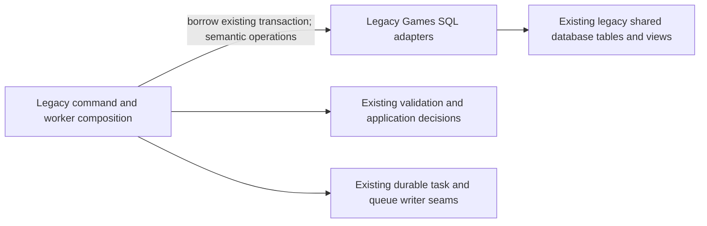

# Legacy Games command storage

**Current source in the unmerged extraction; live deployment unverified.** These modules contain the existing parameter-bound queries, row/advisory locks and row-count/read projections formerly mixed into backend command files. They borrow the command or worker's existing connection and transaction; none opens, commits or rolls back a connection.

| Storage module | Existing caller composition | Stored data / responsibility |
| --- | --- | --- |
| [mutations.py](mutations.py) | [game_commands.py](../../../../backend/app/game_commands.py) | Imported-game exclusion, finding exclusion, derivation generation and existing repertoire-match facts. |
| [synchronization.py](synchronization.py) | [game_sync_commands.py](../../../../backend/app/game_sync_commands.py) | Provider-sync state, admission advisory lock, jobs and deterministic provider windows. |
| [findings.py](findings.py) | [finding_commands.py](../../../../backend/app/finding_commands.py) | Locked current-finding facts, curation/defer/decision writes and canonical linked miss-event lookup. |
| [finding_cards.py](finding_cards.py) | [finding_card_commands.py](../../../../backend/app/finding_card_commands.py) | Existing finding/game/opportunity lock order, saved-card identity facts, legacy finding-card/link writes and queue-position lock binding. |
| [analysis_leases.py](analysis_leases.py) | [game_analysis_commands.py](../../../../backend/app/game_analysis_commands.py) | Parent/position lease reads and guarded writes, reports/errors, retries and existing one-row repair operations. |
| [analysis_publications.py](analysis_publications.py) | [game_analysis_publication.py](../../../../backend/app/game_analysis_publication.py) | Publication admission, bounded staged move/candidate writes, cursor facts, published-generation switch and follow-up lookup/write operations. |

Application validation, HTTP outcomes, provider-window policy, chess/engine computations, UUID/time selection, eligibility/generation/lease decisions and durable task orchestration remain in the caller files outside `database/`. The storage operations return fetched facts or primitive row counts, never cursors. The existing signatures and command registrations remain in the original composition modules. No generic SQL execution port, runtime dispatch layer or new framework is introduced.

This is a physical/query separation within the existing legacy owner. The finding-card path already writes legacy `cards`, `repertoires` and `repertoire_cards` and calls the existing queue writer; finding decisions already call the existing real-game feedback seam. Those existing couplings are preserved and disclosed, not presented as isolated Games ownership or a new permission to access another component's tables. Ordinary Study gains no Games import, call or lifecycle dependency from this move. Strict domain wiring and independent resource deployment are not established by this batch.

The [source-schema charts and complete field/key dictionaries](../../schema/README.md) remain authoritative for actual stored fields, keys and FKs. No table, column, FK, migration, constraint, view or stored JSON format changes here. No live schema or data was inspected. Table/view names in these queries retain their existing owner; logical queue/card/game identities are not extra FK constraints.

Focused tests retain the existing game exclusion/sync admission, finding/card, manual publication, generation/lease fencing and rollback assertions, using fake connections or task-owned in-memory SQLite only. Native PostgreSQL proofs remain separate and unexecuted for this relocation. Source comparison confirms all distinct SQL literals match the pre-extraction source exactly; this is one-time relocation evidence, not a new SQL-literal test framework.

[Derivation storage](derivation/README.md) owns the existing position/event stages, job projections, feature publication and miss/priority queries. Application workers keep chess/phase/task decisions and the same borrowed transactions.

[Provider synchronization](sync/README.md) and [repertoire staging](repertoire/README.md) contain complete original sync/claim/window/comparison queries. Worker normalization, fetch, phase, task/lease and publication decisions remain outside database with their existing transaction authority.

[Legacy provider import storage](imports/README.md) and [event/finding storage](evidence/README.md) hold the existing imported-game/state, gameplay-event and staged finding/publication operations. Provider/chess/classification, task/retry and publication decisions remain at the original application seams.

[Coordinator storage](coordinator/README.md) contains the original recovery/claim/status/settlement queries; the coordinator retains process/async/provider/task lifecycle. Shared claim SQL builders remain available through their old composition names.

[Authority, finite capture and acceptance storage](authority/README.md) owns the existing reader/tuple writer, column metadata, bounded stream SQL and receipt/acceptance operations. Application scope/budget/digest/chess/lineage and command outcome decisions remain outside database.

[Analysis-worker position storage](analysis_worker/README.md) and [legacy finding projections](finding_projections/README.md) own the existing report/lease, threshold/candidate and finding/opportunity/priority operations. Scoring/chess/evidence/recommendation, time/attempt/lease decisions and callback order remain in the original worker/application files. The existing command adapter `findings.py` remains distinct.

The unsupported correction-first Games guided-review server and its exclusive adapter are retired in source. [Last implementation](https://github.com/aaweaver-actuary/tempo/tree/1a0fd5c582c13f9d0de428d2f66d7e7cb358c4bf/database/tempo_legacy_database/adapters/games/guided_review/README.md) records its former session/finding/attempt behavior. Stored tables and [their schema description](../../schema/study-queue-review-1/README.md) remain unchanged; the existing snapshot reader remains. Ordinary Study scheduling and graph/repertoire ownership are separate and retained. No live data was removed.

`product_feedback.has_determined_delivery_in_transaction` reuses the existing
pending-source predicate on the caller's borrowed transaction. It reads only
Games outbox facts, returns a boolean, and never changes transaction settings,
opens a connection, locks rows, replays sources or dispatches work. Composition
contains optional failures with a savepoint and checks the managed-mode hint;
actual acceptance still uses the separately locked mode/source/current fences.
No schema changes accompany this borrowed-read adapter.

`product_feedback.retained_page` reads one immutable original provider page by
job and input continuation for the [finite historical operator](../../../../backend/app/product_composition/README.md#one-time-historical-games-scripts).
Zero or multiple matching pages fail closed. Historical jobs use the additive
JSON purpose `history`; generic claims accept only `sync` (including older rows
with no purpose), while exact claims retain account leases and retry admission.
History therefore does not become a forward or Refresh-now checkpoint. Existing
tables, atomic page/capture/source/outbox transactions, keys and ownership are
unchanged; no new migration or storage relationship is introduced.

The canonical source adapter recognizes Lichess's legacy PGN UTC-second and a
matching provider millisecond timestamp only with exact PGN, provider identity,
player, moves, result and starting position. It retains the legacy row and raw
provider capture. Its explicit first-page history recovery locks and revalidates
the quarantined job, original page, initial source/capture, existing game and
empty outbox, then appends a resolution capture and updates that source. The
job can resume only when every source in that saved page is available and its
original serialized page key is verified. Other quarantine cases stay held.

For a historical Lichess response-limit failure, the Games owner can requeue
only the exact unchanged failed job when its saved configuration and prior
page are fenced and no page has committed at the failed input cursor. A typed
receipt of the original failure and cursor digest remains in the job payload.
This does not change any game source, capture, page or Study state.
