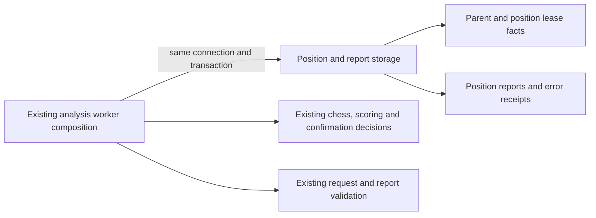

# Legacy game-analysis worker storage

**Current source in this extraction; live schema and deployment unverified.** [positions.py](positions.py) contains the existing complete position/report queries from [game_analysis_worker.py](../../../../../backend/app/services/game_analysis_worker.py). The worker retains connection/lifecycle ownership and engine/chess decisions; each operation borrows the original caller's transaction.

| Stored facts / effects | Existing operation and application owner |
| --- | --- |
| `game_analysis_jobs`, `imported_games.analysis_state` | Existing fenced parent release and imported-game state write. The worker retains failed/queued/pending decisions, caller background state and release timing. |
| `game_analysis_position_reports` | Completed-report projection, existing position/lease facts, terminal/leased insert, lease extension, fenced completion/replay facts and release. The worker retains UUIDs, expiry/current clocks, shallow/confirmed selection, request/report validation, retry limit and stale-lease outcomes. |
| `game_analysis_position_errors` | Existing report/game/error/time receipt. The worker retains when an error is recorded and how its parent is released. |
| Evaluation read selection | Existing PostgreSQL-versus-local read-scope choice moved to `evaluation_read_section`; the worker still supplies/opens the same reader capabilities at its original point. |

The canonical [game-analysis dictionary and ER chart](../../../schema/game-projections-1/README.md) lists every stored field/type, key and enforced FK for jobs, position reports and position errors. Reports store game/version/pass/position identity, request/report JSON, state, lease/parent-lease IDs and expiry, attempts, error and update time. Jobs retain their original parent lease/lifecycle/error fields; imported-game analysis state is documented with [imported-game fields](../../../schema/authored-content-1/README.md). No stored field, key, constraint, migration, view, JSON shape or SQL expression changes.

This adapter retains the local worker's exact SQL semantics; it does not replace or weaken the distinct PostgreSQL command operations in [analysis_leases.py](../analysis_leases.py). Completed-report reads share one implementation here. No generic SQL port, driver wrapper, independently committing repository or new connection authority is added. Row counts and fetched facts return to the original application decisions; no cursor escapes these fixed operations.

All scoring, terminal-board handling, confirmation selection, engine request creation, report validation, replay comparison, retry/error decisions and game-evaluation construction remain outside this directory. Existing worker/API/shared-storage coupling and engine lifecycle are unchanged, not proof of new domain or Games/Study isolation. Study gains no Games dependency.

Focused task-temporary SQLite cases use supplied engine-report JSON to exercise claim, timeout/retry, completion and invalid report rejection. They start no engine or Docker service. Exact source comparison preserves query/time/lease/callback order and pure algorithms. Native PostgreSQL locking/rollback, deployment and real engine execution remain unverified.
