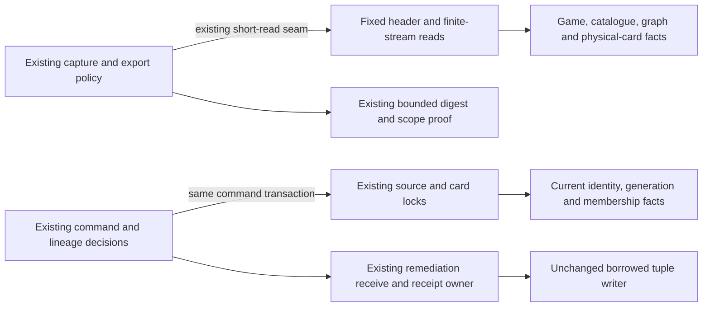

# Legacy Games authority and capture storage

**Current source in this extraction; live schema and deployment unverified.** This directory owns the existing source/receipt queries, finite stream SQL, acceptance locks and borrowed writer adapter used by the legacy Games evidence bridge. Application capture, export and command decisions remain outside `database/`; no schema, authority policy, framework or work frontier is added.

| Database module | Existing storage operations | Application owner |
| --- | --- | --- |
| [headers.py](headers.py) | Canonical game/card/repertoire column projections; the unchanged short-read `read_rows`; fixed backend identity, game/header, repertoire metadata, delivery receipt and accepted-game-head reads. | [legacy_game_authority.py](../../../../../backend/app/services/legacy_game_authority.py) retains authority/lineage validation, integrity certificate callback, source token and exact decision preparation. [legacy_game_observation.py](../../../../../backend/app/legacy_game_observation.py) retains explicit-game/scope validation and read-only export/digest construction. |
| [capture.py](capture.py) | The unchanged `Stream` record; existing count/highwater/keyset-page SQL and five source stream definitions. | [legacy_game_capture.py](../../../../../backend/app/services/legacy_game_capture.py) retains traversal budgets/deadlines, page/row/byte accounting, digest/exhaustion proofs, chess/route/card selection and source-change invalidation. |
| [acceptance.py](acceptance.py) | Existing advisory/card/source row locks and current identity/revision/generation/card/membership/deleted/block facts, borrowing the command transaction. | [game_evidence_commands.py](../../../../../backend/app/game_evidence_commands.py) retains receipt replay, withdrawal lineage, exact source rechecks, sorted affected-card order, error outcomes and remediation receive/admit composition. |
| [driver.py](driver.py) | Existing writer guard and unchanged `BorrowedTupleConnection` DBAPI adapter. It borrows the command writer's raw connection and tuple cursor; it does not acquire, commit or close a connection. | The command still invokes the existing remediation repository in its original transaction. |

The canonical source schema charts and dictionaries describe actual stored fields/types, primary/composite keys and enforced versus logical relationships:

- [Authored-content source facts](../../../schema/authored-content-1/README.md), [line/membership/integrity facts](../../../schema/authored-content-2/README.md) and [repertoire fields](../../../schema/authored-content-3/README.md): imported game identity/content hash/date/color/result/start/move JSON, backend identity, repertoire source/canonical-prefix revisions, authored routes and physical card memberships.
- [Opening graph fields and keys](../../../schema/opening-graph/README.md): published graph generation/state and executable physical-card binding steps.
- [Card/deleted-card fields](../../../schema/study-queue-review-1/README.md) and [game scope generation](../../../schema/game-projections-3/README.md): physical revision/content/archive/introduction state, deletion markers and classification scope. Integrity block/state fields retain their original authored-content dictionary.
- [Remediation owner schema](../../../../tempo_remediation_database/schema/README.md): existing delivery payload hash/response, accepted game head, obligation head and retained contribution source lineage. That canonical dictionary distinguishes the legacy `public` integration from the Learning runtime schema; this move grants no new cross-owner table access.

Capture reads five existing streams: repertoires, authored repertoire lines, graph steps, relevant physical cards and their memberships. It retains the original count/highwater preflight and PostgreSQL keyset/collation semantics, 64-row query bound, seek-advance projection, parameter ordering and complete-exhaustion requirement. The existing application traversal still closes each reader call before hashing/replay and owns all finite budgets, deadline checks, digests and fail-closed conditions. Captures, scope proofs and observation export JSON remain ephemeral application results, not new stored tables.

Acceptance preserves the existing imported-game advisory lock, shared prefix/graph locks, retained withdrawal facts, sorted card-edit/row locks, backend/source checks, integrity certificate callback and physical membership/deleted/block checks in their original order. The command's immutable receipt and remediation effects still use the same borrowed transaction. No query, lock, key, FK, migration, stored JSON shape, retry outcome or authority decision changes.

`read_rows`, `Stream`, the four column definitions and `BorrowedTupleConnection` moved once and remain available through their existing application import aliases. The generic reader/DBAPI seams already existed; fixed operations now contain their SQL, and this extraction introduces no new generic execution interface. The four original authority/capture/observation/command files contain no SQL-bearing literals or direct SQL/driver/cursor operations. Other legacy integrity/remediation/reader consumers remain at their existing seams and retain their separately coordinated extraction owners.

Existing source/catalogue/card/remediation coupling is preserved explicitly. This physical move does not prove a new clean domain boundary, resource isolation or independent Games/Study shutdown behavior; Study gains no Games dependency. All 101 focused synthetic authority, finite capture, command and read-only observation cases pass. Native PostgreSQL locking/collation/rollback, deployment and live schema remain unverified; no live database or provider was used.

## Bounded candidate discovery

[`candidate_lookup.py`](candidate_lookup.py) adds a read-only one-position
physical-binding lead query through the existing short reader. It retains
conflicting and ineligible alternatives and refuses the 65th binding; it grants
no capture or write authority. The [owning view and focused proof](candidate_lookup/README.md)
show its explicit relationship to unchanged complete authority capture. No schema,
transaction, certificate, capture budget or Study dependency changes.
