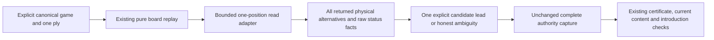

# One-position physical-binding discovery

`candidate_lookup.decision_bindings(reader, repertoire_id, graph_generation,
position_key) -> tuple[dict, ...]` uses the existing short background reader and
returns at most 64 exact current published-graph/card/route facts. A 65th row
refuses the entire result. Inputs identify one position replayed from a genuine
canonical imported game; no guessed PGN or source authority is constructed.

This read does not filter away conflicting, missing, archived, blocked, deleted
or unintroduced physical alternatives. It returns their facts for inspection.
It does not select a move, evaluate introduction chronology, prove exclusive
route authority, issue an attempt, create an obligation or write any state.

The unchanged authority capture retains its complete competing-route context,
64-route guard, certificate/current-content/introduction checks and provenance.
A discovery result cannot replace it. Changed source/generation, ambiguity,
overflow or unavailable admission never authorizes feedback.

No schema, credential, transaction/writer or runtime installation is added.
Native query validation uses only task-owned disposable tables. Synthetic tests
are `backend/tests/test_legacy_candidate_lookup.py`; they retain ineligible
alternatives and reject overflow/invalid inputs. Deployment remains unverified.
