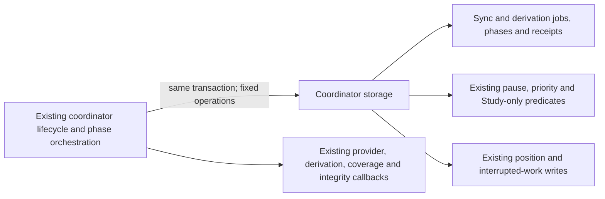

# Legacy Games coordinator storage

**Current source in this extraction; live schema and deployment unverified.** [storage.py](storage.py) contains the existing complete database operations from [game_sync_coordinator.py](../../../../../backend/app/services/game_sync_coordinator.py). The application file retains connection ownership, worker lifecycle, orchestration and all decisions. Each operation borrows the original connection/transaction; no independent commit or new task authority is introduced.

| Stored facts / effects | Existing behavior and application owner |
| --- | --- |
| `game_sync_jobs` | Existing active-job lookup, queued admission, immediate claim transaction, claim candidate and conditional running transition, success/failure receipt and interrupted-job recovery. Application composition retains UUID/request/result construction, retry loops, foreground waits and provider execution. |
| `game_derivation_jobs` | Existing version/phase/status/attempt facts, queued admission, immediate claim transaction, conditional phase advancement, pause/resume, retry/failure/completion and interrupted-job recovery. Application composition retains phase sequence, pause/stop decisions, backoff clock, error handling and progress callbacks. |
| `background_activity`, `settings` | Existing pause/priority/Study-only claim predicates and derivation pause facts. The two existing shared [claim SQL builders](../../controls/claim_sql.py) moved unchanged and remain re-exported by [background_activity.py](../../../../../backend/app/services/background_activity.py); all that file's other mixed operations remain pending. |
| `imported_games`, `game_position_occurrences` | Existing game move facts and replace-this-game position publication. Chess replay, legal-move boundary and final position remain outside this directory. |
| Current repertoire matches, coverage nodes, integrity jobs/state and priority jobs | Existing distinct matching repertoire IDs and startup interrupted-work recovery writes. The coordinator retains existing refresh callbacks and recovery order. These are legacy cross-feature orchestration, not new owner access. |

The canonical [sync/position/match dictionary and ER chart](../../../schema/game-projections-2/README.md) and [derivation-job dictionary and ER chart](../../../schema/game-projections-1/README.md) describe actual fields/types, primary/composite keys and enforced relationships. Job rows store request/result or derivation phase/version/attempt/error state and lifecycle timestamps; position rows store game, ply, FEN key and move. [Runtime metadata](../../../schema/runtime-metadata/README.md) documents actual activity/settings fields, and [discovery/priority](../../../schema/discovery-priority/README.md) plus [authored-content projections](../../../schema/authored-content-2/README.md) describe the existing recovery targets. No table, field, key, FK, migration, view, JSON format or SQL expression changes occur here.

Both dynamic claim queries retain their original expression AST. The existing claimable/priority builders execute in their original order; the derivation claim's application clock callback still runs after building those fragments and before query execution. Transaction starts, conditional row counts, projection reads, callback order, phase fences and task/event dispatch stay at their original points. Helpers return facts/counts rather than cursors and expose no arbitrary execution interface or dispatch framework.

The coordinator still composes the existing legacy Games, feedback, coverage, integrity, statistics, opening graph and priority implementations. The mixed `background_activity.py` remainder and authority/capture traversal are unfinished extraction work. This physical move does not establish a new domain boundary, grant cross-owner permissions or prove Games/Study shutdown/resource independence. Study gains no Games dependency.

Focused task-temporary SQLite/fake checks cover derivation contention/restart, phase pause/resume, durable control priority, sync finalization retry/admission and dynamic query evaluation order. Native PostgreSQL, live services/providers, deployment and full-system behavior remain unverified.
