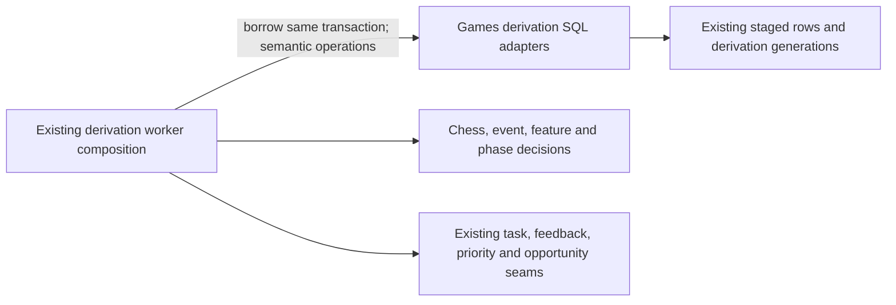

# Legacy Games derivation storage

**Current source in this unmerged extraction; live state unverified.** These are the existing complete queries formerly embedded in the five `postgres_game_*` derivation workers. Every operation borrows the caller's existing connection and transaction; no connection acquisition, commit, rollback or task/queue authority is added.

| Module | Stored data / operation | Application composition |
| --- | --- | --- |
| [jobs.py](jobs.py) | Existing shared `game_derivation_jobs` row-lock projection (`derivation_version`, `completed_phases`, `status`). | All five workers retain their original version/phase/status decisions. |
| [positions.py](positions.py) | Imported start/move facts, one `game_position_occurrences_staged` write/count and the published-position generation/phase write. | [postgres_game_derivation.py](../../../../../backend/app/services/postgres_game_derivation.py) retains chess replay, illegal-move boundary, stage-count validation and task handoff. |
| [events.py](events.py) | Existing event column list, one staged event write/count and source-version/publication-phase writes. | [postgres_game_events.py](../../../../../backend/app/services/postgres_game_events.py) retains event computation, source signature, cursor bounds and stage validation. |
| [features.py](features.py) | Canonical `GAME_FEATURE_UPSERT_SQL` and existing feature-phase write. | [postgres_game_features.py](../../../../../backend/app/services/postgres_game_features.py) retains feature preparation and missing-input handling. [statistics.py](../../../../../backend/app/services/statistics.py) imports/re-exports the same canonical SQL constant; other mixed statistics operations remain pending. |
| [misses.py](misses.py) | Existing bounded current-miss cursor and phase transition write. | [postgres_game_misses.py](../../../../../backend/app/services/postgres_game_misses.py) retains feedback application and task cursor/handoff. |
| [priorities.py](priorities.py) | Imported color, next matching repertoire and derivation-completion write. | [postgres_game_priorities.py](../../../../../backend/app/services/postgres_game_priorities.py) retains priority/opportunity handoff and completion decisions. |

Application work is still prepared at its original points outside database sections. The workers retain task-lease checks, generation/phase/status fences, source-signature handling, stage completeness checks, callback/lock order and original task payloads. Helpers return fetched facts or counts, not cursors, and import no sibling application implementation. No generic SQL port, dispatch layer, framework or duplicate feature SQL implementation is introduced.

The [legacy source schema charts and complete field/key dictionaries](../../../schema/README.md) describe actual stored fields and enforced relationships. This extraction changes no table, field, JSON shape, key, view, FK, migration or generation publication format. Existing feedback/priority/opportunity calls remain explicit legacy coupling, not proof of independent Games/Study resource or lifecycle isolation and not new cross-owner table permission. Study gains no Games dependency.

Focused fake-connection tests cover position/event stage completeness and replay, current generation and lease fences, miss cursor handoff, feature publication and final repertoire completion. Native PostgreSQL and deployment behavior remain unverified; no live resources or data were used.
