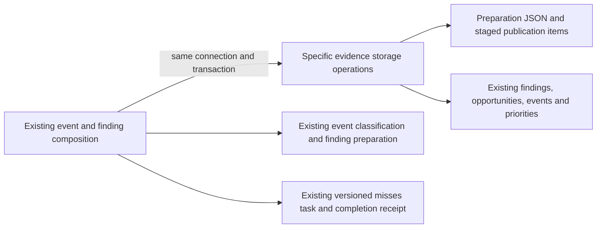

# Legacy Games event and finding storage

**Current source in this extraction; live schema and deployment unverified.** These adapters contain the existing complete event/finding queries, borrowing the caller's original connection and transaction. Computation, source-generation checks, task leases and publication decisions remain in application composition.

| Module | Stored facts / operations | Application composition |
| --- | --- | --- |
| [gameplay.py](gameplay.py) | Imported game/analysis/candidate/settings projections; delete this classifier's events; insert the existing computed event rows. | [gameplay_events.py](../../../../../backend/app/services/gameplay_events.py) retains chess replay, motif/equivalent-move classification, evidence construction, event identities and prepare-only behavior. |
| [findings.py](findings.py) | Preparation item read/write, fixed staged-item upsert/count, source-generation facts, finding/opportunity/priority publication, superseded-opportunity state and derivation phase/version writes. | [postgres_game_findings.py](../../../../../backend/app/services/postgres_game_findings.py) retains source fingerprint/preparation, item deduplication, stage completeness, scope/version/lease fences and versioned misses-task handoff. The worker reuses the existing [derivation job lock](../derivation/jobs.py). |

The canonical [source schema index](../../../schema/README.md) links all field/type/key dictionaries and ER diagrams, including finding preparation/publication items, live findings/opportunities, analysis/candidate rows, settings and gameplay events/priorities. Preparation rows retain source signature, item count and `items_json`; staged publication rows retain game/version/kind/key and payload JSON. Finding publication preserves existing card association and scope-generation rules, opportunity publication preserves supersession/active state, and priority publication retains the earliest stored priority date. Event rows retain identity, analysis/classifier versions, ply, motif, beneficiary/creator, outcome/confidence/loss, engine move/PV and evidence JSON. No table, field, constraint, migration, key, JSON shape or view changes here.

The helpers return fetched facts/counts and expose only fixed semantic operations, never arbitrary SQL or cursors. Original query, lock, callback and clock evaluation order is retained, including completeness validation before publication and the existing per-item durable cursor. The legacy comparison/scope/finding preparation helpers, settings read, priority write and misses callback remain existing coupling at their original seams. Physical colocation grants no new cross-owner access and proves no Games/Study resource or lifecycle isolation; Study gains no Games dependency.

Focused fake-connection checks cover prepare-only reads, bounded preparation, per-item replay, source-change restart and misses-task publication. Task-temporary SQLite checks cover event evidence and idempotent replacement. Native PostgreSQL JSON-record publication, locking/rollback and deployment behavior remain unverified.
