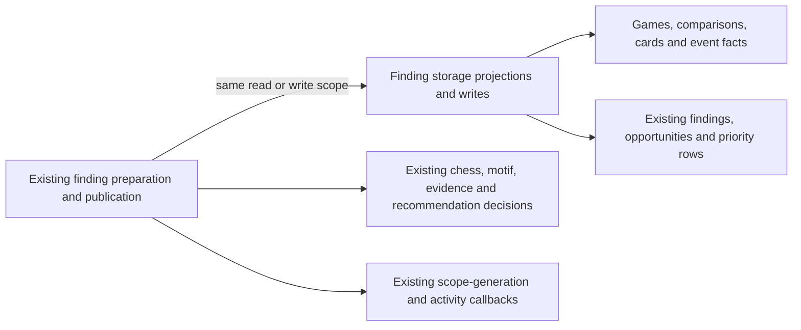

# Legacy game-finding projections and publication

**Current source in this extraction; live schema and deployment unverified.** [legacy.py](legacy.py) contains complete existing finding preparation/publication and recommendation queries from [game_findings.py](../../../../../backend/app/services/game_findings.py). It borrows the original read/write scopes; the application file retains classification, evidence, priority and recommendation policy.

| Stored facts / effects | Existing application behavior |
| --- | --- |
| Imported games joined to current primary repertoire matches | The original optional single-game predicate and complete comparison projection; the application retains scope-generation capture and preparation decisions. |
| Settings, move analysis and candidate rows | The application reuses the already-centralized [gameplay input operations](../evidence/gameplay.py), preserving their exact queries and row order. |
| Physical unseen opening cards and review absence | Existing all-card or 64-row keyset page reads. The application retains prepare-only paging, chess-position matching and missing-card decisions. |
| `game_findings` | Existing fixed row upsert, retaining card-association and scope-generation fields. Application code retains deterministic finding identity, evidence JSON and current-generation callback timing. |
| `tactical_opportunities`, `gameplay_card_priorities` | Existing opportunity supersession/upsert and earliest-priority write. Application code retains computed payloads, publication order and policy. |
| Gameplay events joined to imported games | Existing bounded-time/high-confidence motif input query. Application code retains grouping, denominator, recurrence threshold, unfinished-pack choice and recommendation order. |

Canonical data dictionaries and ER charts show actual fields/types, primary/composite keys and enforced versus logical relationships: [findings and analysis metadata](../../../schema/game-projections-1/README.md), [match/priority/event fields](../../../schema/game-projections-2/README.md), [tactical opportunity fields](../../../schema/practice-families-1/README.md), [imported-game fields](../../../schema/authored-content-1/README.md), [card/review fields](../../../schema/study-queue-review-1/README.md) and [settings](../../../schema/runtime-metadata/README.md). Findings store game/analysis/ply/kind identity, confidence, evidence JSON, source card/repertoire/opportunity association, status and publication metadata. Opportunities store motif/outcome/value/loss, played/accepted moves, engine/evidence JSON and active/superseded state; priorities store physical card/source game/finding/date/reason. No schema, key, FK, migration, view or stored JSON change occurs here.

Preparation still closes its original read scope before chess/classification work. Prepare-only unseen-card pages retain their original order and size; application code still owns loop termination. Publication retains the original `BEGIN IMMEDIATE`, scope-generation fence, supersession/opportunity/finding/priority order and existing clock/callback evaluation points. No SQL-bearing literal or direct SQL/driver/cursor call remains in the application file. The prior [finding-command adapter](../findings.py) and [staged PostgreSQL publication adapter](../evidence/findings.py) remain distinct and unchanged.

Existing shared settings/card/review reads, tactical catalogue access, comparison helpers, scope-generation callback and priority writes remain explicit legacy coupling, not new cross-owner permission or Games/Study lifecycle/resource isolation. Study gains no Games dependency. No generic execution interface, dispatch layer or new framework is introduced.

Focused fake/task-temporary SQLite cases cover prepare-only reads, bounded cards, staged replay/handoff, motif recommendation denominator, missing-card preview and existing unseen-card priority behavior. Exact source comparison preserves all original classification/recommendation algorithms, SQL expressions and transaction/callback/time order. Native PostgreSQL, live schema, deployment and full-system behavior remain unverified.
