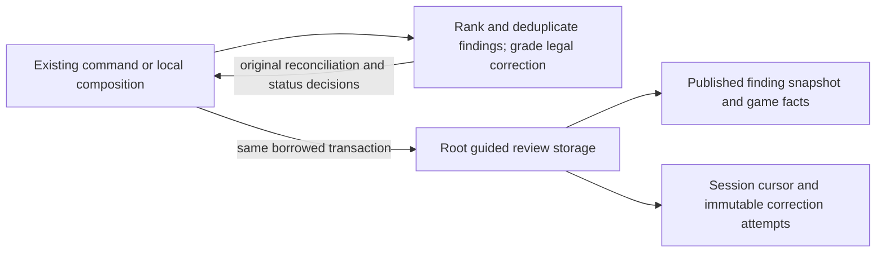

# Legacy guided game-review storage

**Current unmerged source; live schema/deployment unverified.** [storage.py](storage.py) holds the existing complete queries from [guided review commands](../../../../../backend/app/guided_review_commands.py) and [local session composition](../../../../../backend/app/services/guided_review.py). Commands retain their borrowed foreground transaction; local paths retain their existing transaction scope and `BEGIN IMMEDIATE`. No helper opens, commits or rolls back a connection.

| Data location | Actual identity / stored meaning |
| --- | --- |
| `public.guided_review_sessions` | `id text` PK; required `game_id text` FK to imported game. Stores `analysis_version bigint`, ordered `finding_ids_json text`, `current_index bigint`, `status text`, `created_at text`, `updated_at text`, all non-null. The version and finding IDs inside JSON are checked logically, not extra FKs. |
| `public.guided_review_attempts` | Composite PK (`session_id text`, `finding_id text`), both enforced FKs to the session and base finding respectively. Stores `move_uci text`, `correct bigint`, `attempted_at text`, all non-null. Duplicate session/finding attempts retain existing idempotency. |
| `current_game_findings` | Existing published-finding view used for ranking and the single reconciliation/display/grading snapshot. It introduces no new table or FK. |

The canonical [complete field/type/key/FK dictionary and ER chart](../../../schema/study-queue-review-1/README.md) records these tables and source DDL; the [schema index](../../../schema/README.md) links parent game/finding definitions. Actual game/session and session/finding constraints are distinct from logical array membership/current-version checks. No table, field, migration, constraint, JSON or view changes.

Ranking/deduplication/top-five selection, chess/correction validation, reveal policy, stale/hidden finding reconciliation, completed-prefix remapping, response/HTTP errors, UUID/time selection and command registration remain outside database. Native session/game locks and the exact dynamic finding-ID query move intact. Three repeated query sites reuse identical existing operations; no generic query API or new dispatch framework is introduced. Ordinary Study gains no Games dependency, and no scheduling/FSRS writer is introduced; existing application assembly/resource isolation remains unverified.

Ten existing selected local/fake-native cases pass, covering game/session lock order, restart/resume, ranking, FSRS preservation, hidden/current finding agreement and stale/complete reconciliation outcomes. Specific expansion restores every non-import application AST, including all twenty-one call sites and exact statement/parameter/callback/clock expressions. Four Python sources compile. Native PostgreSQL/locks, installed-wheel discovery, actual engine/live services, deployed resource independence and full-system checks remain unverified. [Remaining extraction work](../../../../INVENTORY.md).
