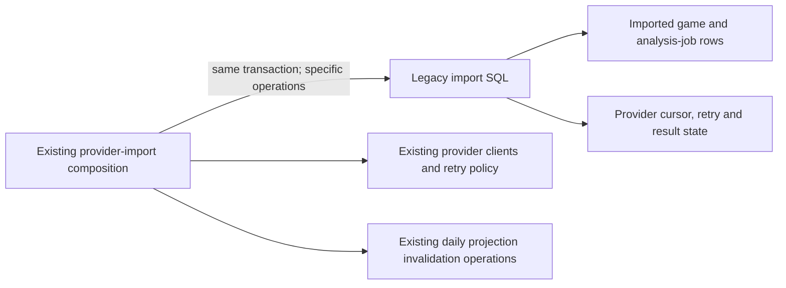

# Legacy provider-import storage

**Current source in this extraction; live schema and deployment unverified.** [legacy.py](legacy.py) contains the existing local provider-import queries from [game_sync.py](../../../../../backend/app/services/game_sync.py). It borrows each original caller connection and transaction; no connection acquisition, commit or task authority is added.

| Stored data | Specific operations | Application owner |
| --- | --- | --- |
| `imported_games` | Provider/source-hash lookup, fixed normalized-row insert/update, newest provider game time. | `game_sync.py` retains source identity, normalized field values, insert/update/duplicate decisions and incremental-overlap policy. |
| `game_analysis_jobs` | Existing create or insert-if-absent operations, preserving their distinct SQL semantics. | The importer retains exactly when each follow-up state is created. |
| `game_sync_state` | Provider retry facts, account-change cursor reset, syncing state and saved success/failure results. | The importer retains rate-limit decisions, provider HTTP calls, retry calculation, counters and public/private result projection. |

The canonical [source schema index](../../../schema/README.md) links the imported-game/analysis-job field and key dictionaries; [sync-state fields and ER chart](../../../schema/game-projections-2/README.md) describe the actual provider primary key and stored types. Imported game rows contain provider identity/content hash, player/date/result metadata, starting FEN and move JSON. Provider state contains username, cursor, lifecycle/error/retry timestamps and result JSON. No schema, field, key, FK, migration, JSON format or query changes occur here.

The importer reuses the already-centralized [daily snapshot/insight invalidation operations](../sync/records.py). Those existing writes to `daily_chess_snapshots`/`daily_chess_insights` remain disclosed legacy shared-storage coupling, not new ownership permission or proof of Games/Study isolation. Connection/admission and existing coordinator callbacks retain their original owners outside this directory. Study gains no Games dependency.

Focused mocked-provider/task-temporary SQLite checks cover distinct provider identities, one-provider failure with another's success, incremental overlap, duplicate/filtered/rejected counters and follow-up state. Source comparison preserves all original application decisions and query/parameter/callback order. No native PostgreSQL, live provider or deployment check is claimed.
