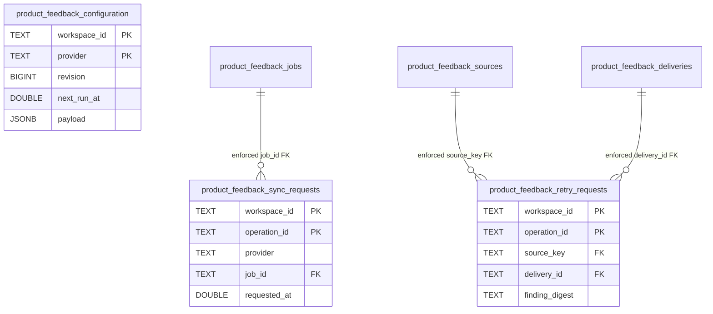

# Product game-sync storage (#491)

Current **unmerged source**, with native disposable proofs; no live schema or
runtime activation is claimed. [`052_product_game_sync.sql`](../../../ddl/migrations/052_product_game_sync.sql)
follows Study-owned 051 and advances the source readiness version to 52.
The first-release candidate remains independent of this later feature branch.

[`PostgresReviewStore`](../product_review.py) owns explicit configuration,
configured enqueue/replay, bounded stored projections and durable retry request
binding. It calls #489's `PostgresGamesStore.enqueue` inside the same borrowed
transaction, so job plus request plus recurrence advancement commit together.
No account or filter is inferred or overwritten on a stale revision. Configuration
and enqueue serialize their short configuration section; active jobs prevent a
configuration change from altering the policy of a continuing provider cursor.

`request_retry` rechecks the current source/version/finding under its owning row
lock, binds the request to the existing delivery, and never creates another lapse.
Changed/quarantined, forged or superseded commands fail closed. Owner receipts
are not synthesized. `recent` returns at most 50 supplied summaries (hard cap
100); detail/delivery projections reject more than 1000 delivery facts rather
than presenting a silently partial result. A quarantined detail is unavailable
until D08 is resolved: original evidence remains stored, and new findings are
never drawn over old original moves. Other games remain usable.

`fence_imported_game` is the T10 Games-owned admission fence. In the receiver's
borrowed transaction it locks the actual imported provider identity, checks the
retained canonical game, and holds the committed T10 source against correction.
It binds provider ID, raw source ID/digest/revision/time, canonical moves/color/FEN
and current eligible decision occurrence. It does not read or write Study tables.
Outer composition then calls #487's public current-owner factory to validate and
mutate Study. This fence requires T10's committed storage and is not a T07 dependency.

`canonical_game_id` reads the existing Games library identity, including the
retained `chess.com` alias. Missing/ambiguous identities fail closed. It does not
invent an imported row or adopt a provider-ID alias as canonical identity.
New-game library mirroring requires the coordinated repertoire-only snapshot
seam before it can share the atomic page commit; no pre-checkpoint mirror is
written merely to make a game-specific source capture possible.

`DedicatedGamesConnections` owns at most one open connection per process,
250 ms acquisition wait, 2 s connect timeout, and PostgreSQL 250 ms transaction /
statement plus 100 ms lock limits. Connections close on every exit. HTTP/chess
work runs before database sections; no foreground Study pool is borrowed. The
retained backend capture API still uses its existing bounded background reader;
this scoped legacy read dependency is disclosed, not a second authority. Host
CPU/memory isolation is separate from these source/database bounds.

## Stored relationships

The first five tables and their payload dictionaries remain canonical in
[#489's owner README](../../../../../backend/app/games/feedback/README.md).
The additions below contain no Study FK, queue state or learning schedule.
Workspace/provider and repertoire IDs are logical owner references, not FKs.

Configuration payload is the frozen Games-owned `SyncConfiguration`: explicit
account/window/repertoires/speeds/rated policy, opt-in fixed-window recurrence,
and revision. A null interval is off. Sync requests retain the job/operation
identity and processing clock; retry requests retain the exact current Finding
digest and existing delivery identity. Retry acknowledgments can truthfully move
from `accepted` to the owner's `duplicate` outcome while keeping the same owner
receipt and original deadline. Source JSON expression indexes serve bounded
workspace/provider/canonical-game lookups; full PGNs are excluded from recent
summary reads.

## Native evidence

The assigned #491 backend integration file proves configuration/new-connection
readback, no stale account overwrite, configured enqueue, inert reads, original
history projection, current-finding retry/replay, explicit recurring enqueue and
the real #487 current-authority factory/fence. Its PostgreSQL fixture applies
the actual ordered source migrations through 52, and is capped and removed by
its owner. Source-only provider/policy cases and actual native transaction proof
are reported separately in the PR.

The named Node worker check runs two native process cases: a real optional child
blocked in local provider HTTP, normal Study issuance/save while blocked, graceful
stop or forced kill, then another normal Study issuance/save. No Study restart
is performed. These are disposable source proofs, not deployment or host latency
guarantees. See [composition details](../../../../../docs/product-v02/game-sync/README.md).

## Task D stream selection and namespace projections

Prepared source, with focused owned-PostgreSQL evidence; deployment remains
unverified. No table, column, key, FK or stored source bytes change. Existing job
IDs distinguish `following:` and `reconciling:` streams by provider/configuration
revision; the job specification/digest binds exact workspace/account/filter/
repertoire/window scope. The existing request FK joins each stream to its durable
job, whose JSON payload retains continuation, completeness and completion time.

`continuous_state` returns at most two configured recurring providers. Each
purpose lookup returns one job: oldest unfinished first, otherwise the greatest
completed window end. An arbitrary manual request remains visible through
`last_job` without replacing either stream pointer. The existing query/transaction
limits remain enforced; no PGN processing or HTTP enters these sections.

`enqueue_continuous` serializes with configuration writes, compares the expected
stream state, rejects unfinished/replaced state and borrows the existing enqueue
writer's exact transaction. The existing Games job writer remains authoritative.
Reconciliation writes no forward `next_run_at`; a job/request failure rolls both
back. See the canonical [scheduling flow](../../../../../backend/app/games/feedback/README.md#continuous-acquisition-and-historical-reconciliation--task-d).

Recent summaries map stored `chess.com` to public `chesscom`. Source detail and
canonical identity lookups accept both stored aliases, retain workspace fences
and reject ambiguous rows. These are read projections: canonical IDs, digests,
original PGNs and historical source metadata retain their stored spelling.
