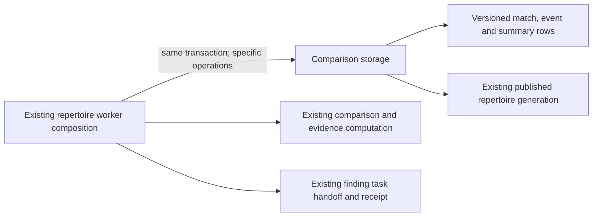

# Legacy Games repertoire-comparison storage

**Current source in this extraction; live schema and deployment unverified.** [comparison.py](comparison.py) holds the existing complete queries from [postgres_game_repertoire.py](../../../../../backend/app/services/postgres_game_repertoire.py). All operations borrow the worker's original connection/transaction; this directory adds no connection, commit, queue authority or computation framework.

| Stored data | Existing operation and application owner |
| --- | --- |
| Imported game move/color/date facts and `repertoire_scope_generation` | The adapter reads/stores facts; the worker retains repertoire snapshot preparation, comparison computation and scope-generation callback timing. |
| `game_repertoire_matches_staged` | A fixed ordered match-row write and staged count; application code retains primary selection, classification/deviation/timeline projection and stage completeness decisions. |
| `repertoire_decision_events_staged` | A fixed ordered primary-decision write and staged count; application code retains evidence-owner selection and deterministic event identity. |
| `repertoire_comparisons_staged` | A fixed ordered comparison-summary write; application code retains absent-repertoire/deviation handling. |
| `game_derivation_jobs` | Source-change restart and repertoire generation/phase publication. The worker reuses the existing [derivation-job row lock](../derivation/jobs.py) and retains generation, phase, status, task-lease and stage-count fences. |

See the canonical [match-table dictionary and ER chart](../../../schema/game-projections-2/README.md) and [comparison/event dictionary and ER chart](../../../schema/game-projections-3/README.md) for actual field types, composite keys and enforced versus logical relationships. Match rows store coverage counts, deviation/gap fields, timeline JSON and canonical-prefix revision; event rows store game/repertoire/card/ply identity, expected/actual move and outcome; summary rows store classification and first divergence. The version field and existing published-generation views retain their original format and semantics. No schema, migration, FK, key, JSON or view changes occur here.

The worker still calls the existing comparison snapshot/preparation and scope-generation helpers; this move does not establish a new domain boundary for those legacy helpers. It retains preparation outside the write section, original scope/job/task lock order, source-signature handling, per-item cursor advancement, completeness checks and finding-task handoff. Physical colocation gives no new owner access and creates no Study dependency. No generic execution port or duplicate implementation is introduced.

Focused fake-connection regressions cover per-item staging, atomic generation switch, source-change restart and foreground availability during computation. The source migration fixture checks the three legacy views' generation predicates; native PostgreSQL and deployment behavior remain unverified.
