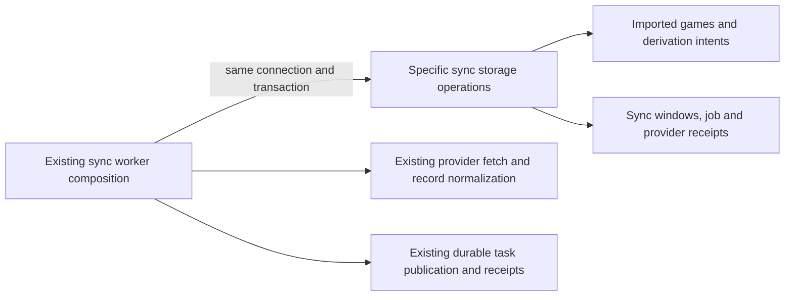

# Legacy Games provider-sync storage

**Current source in this extraction; live schema and deployment unverified.** These are the existing complete provider-sync queries moved from three worker files. Each operation borrows the caller's connection and transaction. Connection acquisition, provider requests, record normalization, task publication/receipts and completion decisions stay in application composition.

| Module | Stored facts / operations | Existing application composition |
| --- | --- | --- |
| [records.py](records.py) | Advisory identity lock; imported-provider/legacy-identity lookup; canonical imported-game field order and insert/update; analysis-job creation; sync result progress. | [postgres_game_sync.py](../../../../../backend/app/services/postgres_game_sync.py) retains insert/update/duplicate decisions, normalized game values, counters and durable follow-up intent. It reuses the existing [derivation restart operation](../mutations.py). |
| [windows.py](windows.py) | Window insert/load/row locks, staged records and source digest, split/completed status, next-record cursor. | [postgres_game_sync_windows.py](../../../../../backend/app/services/postgres_game_sync_windows.py) retains provider fetching, bounded split decisions, archive/month handling, one-record dispatch and task leases/receipts. |
| [completion.py](completion.py) | Sync-job lock, unfinished window/task receipt facts, provider-window aggregate counts, provider result state and final job receipt. | [postgres_game_sync_completion.py](../../../../../backend/app/services/postgres_game_sync_completion.py) retains all completion conditions, result construction and profile-refresh handoff. |

The source schema's [game projections dictionary](../../../schema/game-projections-2/README.md) lists actual field types, primary/composite keys and enforced FKs for `game_sync_jobs`, `game_sync_state`, `game_sync_windows` and staged game projections. The [complete schema index](../../../schema/README.md) links imported games, derivation jobs, background task receipts and daily snapshot/insight fields. No table, field, key, constraint, JSON shape, migration or transaction boundary changes here.

`game_sync_windows` stores the provider/time interval, source URL/digest, staged record JSON, next-record cursor and fetched/filtered/rejected counts. `game_sync_jobs` stores request/result JSON and lifecycle timestamps; `game_sync_state` stores each provider's username, cursor, result and retry/error state. `imported_games` stores normalized source identity, moves and game metadata; `game_analysis_jobs`/`game_derivation_jobs` retain existing follow-up state. Result construction and retry/idempotency decisions remain outside this directory.

The existing read of `background_tasks` remains legacy shared-storage coupling, not new ownership permission or proof of Games/Study isolation. The retired daily-statistics invalidation helpers and calls are removed; game insertion/update, analysis admission, derivation and feature handoffs remain. Existing task/profile helper internals and shared connection/resource behavior remain outside this bounded extraction. Study gains no Games dependency. Helpers return fetched facts, never cursors; no generic SQL port, framework or independent commit is added.

Focused fake-connection regressions cover foreground admission, stale replay, one-game atomic follow-up intent, dense-window splitting, staged-record dispatch and final receipt ordering. No live/provider network, native PostgreSQL or deployment check is claimed.
