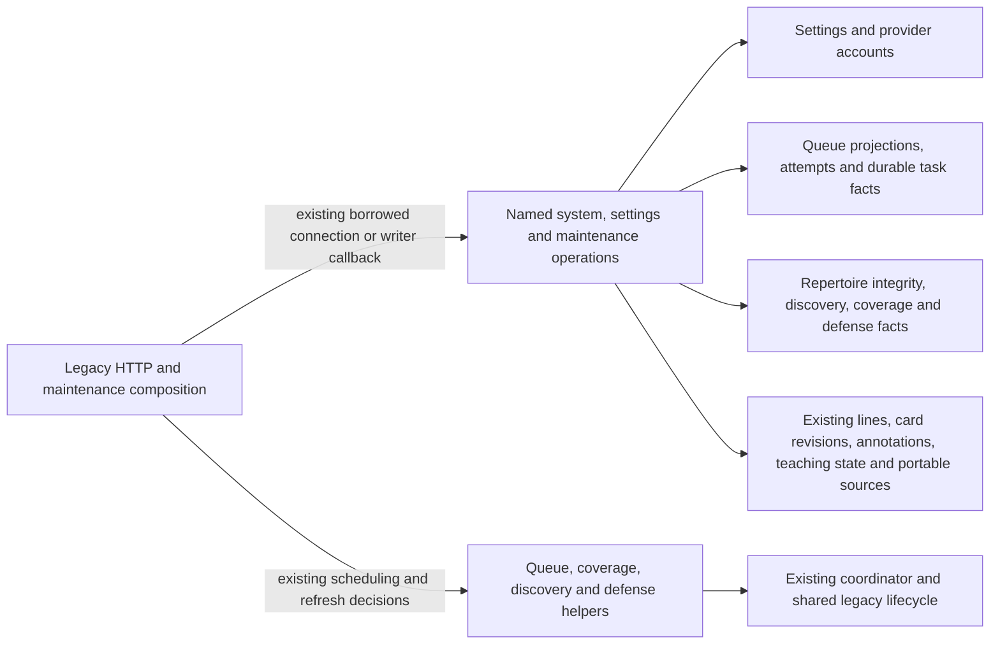

# Legacy HTTP composition persistence

**Current source; live schema and deployment unverified.** These named operations are mechanically separated from [the existing HTTP composition root](../../../../backend/app/main.py). They borrow its connection/transaction, preserve the existing complete SQL and parameter order, and return fetched facts or lazily yielded rows. They never open/commit/rollback a transaction, construct HTTP responses, choose scheduling/settings policy or import an application implementation.

This directory currently covers 128 direct database call sites in `main.py`: system status, global settings, queue maintenance, queue read projections, head/entry operations, repertoire browsing/metadata, portable snapshot/export reads and PGN/branch authoring persistence, card revision/split/archive, progress, discovery/coverage controls and supplemental practice facts. **The remaining inline database operations in that file are unfinished extraction work.** It is not yet a completed centralization claim.

| Module | Persistence responsibility | Decisions retained in `main.py` |
| --- | --- | --- |
| [system.py](system.py) | Frozen target/active-run identity; SQLite settings-read probe; recent queue projections; analysis threshold fact. | Health/HTTP availability, target key/presentation, task counts and writer status. |
| [settings.py](settings.py) | Public/previous settings facts, fixed settings update and clean eligible repertoire rows. | Omitted-flag preservation, model values, account normalization, coverage/discovery change detection and refresh callbacks. Identical account writes reuse [the existing account operations](../commands/accounts.py). |
| [practice.py](practice.py) | Progress state/review/due/blocked facts, tactic-progress rows, enabled endgames and saved operation payload. Nine tactic-attempt statements reuse [existing tactic storage](../tactics/attempts.py). | Calendar/summary/pack mapping, puzzle legality/membership, clean/mode/due/requeue/identity/receipt handling, saved-endgame recovery and removed-feature HTTP behavior. |
| [discovery.py](discovery.py) | Existing current-opportunity counts/page identities and admission/task state facts; exact repertoire presence reuses existing projection storage. | Pagination/group/detail assembly, missing/stale/failure presentation, refresh callbacks, HTTP and dispatch. |
| [coverage.py](coverage.py) | Existing native availability query using root scope/attempt predicates; exact heartbeat/release/failure lease rows/writes. | Study-only/reader routing, lease validation, two heartbeat clocks and duration, failure text, HTTP/stale result, refresh callback and worker dispatch. |
| [card_authoring.py](card_authoring.py) | Published split usage, failed-review fact, revision snapshot/definition/queue/membership/archive statements and row projections. Reuses existing [prefix control operations](../foreground_controls/prefix_splits.py) and [opening card mutations](../authored_repertoires/opening_mutations/prefix_splits.py), including complete column-discovered card insertion. | Split/history/replacement/reset fields, chess validation, deletion guards, scope validation/certification, atomic follow-up enqueue, conflicts/HTTP, clocks and integrity refresh. |
| [line_authoring.py](line_authoring.py) | Existing import/branch settings, conditional transaction start, repertoire/line/depth/annotation writes, segment/deletion facts, coverage-gap read/write and line removal. | PGN parsing, chess legality, identities/depth/segment counts, scope validation/certification, removed-line matching, scheduler callbacks/timing, HTTP/dispatch and response decisions. |
| [repertoires.py](repertoires.py), [snapshots.py](snapshots.py) | Repertoire/line/comparison/integrity facts; annotation and teaching rows/writes; main selection; fixed portable table reads and PGN export source rows. Exact presence, rename, quota and annotation-delete statements reuse existing root operations. | Priority/prefix projections, request/FEN/JSON/clock/HTTP handling, shared scope/refresh callbacks, snapshot enrichment exclusions/checksum and PGN chess/annotation rendering. |
| [queue_projection.py](queue_projection.py), [availability.py](availability.py) | Queue/card projection SQL, availability and count/head queries, encounter batch reads, exercise revision, issued-head/entry facts, existing begin/failure/bury statements. One fixed availability SQL implementation is also used by the existing `queue_application` compatibility helper. | Clock and badge choices, payload/prepared snapshot shaping, HTTP/conflict decisions, writer/worker routing, canonical head issuance/attempt validation and queue-order callbacks. |
| [queue_maintenance.py](queue_maintenance.py) | Queue projection status/failure/refresh writes; existing defense task and eligible candidate facts; pending discovery intent. | Dates, error sanitization/rethrow, admission checks, enqueue conditions, priorities, foreground/background submission and coordinator wake. Startup and maintenance reuse the same projection-state read. |

Queries that were consumed by cursor iteration still yield one row at a time at the original comprehension points. Fixed settings arguments are evaluated in the application in their original order. Queue projection writes discard their otherwise unused internal driver cursor; existing callers discard the submitted callback result. No new connection, transaction, queue writer, schema/migration or generic SQL interface is introduced.

## Queue projection and head issuance

`queue_rows` retains both original query shapes, conditional availability fragments, repeated configured-mode checks, limits and parameter order. The application still performs the existing 400-key encounter batches, cutoff/badge clocks and response assembly; the adapter owns each complete parameter-bound batch read. `available_head` accepts only the application-owned current-day capability so its original clock read stays after availability SQL construction. It does not accept a SQL string or query callback.

Head issuance still reads the immutable identity first, returns on an already issued head, and uses the existing PostgreSQL worker command or SQLite caller-owned transaction. The named `begin_head_issuance` operation executes the original `BEGIN IMMEDIATE` at the same point; it does not open/commit/rollback a connection or become another issuance authority. Existing `queue_commands.issue_queue_head`, validation, first-issuance binding, failure conflict checks and capture/preserve queue-order callbacks are unchanged. Prepared Study exercise snapshots and optional opening evidence remain application composition.

The narrow `queue_application._AVAILABLE_ATTEMPT_SQL` initialization and `available_attempt_sql()` public helper now delegate to the root fixed SQL implementation. The base SQL is purely reconstructed on calls using the existing semantic miss reason; no cache, runtime holder or raw-SQL port was added. The existing SQL bytes, configured-mode evaluation, query parameters, clocks and effect/callback order are preserved.

## Repertoire metadata and portable exports

The repertoire list still makes its two current-day reads after fixed SQL and parameter serialization, using an application-owned date capability. It retains the existing shared connection for introduction-priority and prefix projections. Annotation FEN canonicalization, comment trimming/JSON, teaching timestamps and idempotent response shape remain application decisions. The SQLite teaching statement retains its original `INSERT OR IGNORE` behavior; it is not replaced with the PostgreSQL command's distinct saved-timestamp replay contract. Main selection still runs inside the existing connection and scope-refresh context; no additional locking or writer is introduced.

Portable snapshot source is one fixed, ordered 51-table iterable in `snapshots.py`. It accepts only the existing connection, never caller-supplied table names or query text. One table's fetched rows are yielded at each original query point. The application still removes automatic coverage enrichment, constructs counts/canonical JSON/checksum and chooses export time/source. That existing cross-feature portable read is retained as legacy composition, not new cross-owner read authority. PGN source queries retain optional repertoire scope; legal chess traversal, comments/arrows/squares and response headers remain outside the database tree.

## PGN import and branch persistence

`line_authoring.py` owns complete existing statements and the import's conditional `in_transaction` / `BEGIN IMMEDIATE` check at its original point. The caller still owns the connection, shared scope-refresh context and commit/rollback. PGN parsing/decision segmentation, legal branch traversal, UUID/card/line identities, route scope validation/certification, deletion exclusions/counts, scheduler callbacks, error handling and phase clocks remain in application code.

The identical import/branch line INSERT has one private storage implementation. Its import wrapper returns the original rowcount; its branch wrapper discards the unused cursor without reading rowcount. No driver cursor crosses into application code. Initial-depth reads and exact repertoire-presence operations are reused. Existing path-specific training-depth/annotation SQL bytes and the native command contracts are retained; this extraction adds no SQL normalization, new locking, canonical source model or second writer.

## Card revision, split and archive

HTTP composition retains the existing split algorithm, deletion guards, identity/history policy, replacement/reset field preparation, scope validation/certification, conflicts and follow-up enqueue. The adapters borrow the original connection and shared scope context and own only complete stored-fact queries/writes. Split follow-up work is still enqueued inside that transaction; no lock, commit, queue or issuance authority changes.

Exact existing card reads, source promotion, review reassignment, source archive and membership deletion are reused. New card insertion reuses the already-extracted `copy_card` operation with the prepared complete fields and no further updates; its existing column discovery and INSERT stay together at the original point. Existing cursor-returning split memberships are consumed by a root iterable wrapper before rows reach application code. No cursor, SQL text, generic query callback or adapter framework crosses into policy. The permanent-delete path continues to call its existing owner without alteration.

## Progress, discovery, coverage and supplemental practice

The application still owns the seven-day progress calendar/summary, discovery pagination/detail grouping, admission failure presentation and refresh dispatch. Root operations return the same facts/iterables without joining, batching or changing the original query order. Coverage keeps the original Study-only guard and foreground/background connection choice. Its native availability operation reuses the existing root freshness predicates, with a narrow application-owned time capability so the timestamp is read after predicate construction. Heartbeat retains two separate original clock reads and its existing five-minute value; release/failure fences, error truncation and refresh callback are unchanged.

All nine tactic-attempt operations reuse their existing exact root implementations. Pack/historical membership, legal puzzle normalization, clean/correct decisions, light scheduling dates, wrong-attempt requeue, UUID/receipt replay and canonical/legacy progress aliases remain in main. Legacy connection choices stay intact. Saved endgame payload is read only at the original receipt-recovery point; on-demand calculation remains removed. No native command, schema, policy, queue authority or isolation behavior changes.

## Storage map

The linked schema README views remain canonical for actual stored fields/types, primary/composite keys, enforced foreign keys and explicitly logical relationships. No constraints or ownership are inferred from this call graph.

| Existing storage | Facts touched by this slice | Canonical source schema |
| --- | --- | --- |
| `settings` | Singleton `id=1`; daily quotas, study/defense flags, depth/timezone, provider usernames, engine/light/draw policy and coverage settings. | [Runtime metadata dictionary](../../schema/runtime-metadata/README.md#publicsettings) |
| `game_accounts` | `provider` identity and normalized `username`. | [Game projections](../../schema/game-projections-1/README.md#publicgame_accounts) |
| `repertoires`, `repertoire_lines`, `repertoire_cards`, opening graph and integrity metadata | Existing repertoire names/source/order/limits/prefix, route FEN/moves/color, memberships, graph generation/readiness and integrity counts/signatures. | [Authored source dictionaries](../../schema/README.md) |
| Current opportunity read view, `discovery_admission_intents`, coverage nodes/runs and activity controls | Current publication view counts/identities; existing admission state/errors; scope-fenced Maia status/lease/expiry/run/error and pause facts. The current-opportunity source is a view, not a new stored table. | [Discovery/coverage dictionaries](../../schema/discovery-priority/README.md), [activity/runtime metadata](../../schema/runtime-metadata/README.md) |
| `tactic_progress`, `tactic_discovery_attempts`, `tactic_introductions`, `endgame_templates`, `operation_receipts` | Existing puzzle/pack/card admission and replay facts, stored tactic-progress visibility, enabled endgame definitions and immutable saved-command payload. | [Practice-family dictionary](../../schema/practice-families-1/README.md), [operation receipts](../../schema/runtime-metadata/README.md#publicoperation_receipts) |
| `card_revisions`, `prefix_splits`, card/review/queue/membership fields | Existing pre-edit revision snapshot and history mode; original split source/parent/continuation relationships; unchanged executable fields, scheduling history, source/validation/archive state and queue/membership links. | [Card revisions](../../schema/study-queue-review-1/README.md#publiccard_revisions), [prefix splits](../../schema/opening-graph/README.md#publicprefix_splits) and existing card/queue dictionaries below. |
| `repertoire_line_training_depths`, coverage gap candidates/nodes, `deleted_cards` | Existing line learner-decision depth, selected gap identity/covered flag, segment-card identity and permanent deletion exclusions. | [Line training depth dictionary](../../schema/authored-content-2/README.md#publicrepertoire_line_training_depths), [coverage/deletion schema index](../../schema/README.md) |
| `position_annotations`, `teaching_states` | Existing repertoire/FEN note key, comment/arrows/squares/time; card/revision/ply taught timestamp. | [Annotations](../../schema/authored-content-1/README.md#publicposition_annotations) and [teaching states](../../schema/study-queue-review-3/README.md#publicteaching_states) |
| Fixed portable 51-table set | Existing portable settings/authored content/cards/queue/review, tactics/endgames, Games/analysis/defense/statistics/coverage/sync source rows, in the original table order. | [Full schema index](../../schema/README.md); the exact export set is visible in [snapshots.py](snapshots.py). |
| `cards`, `daily_queue`, `reviews`, `queue_attempt_origins`, deletion and integrity blocks | Existing executable card/revision/content, status/position/cycle/guided attempt fields, historical review facts, exact issued identity and eligibility exclusions. No state/queue ownership changes. | [Study/queue/review dictionary](../../schema/study-queue-review-1/README.md) and [attempt/projection dictionary](../../schema/study-queue-review-2/README.md) |
| `study_exercises`, `study_exercise_revisions`, `studies`, sibling burials | Existing published exercise/current revision/specification, archive and same-day sibling eligibility facts. | [Authored content and Study schema index](../../schema/README.md) |
| `game_position_occurrences`, `imported_games` | Existing FEN/game encounter counts and last-seen date, excluding adaptively excluded games. | [Game projection dictionaries](../../schema/README.md) |
| `queue_projections` | `queue_date`, state, generation, refresh pending, error and existing status fields. | [Queue projection dictionary](../../schema/study-queue-review-2/README.md#publicqueue_projections) |
| `background_tasks` | Existing defense task kind/deduplication identity. | [Runtime metadata](../../schema/runtime-metadata/README.md#publicbackground_tasks) |
| `threat_training_candidates` | Validation/approval/dismissal/pause/supersession eligibility facts. | [Defense candidates](../../schema/practice-families-2/README.md#publicthreat_training_candidates) |
| `discovery_admission_intents` | Pending identity/state, creation order and missing durable-task relationship. | [Discovery priority](../../schema/discovery-priority/README.md#publicdiscovery_admission_intents) |
| `repertoires`, `repertoire_integrity_state` | Non-system repertoire identity and existing clean-integrity state. | [Authored content](../../schema/README.md) |
| `frozen_opening_activation`, PostgreSQL system catalogs | Active run and original database/system/schema target identity. | [Opening activation](../../schema/opening-evidence-1/README.md#publicfrozen_opening_activation); system catalogs are PostgreSQL-owned infrastructure. |

The legacy composition root still wires Study, Games and other optional-feature helpers and their shared lifecycle; this move preserves that pre-existing coupling and table access. It does not establish optional-feature/Study failure isolation or grant cross-owner table permission. The existing [Study loaded-graph guard](../../../../scripts/study-composition.ts) is unchanged.

Focused existing status tests and one-time old/new fake traces check the moved read/iterator/settings/maintenance paths, including omitted flags, callbacks, errors, repertoire/annotation/teaching/export/snapshot/import/branch behavior and server-style identity facts. No lifespan/bootstrap, real PostgreSQL, live data/schema, provider, deployment or full-system validation is claimed.
