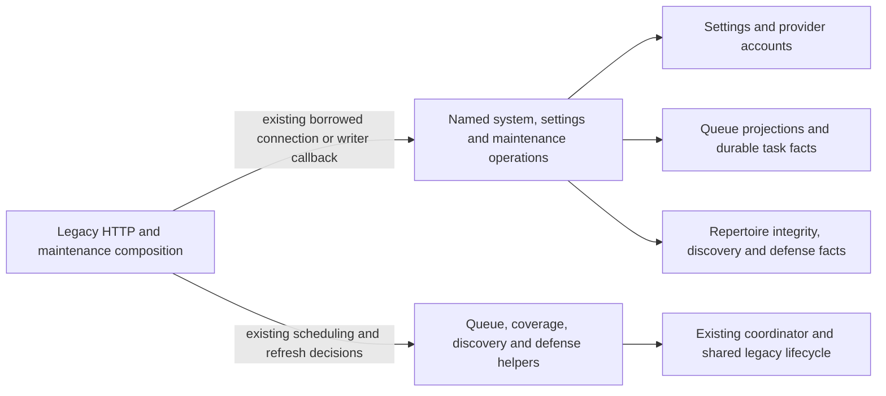

# Legacy HTTP composition persistence

**Current source; live schema and deployment unverified.** These named operations are mechanically separated from [the existing HTTP composition root](../../../../backend/app/main.py). They borrow its connection/transaction, preserve the existing complete SQL and parameter order, and return fetched facts or lazily yielded rows. They never open/commit/rollback a transaction, construct HTTP responses, choose scheduling/settings policy or import an application implementation.

This directory currently covers the first 17 direct database call sites in `main.py`: system status, global settings and queue maintenance. **The remaining inline database operations in that file are unfinished extraction work.** It is not yet a completed centralization claim.

| Module | Persistence responsibility | Decisions retained in `main.py` |
| --- | --- | --- |
| [system.py](system.py) | Frozen target/active-run identity; SQLite settings-read probe; recent queue projections; analysis threshold fact. | Health/HTTP availability, target key/presentation, task counts and writer status. |
| [settings.py](settings.py) | Public/previous settings facts, fixed settings update and clean eligible repertoire rows. | Omitted-flag preservation, model values, account normalization, coverage/discovery change detection and refresh callbacks. Identical account writes reuse [the existing account operations](../commands/accounts.py). |
| [queue_maintenance.py](queue_maintenance.py) | Queue projection status/failure/refresh writes; existing defense task and eligible candidate facts; pending discovery intent. | Dates, error sanitization/rethrow, admission checks, enqueue conditions, priorities, foreground/background submission and coordinator wake. Startup and maintenance reuse the same projection-state read. |

Queries that were consumed by cursor iteration still yield one row at a time at the original comprehension points. Fixed settings arguments are evaluated in the application in their original order. Queue projection writes discard their otherwise unused internal driver cursor; existing callers discard the submitted callback result. No new connection, transaction, queue writer, schema/migration or generic SQL interface is introduced.

## Storage map

The linked schema README views remain canonical for actual stored fields/types, primary/composite keys, enforced foreign keys and explicitly logical relationships. No constraints or ownership are inferred from this call graph.

| Existing storage | Facts touched by this slice | Canonical source schema |
| --- | --- | --- |
| `settings` | Singleton `id=1`; daily quotas, study/defense flags, depth/timezone, provider usernames, engine/light/draw policy and coverage settings. | [Runtime metadata dictionary](../../schema/runtime-metadata/README.md#publicsettings) |
| `game_accounts` | `provider` identity and normalized `username`. | [Game projections](../../schema/game-projections-1/README.md#publicgame_accounts) |
| `queue_projections` | `queue_date`, state, generation, refresh pending, error and existing status fields. | [Queue projection dictionary](../../schema/study-queue-review-2/README.md#publicqueue_projections) |
| `background_tasks` | Existing defense task kind/deduplication identity. | [Runtime metadata](../../schema/runtime-metadata/README.md#publicbackground_tasks) |
| `threat_training_candidates` | Validation/approval/dismissal/pause/supersession eligibility facts. | [Defense candidates](../../schema/practice-families-2/README.md#publicthreat_training_candidates) |
| `discovery_admission_intents` | Pending identity/state, creation order and missing durable-task relationship. | [Discovery priority](../../schema/discovery-priority/README.md#publicdiscovery_admission_intents) |
| `repertoires`, `repertoire_integrity_state` | Non-system repertoire identity and existing clean-integrity state. | [Authored content](../../schema/README.md) |
| `frozen_opening_activation`, PostgreSQL system catalogs | Active run and original database/system/schema target identity. | [Opening activation](../../schema/opening-evidence-1/README.md#publicfrozen_opening_activation); system catalogs are PostgreSQL-owned infrastructure. |

The legacy composition root still wires Study, Games and other optional-feature helpers and their shared lifecycle; this move preserves that pre-existing coupling and table access. It does not establish optional-feature/Study failure isolation or grant cross-owner table permission. The existing [Study loaded-graph guard](../../../../scripts/study-composition.ts) is unchanged.

Focused existing status tests and one-time old/new fake traces check the moved read/iterator/settings/maintenance paths, including omitted flags, callbacks, errors and server-style identity facts. No lifespan/bootstrap, real PostgreSQL, live data/schema, provider, deployment or full-system validation is claimed.
