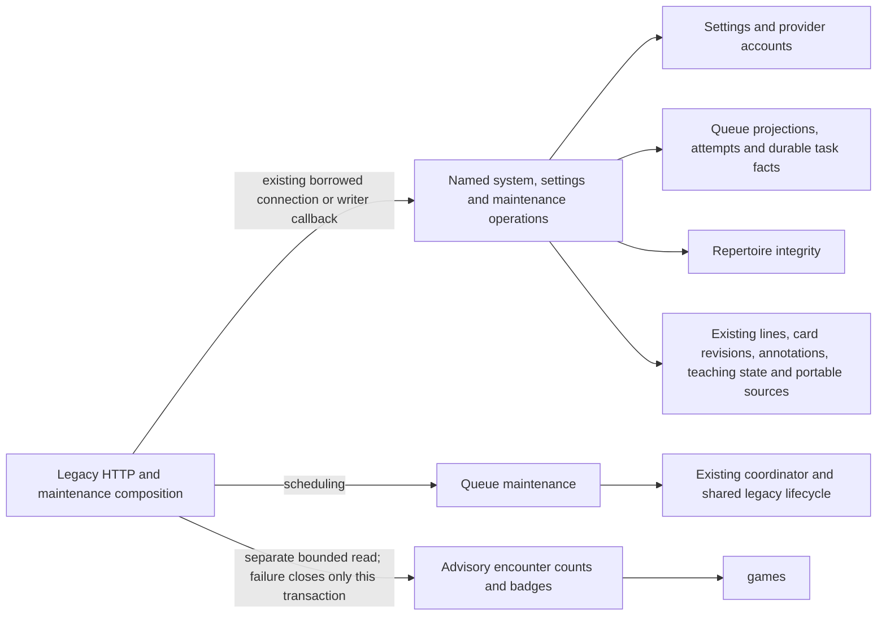
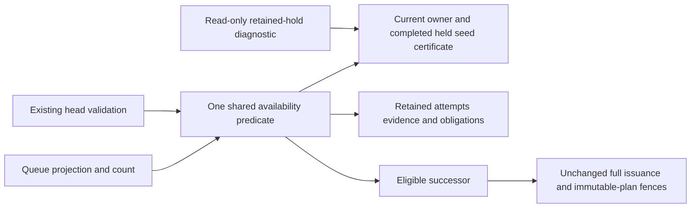
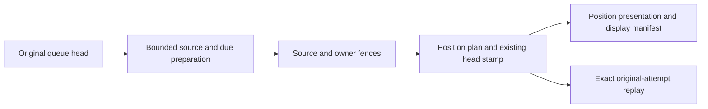

# Legacy HTTP composition persistence

**Current source; live schema and deployment unverified.** These named operations are mechanically separated from [the existing HTTP composition root](../../../../backend/app/main.py). They borrow its connection/transaction, preserve the existing complete SQL and parameter order, and return fetched facts or lazily yielded rows. They never open a connection, commit/rollback the caller’s transaction, construct HTTP responses, choose scheduling/settings policy or import an application implementation.

The serving HTTP API uses these operations for system health, settings, Study queues, repertoire authoring and Tactics progress. Game Review uses the [Games adapters](../games/README.md).

| Module | Persistence responsibility | Decisions retained in `main.py` |
| --- | --- | --- |
| [system.py](system.py) | Frozen target/active-run identity; SQLite settings-read probe; recent queue projections. | Health/HTTP availability, target key/presentation, task counts and writer status. |
| [settings.py](settings.py) | Public/previous settings facts, fixed settings update and clean eligible repertoire rows. | Omitted-flag preservation, model values, account normalization, coverage/discovery change detection and refresh callbacks. Identical account writes reuse [the existing account operations](../commands/accounts.py). |
| [practice.py](practice.py) | Read saved Tactics progress and count human reviews. | Catalog mapping, puzzle legality and result presentation. |
| [card_authoring.py](card_authoring.py) | Published split usage, failed-review fact, revision snapshot/definition/queue/membership/archive statements and row projections. Reuses existing [prefix control operations](../foreground_controls/prefix_splits.py) and [opening card mutations](../authored_repertoires/opening_mutations/prefix_splits.py), including complete column-discovered card insertion. | Split/history/replacement/reset fields, chess validation, deletion guards, scope validation/certification, atomic follow-up enqueue, conflicts/HTTP, clocks and integrity refresh. |
| [line_authoring.py](line_authoring.py) | Existing import/branch settings, conditional transaction start, repertoire/line/depth/annotation writes, segment/deletion facts, coverage-gap read/write and line removal. | PGN parsing, chess legality, identities/depth/segment counts, scope validation/certification, removed-line matching, scheduler callbacks/timing, HTTP/dispatch and response decisions. |
| [repertoires.py](repertoires.py) | Repertoire and line metadata, annotations, teaching history and source rows for PGN export. | Repertoire selection and legal PGN formatting. |
| [queue_projection.py](queue_projection.py), [availability.py](availability.py) | Queue/card projection SQL, availability and count/head queries, encounter batch reads, exercise revision, issued-head/entry facts, existing begin/failure/bury statements. One fixed availability SQL implementation is also used by the existing `queue_application` compatibility helper. | Clock and badge choices, payload/prepared snapshot shaping, HTTP/conflict decisions, writer/worker routing, canonical head issuance/attempt validation and queue-order callbacks. |
| [queue_maintenance.py](queue_maintenance.py) | Queue projection status, failure and refresh state. | Dates, error reporting, task submission and coordinator wake. |

Queries that were consumed by cursor iteration still yield one row at a time at the original comprehension points. Fixed settings arguments are evaluated in the application in their original order. Queue projection writes discard their otherwise unused internal driver cursor; existing callers discard the submitted callback result. Queue encounter badges use their own read transaction; all authoritative projections retain the caller transaction. No new queue writer, schema/migration or generic SQL interface is introduced.

## Queue projection and head issuance

`queue_rows` retains both original query shapes, conditional availability fragments, repeated configured-mode checks, limits and parameter order. The application supplies cutoff/badge clocks and response assembly; `encounter_badges` owns the 400-key batches on a separate read with a 100 ms statement and 25 ms lock deadline on PostgreSQL. Optional SQL failure closes that read before issuance; the response marks `encounter_evidence_status=unavailable` and omits its count instead of presenting a known zero. Core queue and required attempt projections still fail visibly. `available_head` accepts only the application-owned current-day capability so its original clock read stays after availability SQL construction. It does not accept a SQL string or query callback.

Head issuance still reads the immutable identity first, returns on an already issued head, and uses the existing PostgreSQL worker command or SQLite caller-owned transaction. The named `begin_head_issuance` operation executes the original `BEGIN IMMEDIATE` at the same point; it does not open/commit/rollback a connection or become another issuance authority. Existing `queue_commands.issue_queue_head`, validation, first-issuance binding, failure conflict checks and capture/preserve queue-order callbacks are unchanged. Prepared Study exercise snapshots and optional opening evidence remain application composition.

The narrow `queue_application._AVAILABLE_ATTEMPT_SQL` initialization and `available_attempt_sql()` public helper now delegate to the root fixed SQL implementation. The base SQL is purely reconstructed on calls using the existing semantic miss reason; no cache, runtime holder or raw-SQL port was added. The existing SQL bytes, configured-mode evaluation, query parameters, clocks and effect/callback order are preserved.

## Repertoire metadata and PGN export

The repertoire list still makes its two current-day reads after fixed SQL and parameter serialization, using an application-owned date capability. It retains the existing read connection for repertoire facts and canonical-prefix response projection; the adaptive introduction-priority response projection is removed. Annotation FEN canonicalization, comment trimming/JSON, teaching timestamps and idempotent response shape remain application decisions. The SQLite teaching statement retains its original `INSERT OR IGNORE` behavior; it is not replaced with the PostgreSQL command's distinct saved-timestamp replay contract. Main selection still runs inside the existing connection and scope-refresh context; no additional locking or writer is introduced.

## PGN import and branch persistence

`line_authoring.py` owns complete existing statements and the import's conditional `in_transaction` / `BEGIN IMMEDIATE` check at its original point. The caller still owns the connection, shared scope-refresh context and commit/rollback. PGN parsing/decision segmentation, legal branch traversal, UUID/card/line identities, route scope validation/certification, deletion exclusions/counts, scheduler callbacks, error handling and phase clocks remain in application code.

The identical import/branch line INSERT has one private storage implementation. Its import wrapper returns the original rowcount; its branch wrapper discards the unused cursor without reading rowcount. No driver cursor crosses into application code. Initial-depth reads and exact repertoire-presence operations are reused. Existing path-specific training-depth/annotation SQL bytes and the native command contracts are retained; this extraction adds no SQL normalization, new locking, canonical source model or second writer.

## Card revision, split and archive

HTTP composition retains the existing split algorithm, deletion guards, identity/history policy, replacement/reset field preparation, scope validation/certification, conflicts and follow-up enqueue. The adapters borrow the original connection and shared scope context and own only complete stored-fact queries/writes. Split follow-up work is still enqueued inside that transaction; no lock, commit, queue or issuance authority changes.

Exact existing card reads, source promotion, review reassignment, source archive and membership deletion are reused. New card insertion reuses the already-extracted `copy_card` operation with the prepared complete fields and no further updates; its existing column discovery and INSERT stay together at the original point. Existing cursor-returning split memberships are consumed by a root iterable wrapper before rows reach application code. No cursor, SQL text, generic query callback or adapter framework crosses into policy. The permanent-delete path continues to call its existing owner without alteration.

## Tactics progress

The Tactics catalog reads saved puzzle progress through `practice.py`. The human-review count excludes game-generated lapses.

## Storage map

### Retained position carriers without logical state

The Italian issuance repair adds one conservative read-only predicate in
[`retained_position_availability.py`](retained_position_availability.py), reused
by shared API/writer availability and queue diagnostics. It omits only a clean,
unissued ordinary review carrier with one learner decision, one matching current
graph alias, an exact active admission owner, and a completed no-donor seed hold
under unchanged full source-header/integrity certificates. The exact logical
position must have no state in any epoch. Issued attempts, evidence, explicit or
retry work, guided failures, accepted Games obligations and uncertain authority
remain visible. All physical rows, held seed outcomes and history remain intact;
the diagnostic reports `position_retained_carrier_without_logical_state`.
The legacy physical reinforcement flag is retained too: it cannot create a
position-owned obligation without logical state. Actual retry cycles and
reinforcement attempts remain protected by the queue-attempt guards.

This exclusion grants no source, scheduling or issuance authority. It creates
no table, queue status, connection or state writer. The view describes the repair
candidate; native, packaged and installed qualification are separate evidence.

The linked schema README views remain canonical for actual stored fields/types, primary/composite keys, enforced foreign keys and explicitly logical relationships. No constraints or ownership are inferred from this call graph.

| Existing storage | Facts touched by this slice | Canonical source schema |
| --- | --- | --- |
| `settings` | Singleton `id=1`; daily quotas, study/defense flags, depth/timezone, provider usernames, engine/light/draw policy and coverage settings. | [Runtime metadata dictionary](../../schema/runtime-metadata/README.md#publicsettings) |
| `game_accounts` | `provider` identity and normalized `username`. | [Game projections](../../schema/game-projections-1/README.md#publicgame_accounts) |
| `repertoires`, `repertoire_lines`, `repertoire_cards`, opening graph and integrity metadata | Existing repertoire names/source/order/limits/prefix, route FEN/moves/color, memberships, graph generation/readiness and integrity counts/signatures. | [Authored source dictionaries](../../schema/README.md) |
| `tactic_progress`, `tactic_discovery_attempts`, `tactic_introductions` | Determine which puzzle progress appears in the catalog. | [Practice-family dictionary](../../schema/practice-families-1/README.md) |
| `card_revisions`, `prefix_splits`, card/review/queue/membership fields | Existing pre-edit revision snapshot and history mode; original split source/parent/continuation relationships; unchanged executable fields, scheduling history, source/validation/archive state and queue/membership links. | [Card revisions](../../schema/study-queue-review-1/README.md#publiccard_revisions), [prefix splits](../../schema/opening-graph/README.md#publicprefix_splits) and existing card/queue dictionaries below. |
| `repertoire_line_training_depths`, coverage gap candidates/nodes, `deleted_cards` | Existing line learner-decision depth, selected gap identity/covered flag, segment-card identity and permanent deletion exclusions. | [Line training depth dictionary](../../schema/authored-content-2/README.md#publicrepertoire_line_training_depths), [coverage/deletion schema index](../../schema/README.md) |
| `position_annotations`, `teaching_states` | Existing repertoire/FEN note key, comment/arrows/squares/time; card/revision/ply taught timestamp. | [Annotations](../../schema/authored-content-1/README.md#publicposition_annotations) and [teaching states](../../schema/study-queue-review-3/README.md#publicteaching_states) |
| `cards`, `daily_queue`, `reviews`, `queue_attempt_origins`, deletion and integrity blocks | Existing executable card/revision/content, status/position/cycle/guided attempt fields, historical review facts, exact issued identity and eligibility exclusions. No state/queue ownership changes. | [Study/queue/review dictionary](../../schema/study-queue-review-1/README.md) and [attempt/projection dictionary](../../schema/study-queue-review-2/README.md) |
| `study_exercises`, `study_exercise_revisions`, `studies`, sibling burials | Existing published exercise/current revision/specification, archive and same-day sibling eligibility facts. | [Authored content and Study schema index](../../schema/README.md) |
| `game_position_occurrences`, `imported_games` | Existing FEN/game encounter counts and last-seen date, excluding adaptively excluded games. | [Game projection dictionaries](../../schema/README.md) |
| `queue_projections` | `queue_date`, state, generation, refresh pending, error and existing status fields. | [Queue projection dictionary](../../schema/study-queue-review-2/README.md#publicqueue_projections) |
| `repertoires`, `repertoire_integrity_state` | Non-system repertoire identity and existing clean-integrity state. | [Authored content](../../schema/README.md) |
| `frozen_opening_activation`, PostgreSQL system catalogs | Active run and original database/system/schema target identity. | [Opening activation](../../schema/opening-evidence-1/README.md#publicfrozen_opening_activation); system catalogs are PostgreSQL-owned infrastructure. |

The legacy composition root still wires Study, Games and other optional-feature helpers and their shared lifecycle; this move preserves that pre-existing coupling and table access. It does not establish optional-feature/Study failure isolation or grant cross-owner table permission. The existing [Study loaded-graph guard](../../../../scripts/study-composition.ts) is unchanged.

## Recovery candidate: interactive queue read profile

`queue_projection.queue_rows` and `available_count` keep their complete SQL,
parameters, ordering, eligibility/protection checks and authoritative count. On
the existing `PostgresConnection`, they first disable JIT compilation with
transaction-local `set_config` in the borrowed read transaction. Expanded
freshness predicates can otherwise admit compilation even for a short returned
window. No connection, transaction, timeout, global setting, source predicate or
issuance authority changes; the setting restores when the caller ends the
transaction. SQLite and other supplied adapters retain their existing behavior.

The native owning regression verifies results, protected entries, count, borrowed
transaction identity and restoration. Paired disposable timing establishes the
compiler mechanism; installed latency and the complete saved-review-to-playable
journey require separate acceptance.

Proposed #708 queue serving projection explicitly selects the current card
columns rather than `cards.*`; queue predicates, joins, candidate limits,
ordering and count/head operations remain unchanged. The Study queue-serving
assembler owns flat response shaping; the HTTP composition retains separate
advisory reads and head issuance.

### Position-owned queue heads

For an active position owner, the queue head command prepares source, due
witnesses and the selected route before its writer. The writer fences source
and ownership before existing Study card and queue locks and persists the
immutable issued plan in the same transaction as the head stamp. A retry reads
that plan by the original queue/card/revision identity without consulting the
current source. Missing or ambiguous authority returns a position hold; an
unissued position prefetch is also held. The response retains the original
physical card and attempt identity and derives the evidence manifest from the
issued display. Legacy and non-opening rows retain their existing presentation.

A qualified outstanding position Games consequence can nominate its exact
position at head preparation even when the natural FSRS due time is later. The
stored due witness remains the actual schedule fact. The writer rechecks and
locks the same Study-owned obligation before stamping the head; a changed or
settled obligation rolls the proposed plan back. Targeted first introductions
use the existing encounter-exception admission and initialize only the exact
qualified position in the same transaction.
