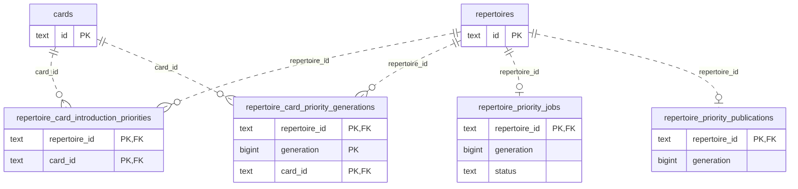
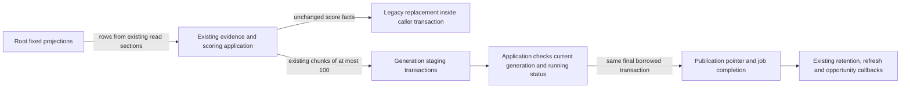

# Legacy introduction-priority storage

**Current unmerged source; live schema/deployment unverified.** Complete queries and writes extracted from [introduction_priorities.py](../../../../backend/app/services/introduction_priorities.py) live here. This is the legacy repertoire-priority owner, using the same borrowed read sections and transactions. No function opens, commits or closes a connection. Application code still owns scoring, chess routes, evidence weighting, JSON conversion, dates, clocks, retries, foreground yielding, pagination/chunk loops, stale-generation decisions and callbacks.

| File | Fixed operations | Existing storage and canonical dictionary |
| --- | --- | --- |
| [inputs.py](inputs.py) | Latest coverage run, nodes/candidates, repertoire lines and active opening cards, coverage settings, personal-game evidence and bounded keyset pages, repertoire IDs matching a game color, current-scope coverage errors. Reuses the existing root [game-color projection](../games/derivation/priorities.py); this preserves the existing legacy game-evidence read, not a new domain interface or owner permission. | [Coverage run/node/candidate fields](../../schema/discovery-priority/README.md), [line/card membership fields](../../schema/authored-content-2/README.md), [card fields](../../schema/study-queue-review-1/README.md), [imported-game fields](../../schema/authored-content-1/README.md), [occurrence fields](../../schema/game-projections-2/README.md), [settings](../../schema/runtime-metadata/README.md). |
| [jobs.py](jobs.py) | Coalesced generation lookup, enqueue upsert, generation lookup, `BEGIN IMMEDIATE`, due candidate selection, conditional queued→running claim, pending-request clear, current/attempt reads and completion/retry/failure updates. Reuses root [claim controls](../controls/claim_sql.py) for pause/promotion and Study-only filtering. | [Priority job fields](../../schema/discovery-priority/README.md#publicrepertoire_priority_jobs), [refresh-request fields](../../schema/authored-content-1/README.md#publicanalysis_refresh_requests), [activity controls/settings](../../schema/runtime-metadata/README.md). |
| [publications.py](publications.py) | Replace legacy priority rows, stage generation rows, update the publication pointer, read published/legacy evidence. Existing compatibility and staged SQL variants retain their exact queries. | [Priority row, generation and publication dictionaries](../../schema/discovery-priority/README.md), [current view definitions](../../schema/README.md#read-projections). |

The linked schema READMEs are canonical for **every stored field/type**, primary/composite key, enforced FK and delete action. The following bounded view shows the affected priority tables; `PK` columns together form each composite key. Every edge below is an enforced SQL FK, with zero or more rows per parent except the singleton-per-repertoire job and publication tables. The external `cards` and `repertoires` entities are expanded in the canonical dictionaries.

| Stored facts | Types and meaning |
| --- | --- |
| Legacy and generation rows | `repertoire_id`/`card_id`: non-null `text`; generation rows additionally have non-null `bigint generation`. Both store `bigint scoring_version` (the existing application value is 2), `double precision completion_mass`, `frontier_reach` and `priority_score`, plus non-null `text completed_line_ids_json`, `frontier_decisions_json`, `evidence_json` and `updated_at`. |
| Priority JSON | Completed line IDs are an array of strings. Frontier decisions are weighted `(weight, reach_probability, decision)` triples; decision facts include position/move/ply and reach probability. Shared evidence stores personal-game weight, explorer/Maia availability and canonical scope identity, plus a nullable real-game-miss fact. Application serialization and scoring remain unchanged; repeated edge provenance is still omitted from stored evidence. |
| Job row | Non-null `bigint generation`/`attempts`, `text status`/`next_attempt_at`/`updated_at`, nullable `text last_error`. A successful conditional claim increments attempts, and only that affected-row success clears the existing refresh intent. Retry thresholds, delay calculations and timestamps remain application decisions. |
| Publication pointer | One row per repertoire: non-null `bigint generation`, `text updated_at`. Its `(repertoire_id,generation)` association with generated rows is **logical, with no composite FK**. Job generations, current-view scope, and control `(source='priority',work_id=repertoire_id)` matches are also logical relationships, not additional constraints. |

All 36 original database call sites are delegated to 31 fixed operations here plus the reused game-color projection; four identical-query pairs share their existing fixed operation. Personal evidence retains its 128-key and 128-row defaults, sorted key/compound cursor order, trained color, allowed-speed, exclusion and optional current-repertoire filters. SQL-only placeholder/keyset/scope assembly now runs inside the existing bounded page read; the application still chooses and closes each read section, advances the cursor and decides when to stop. Legacy replacement still deletes, samples its timestamp, then inserts. Staging still samples its timestamp before the initial delete, writes the existing 100-record chunks, and publishes only through the original stale-generation fence and final transaction. There is no second claim, publication or queue authority.

Existing source and root scope helpers retain their previous legacy dependencies; this file move does not prove optional-feature failure/resource independence. No schema, owner permissions, stored representation, Study lifecycle or sibling-domain architecture was redesigned. No live data was inspected.

Focused checks cover existing scoring/coverage parity, coalescing, interrupted replay, stale-generation rejection, evidence status, bounded/complete paging and atomic retention enqueue. Additional boundary cases cover delegation, legacy delete→clock→insert order, actual SQLite scope/color/speed/exclusion/cursor filtering, and pause/promotion/Study-mode conditional claim authority. One-time source comparison verifies exact queries/parameters, result extraction and restored application functions/dataclasses. Only fakes and task-owned SQLite ran. Native PostgreSQL translation/locking, deployment/resource isolation and full-system behavior remain unverified; the [unfinished extraction inventory](../../../INVENTORY.md) records remaining mixed files.
