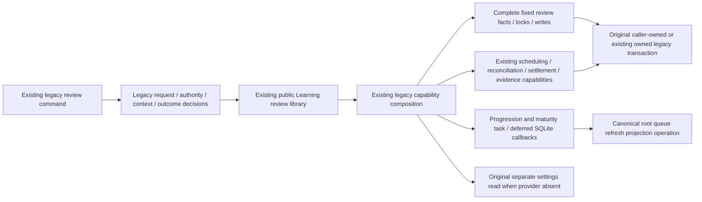
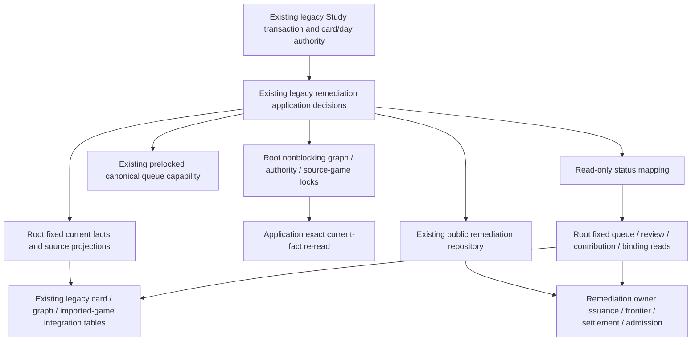

# Existing legacy Learning bridge storage

**Current source; live schema and deployment unverified.** [review.py](review.py) holds the existing legacy review adapter's complete queries and driver-specific card/attempt locks. [learning_review_adapter.py](../../../../backend/app/services/learning_review_adapter.py) retains request/contract mapping, typed facts, conflict translation, sorted current/optional selection, clocks, receipt/evidence authority, scheduling/reconciliation/remediation callbacks and deferred SQLite follow-ups. This is the existing legacy backend consumer of Learning's public review library; it does not change the independently packaged Learning runtime or grant private access to its tables.

Current-card locking still precedes queue locks. An optional continuation retains its original sorted position, nonblocking PostgreSQL advisory try-lock and `FOR UPDATE SKIP LOCKED`; denied optional locks never wait for a row. Native and SQLite dialect selection occurs only in fixed root operations, at the original application decision points. Injected policy avoids settings reads; the fallback retains its original separate read scope. Outer review composition still borrows or owns exactly one command transaction and flushes deferred compatibility effects only after it exits. Application policy remains a single implementation, with unchanged public signatures and no generic query port, framework or new transaction/queue/settlement authority.

The legacy adapter's `refresh_priority(repertoire_id, *, transactional_only=False)`
capability now returns `None` without requesting adaptive recomputation, including
when an original review arrives or reconciles late. The shared review application
and its interface stay intact; the independent Learning adapter still records its
own local advisory notification. Ordinary progression/maturity queue effects,
scheduling, history, receipt and chronological reconciliation keep their existing
owners. Saved-priority readers and existing priority jobs/handlers/controls are
unchanged. This removes one legacy review effect, not every source of optional
work or the broader legacy import/resource coupling.

The two refresh writes reuse the single [foreground projection operation](../queue_refresh/foreground.py). No queue-application file is modified here and no duplicate projection SQL is introduced. Queue ordering, source/recovered attempt completion, typed continuation facts, immutable receipts and exact callback placement remain application decisions; the canonical writer helpers and their existing table access are unchanged.

## Stored data and relationships

Canonical source diagrams/dictionaries retain actual types, primary/composite keys, enforced FKs and logical associations:

- [Cards and queue](../../schema/study-queue-review-1/README.md): content/archive/replacement/revision/state and introduction facts; queue identity/day/cycle/admission/failure/status/result and completion state.
- [Review receipts](../../schema/study-queue-review-2/README.md): attempt/card/queue identity, outcome/guidance, completion/request/result JSON, canonical review reference/status/warning and retained continuation result. Receipt associations remain as documented; this move invents no FK.
- [Membership and integrity](../../schema/authored-content-2/README.md) and [repertoires](../../schema/authored-content-3/README.md): current card ownership and integrity eligibility facts.
- [Opening evidence](../../schema/opening-evidence-1/README.md): completion state and inherited queue/presentation/repertoire/effective-color scope on the original review transaction.
- [Runtime metadata](../../schema/runtime-metadata/README.md) and [practice families](../../schema/practice-families-1/README.md): settings timezone/light interval, queue projection refresh facts and tactical clean-pass stamp.

No schema, table, field, stored encoding, permission, public command or relationship changes. Existing legacy scheduling/queue/evidence/remediation coupling remains; physical root colocation does not establish strict sibling-domain or optional-feature resource/shutdown isolation. The remediation integration below is the second file in this bounded bridge assignment.

## Focused evidence and limits

Eighteen semantic cases in [test_legacy_review_storage_separation.py](../../../../backend/tests/test_legacy_review_storage_separation.py) pass. They cover injected versus owned-read policy; sorted optional/current locks; absent-card short circuit; retained attempt DTOs; capture/write/preserve order; current versus already-issued evidence revision; task-before-projection; deferred SQLite late callback; and receipt-before-late-revision/settlement.

Six additional cases in that owning suite cover fresh and late first delivery,
original receipt replay and chronological reconciliation with both adaptive
enqueue functions unavailable. They use task-owned SQLite plus the existing
borrowed-transaction facade, preserving actual review/schedule/queue writes and
nonempty saved-priority/failure/hold facts. The facade does not qualify native
PostgreSQL locks, deployment or actual held-work disposition.

Historical extraction evidence, before retirement of the priority hook: a one-time captured-original/current comparison passed 59 paths with identical results, 71 query/parameter/cursor events, three clock reads, ten settings/timing-scope events and unchanged late callbacks/deferred effects. All 32 distinct original SQL strings/fragments matched (33 original physical literals became 32 after sharing the revision read), while the two external projection uses retained their exact canonical SQL. Application source had no SQL or direct driver execution; same-package public signatures and unchanged pure/orchestration function text were checked. Synthetic PostgreSQL types never opened a connection; this was not native locking/rollback/race proof. The six new cases above qualify the intentionally retired advisory effect separately.

Task-local source-snapshot discovery uses already installed dependency wheels and rejects socket/SQLite connections. The backend has no declared independent build-system artifact here; source-snapshot/import evidence is not a newly qualified backend wheel or deployment. Existing Docker assembly copies the full `app` and `tempo_legacy_database` trees, including this category. Full backend/native/live/system suites, credentials/security, CI and deployment are untouched. Exact source hashes, comparison and source-snapshot manifests/logs remain under `/tmp/tempo-legacy-learning-review-*`.

## Existing legacy remediation integration

[remediation.py](remediation.py) holds the existing complete parameter-bound facts, source-currentness projection, optional PostgreSQL locks, queue priority write, dialect check and original read-only tuple-cursor facade. [legacy_study_remediation.py](../../../../backend/app/services/legacy_study_remediation.py) retains authority/proof/model validation, introduction and source-count gates, recursive exact re-read, attempt identity, issuance clock, review outcome/settlement mapping, frozen-epoch and protected/buried admission decisions, canonical queue-writer composition and status presentation. Its existing `CURRENT_FACT_SQL` and `SOURCE_FENCE_SQL` aliases remain available; they now refer to the root implementation.

The original card then day then remediation lock order is unchanged. Source-cardinality/currentness checks still precede optional graph locks; denied locks defer without waiting, and all source-game share locks still precede the exact current-fact re-read. First issuance binds only an existing unissued origin with current matching authority, at its original clock read. Settlement consumes the retained binding and actual matching source review; invalidation requires the actual review owner's marker. Queue admission keeps the original frozen activation fence, protected/buried decisions and prelocked canonical writer. Nothing opens, commits or closes a transaction here.

The existing read-only tuple cursor still rejects non-SELECT statements without changing the owner's row factory; the writable path retains its late import of the existing borrowed tuple facade. This moves the original facade rather than adding a generic SQL port. These are existing integration reads across legacy and remediation state; their relocation neither creates a new cross-owner grant nor proves strict domain independence. Public remediation commands retain write authority over their state. The existing queue priority update remains scoped legacy integration coupling, not a newly introduced isolated producer path.

### Remediation data and relationships

The authoritative dictionaries and rendered ER charts list every field/type, primary/composite key and actual enforced FK:

| Existing storage | Facts used by this integration | Source schema home |
| --- | --- | --- |
| `cards`, `daily_queue`, `queue_attempt_origins`, `reviews` | Physical revision/introduction, queue day/position/status/priority, issued-head/failure stamps and actual review outcome/source/invalidation | [Study queue](../../schema/study-queue-review-1/README.md), [reviews](../../schema/study-queue-review-2/README.md) |
| `imported_games`, `legacy_learning_identity` | Exact source-game identity/content/currentness and retained target/workspace | [Legacy source identity](../../schema/authored-content-1/README.md) |
| `repertoires`, `repertoire_cards`, `repertoire_game_scope`, integrity blocks/state, `opening_graph_publications`, `opening_graph_steps`, `background_tasks` | Current scope/catalogue/graph/executable/membership and source-lock fences | [Membership/integrity](../../schema/authored-content-2/README.md), [repertoires](../../schema/authored-content-3/README.md), [game scope](../../schema/game-projections-3/README.md), [graph](../../schema/opening-graph/README.md), [tasks](../../schema/runtime-metadata/README.md) |
| `remediation_cards`, `remediation_contributions`, `remediation_obligation_heads`, `remediation_game_heads`, `remediation_attempts` | Accepted current work, retained authority/proof/source payload, active source revision and issued attempt binding | [Remediation dictionary and ER](../../../tempo_remediation_database/schema/remediation/README.md) |

Legacy card/review/queue identities and remediation payload references are existing logical integration associations; no cross-schema FK is inferred from names or this flowchart. No tables, fields, constraints, stored encodings, relationships or grants change. The charts describe checked-in source; live schema, native PostgreSQL behavior and deployment remain unverified.

### Remediation focused evidence and limits

Sixteen cases in [test_legacy_remediation_storage_separation.py](../../../../backend/tests/test_legacy_remediation_storage_separation.py) cover the retained read-only cursor, source-fence early rejection, share-lock-before-exact-re-read, no retrospective issuance, original issuance clock, retained binding/source review, invalidation marker, card/day order, frozen-epoch early rejection and absent-work status short circuit. Nine existing [legacy Study remediation fixture cases](../../../../backend/tests/test_legacy_study_remediation.py) pass using a temporary synthetic SQLite Study store and scripted PostgreSQL module facts with the real public remediation library. They are source integration proof, not native PostgreSQL semantics.

A one-time captured-original/current comparison passes 54 paths with identical results/errors, 124 query/parameter events, 115 cursor consumptions, six clock reads and 104 capability events. All 22 distinct SQL strings/fragments match; 24 original physical literals become 22 by sharing the identical origin and queued-entry reads. The original twelve public signatures and nested admission writer signature are unchanged, and the application contains no SQL/direct driver operations. The new sixteen cases also pass from an isolated source snapshot using installed dependencies with network/SQLite connections denied. This is source/import discovery, not a backend wheel, native locking/rollback/race or deployment qualification. Evidence and exact hashes remain under `/tmp/tempo-legacy-study-remediation-*`; root integration owns the global checklist and test registration.
