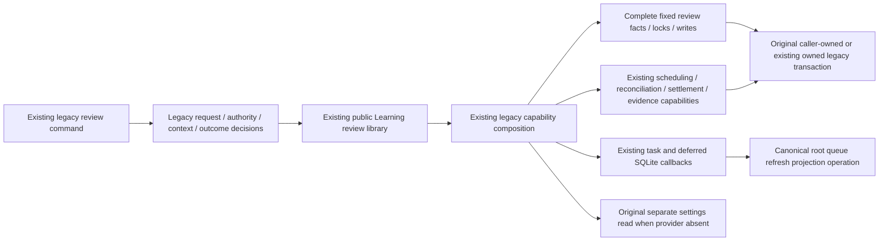

# Existing legacy Learning review bridge storage

**Current source; live schema and deployment unverified.** [review.py](review.py) holds the existing legacy review adapter's complete queries and driver-specific card/attempt locks. [learning_review_adapter.py](../../../../backend/app/services/learning_review_adapter.py) retains request/contract mapping, typed facts, conflict translation, sorted current/optional selection, clocks, receipt/evidence authority, scheduling/reconciliation/remediation callbacks and deferred SQLite follow-ups. This is the existing legacy backend consumer of Learning's public review library; it does not change the independently packaged Learning runtime or grant private access to its tables.

Current-card locking still precedes queue locks. An optional continuation retains its original sorted position, nonblocking PostgreSQL advisory try-lock and `FOR UPDATE SKIP LOCKED`; denied optional locks never wait for a row. Native and SQLite dialect selection occurs only in fixed root operations, at the original application decision points. Injected policy avoids settings reads; the fallback retains its original separate read scope. Outer review composition still borrows or owns exactly one command transaction and flushes deferred compatibility effects only after it exits. Application policy remains a single implementation, with unchanged public signatures and no generic query port, framework or new transaction/queue/settlement authority.

The two refresh writes reuse the single [foreground projection operation](../queue_refresh/foreground.py). No queue-application file is modified here and no duplicate projection SQL is introduced. Queue ordering, source/recovered attempt completion, typed continuation facts, immutable receipts and exact callback placement remain application decisions; the canonical writer helpers and their existing table access are unchanged.

## Stored data and relationships

Canonical source diagrams/dictionaries retain actual types, primary/composite keys, enforced FKs and logical associations:

- [Cards and queue](../../schema/study-queue-review-1/README.md): content/archive/replacement/revision/state and introduction facts; queue identity/day/cycle/admission/failure/status/result and completion state.
- [Review receipts](../../schema/study-queue-review-2/README.md): attempt/card/queue identity, outcome/guidance, completion/request/result JSON, canonical review reference/status/warning and retained continuation result. Receipt associations remain as documented; this move invents no FK.
- [Membership and integrity](../../schema/authored-content-2/README.md) and [repertoires](../../schema/authored-content-3/README.md): current card ownership and integrity eligibility facts.
- [Opening evidence](../../schema/opening-evidence-1/README.md): completion state and inherited queue/presentation/repertoire/effective-color scope on the original review transaction.
- [Runtime metadata](../../schema/runtime-metadata/README.md) and [practice families](../../schema/practice-families-1/README.md): settings timezone/light interval, queue projection refresh facts and tactical clean-pass stamp.

No schema, table, field, stored encoding, permission, public command or relationship changes. Existing legacy scheduling/queue/evidence/remediation coupling remains; physical root colocation does not establish strict sibling-domain or optional-feature resource/shutdown isolation. `legacy_study_remediation.py` is the separately pending second file in this bounded bridge assignment.

## Focused evidence and limits

Eighteen semantic cases in [test_legacy_review_storage_separation.py](../../../../backend/tests/test_legacy_review_storage_separation.py) pass. They cover injected versus owned-read policy; sorted optional/current locks; absent-card short circuit; retained attempt DTOs; capture/write/preserve order; current versus already-issued evidence revision; task-before-projection; deferred SQLite late callback; and receipt-before-late-revision/settlement.

A one-time captured-original/current comparison passes 59 paths with identical results, 71 query/parameter/cursor events, three clock reads, ten settings/timing-scope events and unchanged late callbacks/deferred effects. All 32 distinct original SQL strings/fragments match (33 original physical literals become 32 after sharing the revision read), while the two external projection uses retain their exact canonical SQL. Application source has no SQL or direct driver execution; same-package public signatures and unchanged pure/orchestration function text are checked. Synthetic PostgreSQL types never open a connection; this is not native locking/rollback/race proof.

Task-local source-snapshot discovery uses already installed dependency wheels and rejects socket/SQLite connections. The backend has no declared independent build-system artifact here; source-snapshot/import evidence is not a newly qualified backend wheel or deployment. Existing Docker assembly copies the full `app` and `tempo_legacy_database` trees, including this category. Full backend/native/live/system suites, credentials/security, CI and deployment are untouched. Exact source hashes, comparison and source-snapshot manifests/logs remain under `/tmp/tempo-legacy-learning-review-*`.
