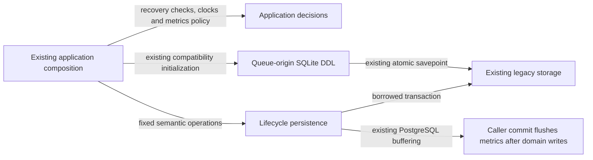

# Legacy queue provenance and background lifecycle storage

**Current unmerged source; live schema/deployment unverified.** These are the existing queue-origin, daily queue readiness and diagnostic metric operations extracted from legacy application modules. They borrow the caller's existing transaction and never open or commit one. No SQL, stored representation, parameter order, lock order, clock sampling or error decisions change.

| Database module / application caller | Facts and operations | Canonical stored fields, keys and relationships |
| --- | --- | --- |
| [queue_attempt_origins.py](queue_attempt_origins.py) / [queue_attempt_origins application](../../../../backend/app/queue_attempt_origins.py) | Reads retained origins by queue/card identity, the current card content/revision and the current queue's card identity; stores a recovered completion result on its exact queue/card/revision tuple. Request-presence checks, revision/content correspondence, retirement conflicts, legacy-marker ambiguity and response decisions remain outside database. Existing public initializer/completion imports remain available from the application module. | [Origin composite key and stored content/admission proof](../../schema/study-queue-review-1/README.md), [card/queue identity](../../schema/study-queue-review-1/README.md). Retained proof intentionally survives replaceable queue projections; these queries do not declare a new foreign key. |
| [Queue-origin SQLite DDL](../../ddl/queue_attempt_origins.py) / the same application entry point | The complete `initialize_sqlite_origins` function moved unchanged: existing table/column/index checks, one-time surviving-row compatibility backfill, insert/update/delete/revision triggers and receipt column repair. The same named savepoint, rollback-on-error and final release preserve atomic direct invocation. Relocation does not run a migration against live data or change the existing backfill. | The source SQLite installer is linked directly; canonical ordered PostgreSQL DDL remains [032_queue_attempt_origins.sql](../../ddl/migrations/032_queue_attempt_origins.sql) and [042_queue_attempt_issuance.sql](../../ddl/migrations/042_queue_attempt_issuance.sql). SQLite compatibility and PostgreSQL source schema are not claimed identical. |
| [refresh_requests.py](refresh_requests.py) / [daily rollover task](../../../../backend/app/tasks.py) | Only `daily_queue_projection` remains: the original `state` / `refresh_pending` read for one queue date, in the caller transaction. Optional priority/opportunity refresh coalescing, status and mutation operations retire with those producers. | [Queue projection date key and readiness fields](../../schema/study-queue-review-2/README.md). |
| [background_metrics.py](background_metrics.py) / [background_metrics application](../../../../backend/app/services/background_metrics.py) | Owns the existing persisted count/duration field names, task-kind lookup, PostgreSQL buffering choice and deterministic sharded delta UPSERT. The caller's PostgreSQL connection still buffers deltas, flushes them after domain writes in sorted key order and clears them on rollback. Finite counter validation, known-kind fallback, event-to-counter mapping, shard hash, clock/bucket calculation and diagnostic response models remain outside database. The application re-exports the same writer/constants for existing callers. | [Metric bucket `(kind, shard, slot)` key, bucket start and counter fields](../../schema/runtime-metadata/README.md), [SQLite metric schema](../../ddl/background_metrics_schema.py). Fixed 288-slot/16-shard storage behavior and max-versus-sum updates are unchanged. |

The linked schema READMEs own the actual stored types, primary/composite keys, enforced foreign keys and explicitly logical relationships. No constraints, tables or owner permissions are added. Existing legacy coupling remains explicit: PostgreSQL metric flushing still uses the existing application writer import. Optional refresh composition and its priority-source dependency are retired. These mechanical moves do not establish a new isolated runtime or a Study dependency. Other mixed files remain on the [unfinished extraction checklist](../../../INVENTORY.md).

The original extraction receipts describe the earlier source revision. Optional refresh coalescing tests retire with the producer; retained queue-origin and metric operations remain unchanged. Task-owned SQLite/fake checks cover essential rollover readiness without importing the retired producer. Native PostgreSQL execution/locking, deployment/resource isolation and full-system behavior remain unverified.

The existing [daily queue rollover worker](../../../../backend/app/tasks.py) now uses `refresh_requests.daily_queue_projection` for its complete `state`/`refresh_pending` read by queue date. The [queue-projection dictionary](../../schema/study-queue-review-2/README.md) remains canonical for actual fields/types/date key and relationships. Worker date, foreground/read scope, ready/pending decision, command ID/dispatch and retry/error response stay in the original application. Its sole direct database site is centralized; other Celery command dispatch is application orchestration. Whole non-import worker AST restoration, two-source compilation and the existing rollover-until-ready fake case pass. Native worker/broker/database/lifecycle and full-system were not run.
