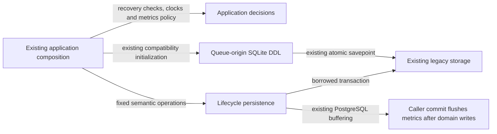

# Legacy queue provenance and background lifecycle storage

**Current unmerged source; live schema/deployment unverified.** These are the existing queue-origin, refresh-intent and diagnostic metric operations extracted from three legacy application modules. They borrow the caller's existing transaction and never open or commit one. No SQL, stored representation, parameter order, lock order, clock sampling or error decisions change.

| Database module / application caller | Facts and operations | Canonical stored fields, keys and relationships |
| --- | --- | --- |
| [queue_attempt_origins.py](queue_attempt_origins.py) / [queue_attempt_origins application](../../../../backend/app/queue_attempt_origins.py) | Reads retained origins by queue/card identity, the current card content/revision and the current queue's card identity; stores a recovered completion result on its exact queue/card/revision tuple. Request-presence checks, revision/content correspondence, retirement conflicts, legacy-marker ambiguity and response decisions remain outside database. Existing public initializer/completion imports remain available from the application module. | [Origin composite key and stored content/admission proof](../../schema/study-queue-review-1/README.md), [card/queue identity](../../schema/study-queue-review-1/README.md). Retained proof intentionally survives replaceable queue projections; these queries do not declare a new foreign key. |
| [Queue-origin SQLite DDL](../../ddl/queue_attempt_origins.py) / the same application entry point | The complete `initialize_sqlite_origins` function moved unchanged: existing table/column/index checks, one-time surviving-row compatibility backfill, insert/update/delete/revision triggers and receipt column repair. The same named savepoint, rollback-on-error and final release preserve atomic direct invocation. Relocation does not run a migration against live data or change the existing backfill. | The source SQLite installer is linked directly; canonical ordered PostgreSQL DDL remains [032_queue_attempt_origins.sql](../../ddl/migrations/032_queue_attempt_origins.sql) and [042_queue_attempt_issuance.sql](../../ddl/migrations/042_queue_attempt_issuance.sql). SQLite compatibility and PostgreSQL source schema are not claimed identical. |
| [refresh_requests.py](refresh_requests.py) / [refresh_requests application](../../../../backend/app/services/refresh_requests.py) | Reads source scope/prefix revisions, opening publication generation/state and optional priority publication generation. Status reads retain the original priority-job → background-task → refresh-intent order and PostgreSQL `FOR UPDATE` clauses, following the existing source lock. Writes existing pending input identity/timestamps, or marks an accepted publication's current input version. Coalescing, quiet-window/maximum-delay math, clock samples, no-op/failure handling and post-commit wake requirements remain outside database. | [Refresh request/source fields](../../schema/authored-content-1/README.md), [repertoire source revisions](../../schema/authored-content-3/README.md), [opening publications](../../schema/opening-graph/README.md), [priority job/publication fields](../../schema/discovery-priority/README.md), [task fields](../../schema/runtime-metadata/README.md). |
| [background_metrics.py](background_metrics.py) / [background_metrics application](../../../../backend/app/services/background_metrics.py) | Owns the existing persisted count/duration field names, task-kind lookup, PostgreSQL buffering choice and deterministic sharded delta UPSERT. The caller's PostgreSQL connection still buffers deltas, flushes them after domain writes in sorted key order and clears them on rollback. Finite counter validation, known-kind fallback, event-to-counter mapping, shard hash, clock/bucket calculation and diagnostic response models remain outside database. The application re-exports the same writer/constants for existing callers. | [Metric bucket `(kind, shard, slot)` key, bucket start and counter fields](../../schema/runtime-metadata/README.md), [SQLite metric schema](../../ddl/background_metrics_schema.py). Fixed 288-slot/16-shard storage behavior and max-versus-sum updates are unchanged. |

The linked schema READMEs own the actual stored types, primary/composite keys, enforced foreign keys and explicitly logical relationships. No constraints, tables or owner permissions are added. Existing legacy coupling remains explicit: refresh composition calls its existing priority-source owner, and PostgreSQL metric flushing still uses the existing application writer import. These mechanical moves do not establish a new isolated runtime or a Study dependency. Other mixed files remain on the [unfinished extraction checklist](../../../INVENTORY.md).

All 32 original database call sites now reside in this root database tree. Source comparison verifies identical SQL values, the complete SQLite installer, metric writer/buffering branch, refresh read/write blocks, counter field constants and application validation/models. Thirty-two existing focused cases cover retained-attempt replay/conflicts, trigger/column install rollback, refresh coalescing/clock/transaction/publication behavior, metric lookup budgets, rollback and fake PostgreSQL buffered flush order; one local guard prevents direct database calls returning to the three originals. Only fakes and task-owned SQLite ran. Native PostgreSQL execution/locking, deployment/resource isolation and full-system behavior remain unverified.
