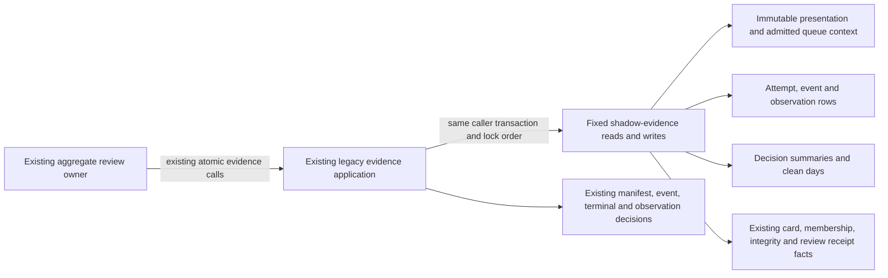

# Legacy opening shadow-evidence storage

**Current source; live schema and deployment unverified.** [storage.py](storage.py) contains the original legacy PostgreSQL opening-evidence queries and read connection. This is existing shadow-evidence behavior, separate from `tempo_learning_database` adapters. It adds no proposed canonical lines/positions/history model, schema, backfill or feature.

[postgres_opening_evidence.py](../../../../backend/app/services/postgres_opening_evidence.py) keeps request/manifest/context validation, trained-color checks, HTTP/error policy, canonical JSON, immutable identity and terminal/event conflicts, contiguous-sequence calculation, observation reduction/count deltas, clean-day decisions, prepared-source comparisons, aggregate review completion policy and response/exposure construction. The database module imports no application implementation.

The original card-edit advisory lock, permanent-deletion guard, original-card row lock, completion receipt/retirement checks and immutable queue/presentation proof retain their order. The application still rejects complete standalone attempts and controls offline parent reconciliation. Attempt header insertion/locking, event identity checks, the 256-event page, terminal sealing, sorted decision-summary updates, clean-day insert-ignore and observation upserts are unchanged. Aggregate review effects remain the caller's responsibility; these helpers write only the same shadow-evidence tables and do not mutate cards, reviews, queue or quota.

Prepared standalone work retains its authoritative bounded source read and closes it before chess validation/reduction. The same original-source comparison raises the same serialization error before projection writes when stale. Reused identical fixed operations preserve both old callsites where applicable. The two ordinary read scopes keep `read_only=True`; the configured probe reuses the existing database helper. Existing public functions, PostgreSQL module alias and `SerializationFailure` class remain available. No helper independently commits, owns a review settlement or accepts arbitrary SQL.

## Stored data and relationships

The [canonical shadow-evidence dictionary and rendered ER diagram](../../schema/opening-evidence-1/README.md) document every stored field/type, primary/composite key, enforced FK, cardinality and nullability. This directory links that single schema source rather than duplicating its full chart.

| Storage | Facts stored or read here | Keys and relationship notes |
| --- | --- | --- |
| `opening_evidence_presentations` | Bigserial snapshot ID; text fingerprint/card/FEN/move/color values, bigint card revision and timestamptz capture time. | Bigserial `id` PK and unique text fingerprint. Immutable presentation identity and revision comparison retain their existing schema constraints. |
| `opening_evidence_queue_contexts` | Bigint queue and presentation IDs; text repertoire and effective learner color. | Composite queue/presentation/repertoire PK, with only the documented presentation FK; repertoire/card/revision/color checks add no FK. |
| `opening_evidence_attempts` | Text attempt/manifest/repertoire/card IDs, context/manifest/terminal/review-result JSON, timezone/state/retirement marker; bigint presentation/card-revision/sequence/queue/review values; timestamptz start/completion. | Attempt PK, presentation FK and retirement-operation receipt FK; repertoire/card/queue/review associations remain logical. Retirement/completion/queue binding semantics are unchanged. |
| `opening_evidence_events` | Attempt text ID, bigint sequence, canonical event JSON text. | Composite attempt/sequence PK and attempt FK; contiguous sequence and sealed-final checks remain application policy. |
| `opening_evidence_observations` | Attempt/decision identity, bigint decision index, timestamptz observation/failure times and text observation JSON. | Composite attempt/index PK with documented attempt relation. Decision summary association is not a newly enforced relationship. |
| `opening_evidence_summaries`, `opening_evidence_clean_days` | Per-decision response/outcome/correction counters and distinct clean-day count; decision/date uniqueness. | Text decision PK; composite `(decision_id, study_day)` PK with date study day and an enforced decision FK to summaries. Delta/exposure/clean-day decisions remain application code. |

Existing [cards and daily queue](../../schema/study-queue-review-1/README.md), [review receipts](../../schema/study-queue-review-2/README.md), [authored memberships/integrity](../../schema/authored-content-2/README.md) and [repertoires](../../schema/authored-content-3/README.md) supply scope and completion facts. Follow the canonical dictionary for actual enforced FKs: similarly named card/revision/queue/review/decision fields do not imply extra constraints. No table, field, key, permission or relationship is changed.

This preserves legacy authored-presentation, queue-context, deletion and aggregate-review coupling. It establishes neither a new domain interface nor optional-feature resource/shutdown isolation. Learning's separate adapter package and authority are unchanged. No new Study-to-Games dependency or storage access is introduced.

## Focused evidence and limits

The existing checkpoint-preparation and evidence-contract suites ran **52 passes and two failures** with fakes/in-process HTTP. The failing cases are `test_opening_checkpoint_request_is_background_without_a_client_work_class_header` and `test_opening_checkpoint_receipt_read_uses_background_admission[False]`: both expect an existing foreground middleware scope but observe none, before any evidence SQL executes. Both reproduce when the saved pre-extraction evidence module is loaded in place of this extraction on the same working tree. Main/admission code, tests and assertions were not modified; this is recorded as a verification limitation, not a passing suite. One existing Starlette/AnyIO warning is reported; the task-local baseline overlay also reports an import-rewrite warning.

The passing cases include close-before-chess/reduction, immutable source/terminal/event conflicts, prepared publication staleness before writes, maximum event/observation preparation, trained-color scope, reconciliation rollback and unchanged dispatch/completion contracts. Task-local fixed-operation expansion restores the entire retained non-import application AST: all **32 original queries, two read scopes and the configured probe**, SQL bytes/parameters/locks, iteration/context/event/terminal/observation/review/callback order. The application contains no SQL-bearing literals or direct query/driver/resource calls; three affected Python modules compile.

Native PostgreSQL execution/locking/rollback/permissions, installed-package discovery, GitHub rendering, live/deployment and resource isolation remain unverified. No live/native service, schema/backfill/security/CI, full-system campaign, new model or issue publication was used.
