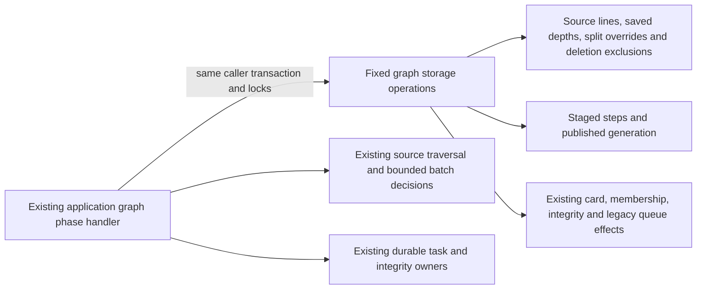

# Legacy opening graph storage

**Current source; live schema and deployment unverified.** This directory holds the existing legacy graph persistence. It does not implement the proposed canonical lines/positions model or change schema, algorithms, SQL or permissions.

[worker.py](worker.py) owns complete original graph queries, two cursor batch writes, native card-array insertion, advisory/row locks and the existing background writer connection. [postgres_opening_graph.py](../../../../backend/app/services/postgres_opening_graph.py) retains traversal/planning, JSON and card defaults, sorted identity/batch selection, generation/lease/task authority, classification decisions, maintenance protection errors, cleanup policy, timestamps and integrity callbacks. All public worker helper signatures remain available to existing consumers. The larger mixed [opening_graph.py](../../../../backend/app/services/opening_graph.py) and recovery are separately coordinated work, not claimed as extracted by this worker slice.

Graph admission retains the task-row lock, shared prefix-transition reservation lock and per-repertoire advisory lock before reading staged/published generations. Staging retains sorted card-edit locks and permanent-deletion checks before inserts. The two original cursors still surround their original batch construction/write points. Native card insertion retains the same arrays and strict-versus-conflict-ignore branch; every card kind/state/day/JSON value remains an application decision.

Publication still rejects missing memberships before the same timestamped upsert. Classification preserves protected-card checks, existing authored-source exclusions and original state/due-date conditions. Integrity block deletion, insertion and pending-validation update retain their order. Cleanup locks eligible links/cards together, retires queue rows, archives or reassigns owners before deleting memberships, removes blocks and archives remaining unlinked generated cards. The application retains the two-card cleanup budget, 256-candidate frontier and original maintenance head/issued-attempt protection. Connection helpers use the original `read_only=False, background=True`; task advancement/completion and integrity requests remain caller-owned, with no independent commit.

## Stored data and relationships

Canonical source dictionaries and rendered ER diagrams document every stored field/type, primary/composite key, enforced FK, cardinality and nullability:

| Storage | Data used or changed here | Canonical schema |
| --- | --- | --- |
| `opening_graph_steps` | Composite repertoire/generation/line/decision key; segment kind, decision bounds/position-key JSON, card/parent IDs, FEN/move JSON and trained color. | [Opening graph](../../schema/opening-graph/README.md) |
| `opening_graph_publications`, `prefix_splits` | Published repertoire PK/FK, generation/state/error/time; source-card PK/FK, revision and shortened/continuation card FKs. | [Opening graph](../../schema/opening-graph/README.md) |
| `repertoire_lines`, `repertoire_line_training_depths`, `repertoire_cards` | Saved line fields, learner-decision depth and composite repertoire/card membership with canonical source provenance. | [Authored content](../../schema/authored-content-2/README.md) |
| `cards`, `daily_queue`, `reviews` | Existing generated presentation identity/FEN/moves/color/kind, archive/owner/validation/state/due-date changes; queued retirement and history-based protection. | [Cards and queue](../../schema/study-queue-review-1/README.md), [reviews](../../schema/study-queue-review-2/README.md) |
| `repertoire_integrity_issues`, `repertoire_integrity_card_blocks` | Position-key issues and composite repertoire/card/issue blocks with graph-derived scan marker and publication time. | [Authored integrity](../../schema/authored-content-2/README.md) |
| `background_tasks`, `settings`, `deleted_cards`, `queue_attempt_origins` | Durable graph generation/lease facts, initial depth, permanent identity exclusions and issued-head maintenance protection. | [Runtime metadata](../../schema/runtime-metadata/README.md), [deletion and attempt origins](../../schema/study-queue-review-1/README.md) |

Only documented FKs are enforced relationships. Task generation/payload checkpoints, graph publication visibility, card IDs/parents in graph steps, shared split overrides and source-versus-generated provenance are existing logical policy relationships where the source schema has no corresponding FK. Advisory locks and the missing-link query do not create constraints. No key, relationship or table access changes.

This is legacy authored-source/card/membership/integrity/task coupling, including pre-existing daily-queue retirement and review/issued-origin protection reads. Those effects and callbacks are preserved, not presented as a repaired Learning authority/domain boundary or isolated optional producer. No new Study-to-Games dependency or cross-owner permission is introduced. Resource/shutdown independence remains unverified.

## Focused evidence

The existing graph-worker suite passes: **18 tests**, using fakes only. It covers source-close-before-traversal, eight-step/link/classification batches, two-card integrity/cleanup, strict bulk insertion, constant cleanup command count, publication membership/generation guards, deletion/maintenance/replay behavior, cleanup frontiers and warm-before-transaction order.

Task-local fixed-operation expansion restores the complete retained non-import application AST: all **33 original query/driver callsites** (including two cursor acquisitions), **seven writer scopes**, SQL bytes/parameters/strict branch, raw row iteration, batch/lease/generation/callback/clock and policy order. The application worker has no SQL-bearing literals or direct query/driver/resource calls; three affected Python modules compile. There is no generic SQL execution port, new framework or duplicate implementation.

Native PostgreSQL execution/locking/rollback/permissions, installed-package discovery, GitHub rendering, live schema and deployment remain unverified. No live/native service, full-system suite, schema/security/CI or planned model change was used.
