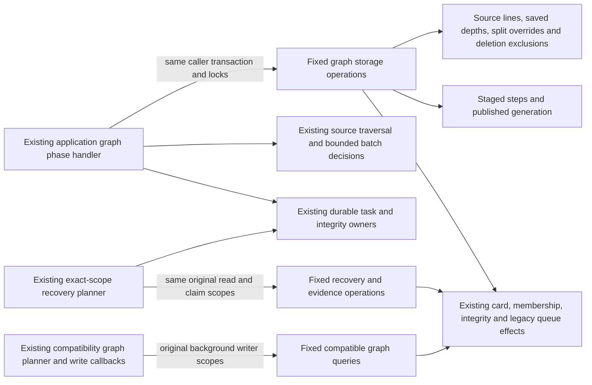

# Legacy opening graph storage

**Current source; live schema and deployment unverified.** This directory holds the existing legacy graph persistence. It does not implement the proposed canonical lines/positions model or change schema, algorithms, SQL or permissions.

[worker.py](worker.py) owns complete original graph queries, two cursor batch writes, native card-array insertion, advisory/row locks and the existing background writer connection. [postgres_opening_graph.py](../../../../backend/app/services/postgres_opening_graph.py) retains traversal/planning, JSON and card defaults, sorted identity/batch selection, generation/lease/task authority, classification decisions, maintenance protection errors, cleanup policy, timestamps and integrity callbacks. All public worker helper signatures remain available to existing consumers. [recovery.py](recovery.py) owns the original fixed maintenance/evidence reads, task claim/event writes and connection mechanics; [opening_graph_recovery.py](../../../../backend/app/services/opening_graph_recovery.py) keeps recovery validation, planning, budgets, preservation comparisons, clock and owner callbacks. [compatibility.py](compatibility.py) owns the original SQLite-compatible source, legacy snapshot, schedule-seed and graph publication queries; [opening_graph.py](../../../../backend/app/services/opening_graph.py) retains all traversal, seed selection, scheduling and publisher callback policy.

Graph admission retains the task-row lock, shared prefix-transition reservation lock and per-repertoire advisory lock before reading staged/published generations. Staging retains sorted card-edit locks and permanent-deletion checks before inserts. The two original cursors still surround their original batch construction/write points. Native card insertion retains the same arrays and strict-versus-conflict-ignore branch; every card kind/state/day/JSON value remains an application decision.

Publication still rejects missing memberships before the same timestamped upsert. Classification preserves protected-card checks, existing authored-source exclusions and original state/due-date conditions. Integrity block deletion, insertion and pending-validation update retain their order. Cleanup locks eligible links/cards together, retires queue rows, archives or reassigns owners before deleting memberships, removes blocks and archives remaining unlinked generated cards. The application retains the two-card cleanup budget, 256-candidate frontier and original maintenance head/issued-attempt protection. Connection helpers use the original `read_only=False, background=True`; task advancement/completion and integrity requests remain caller-owned, with no independent commit.

## Stored data and relationships

Canonical source dictionaries and rendered ER diagrams document every stored field/type, primary/composite key, enforced FK, cardinality and nullability:

| Storage | Data used or changed here | Canonical schema |
| --- | --- | --- |
| `opening_graph_steps` | Composite repertoire/generation/line/decision key; segment kind, decision bounds/position-key JSON, card/parent IDs, FEN/move JSON and trained color. | [Opening graph](../../schema/opening-graph/README.md) |
| `opening_graph_publications`, `prefix_splits` | Published repertoire PK/FK, generation/state/error/time; source-card PK/FK, revision and shortened/continuation card FKs. | [Opening graph](../../schema/opening-graph/README.md) |
| `repertoire_lines`, `repertoire_line_training_depths`, `repertoire_cards` | Saved line fields, learner-decision depth and composite repertoire/card membership with canonical source provenance. | [Authored content](../../schema/authored-content-2/README.md) |
| `cards`, `daily_queue`, `reviews` | Existing generated presentation identity/FEN/moves/color/kind, archive/owner/validation/state/due-date changes; queued retirement and history-based protection. | [Cards and queue](../../schema/study-queue-review-1/README.md), [reviews](../../schema/study-queue-review-2/README.md) |
| `repertoire_integrity_issues`, `repertoire_integrity_card_blocks` | Position-key issues and composite repertoire/card/issue blocks with graph-derived scan marker and publication time. | [Authored integrity](../../schema/authored-content-2/README.md) |
| `background_tasks`, `settings`, `deleted_cards`, `queue_attempt_origins` | Durable graph generation/lease facts, initial depth, permanent identity exclusions and issued-head maintenance protection. | [Runtime metadata](../../schema/runtime-metadata/README.md), [deletion and attempt origins](../../schema/study-queue-review-1/README.md) |

Only documented FKs are enforced relationships. Task generation/payload checkpoints, graph publication visibility, card IDs/parents in graph steps, shared split overrides and source-versus-generated provenance are existing logical policy relationships where the source schema has no corresponding FK. Advisory locks and the missing-link query do not create constraints. No key, relationship or table access changes.

This is legacy authored-source/card/membership/integrity/task coupling, including pre-existing daily-queue retirement and review/issued-origin protection reads. Those effects and callbacks are preserved, not presented as a repaired Learning authority/domain boundary or isolated optional producer. No new Study-to-Games dependency or cross-owner permission is introduced. Resource/shutdown independence remains unverified.

## Focused graph-worker evidence

The existing graph-worker suite passes: **18 tests**, using fakes only. It covers source-close-before-traversal, eight-step/link/classification batches, two-card integrity/cleanup, strict bulk insertion, constant cleanup command count, publication membership/generation guards, deletion/maintenance/replay behavior, cleanup frontiers and warm-before-transaction order.

Task-local fixed-operation expansion restores the complete retained non-import application AST: all **33 original query/driver callsites** (including two cursor acquisitions), **seven writer scopes**, SQL bytes/parameters/strict branch, raw row iteration, batch/lease/generation/callback/clock and policy order. The application worker has no SQL-bearing literals or direct query/driver/resource calls; three affected Python modules compile. There is no generic SQL execution port, new framework or duplicate implementation.

Native PostgreSQL execution/locking/rollback/permissions, installed-package discovery, GitHub rendering, live schema and deployment remain unverified. No live/native service, full-system suite, schema/security/CI or planned model change was used.

## Recovery storage and evidence

`recovery.py` retains the existing generic `read_rows` and 128-row keyset pager as unchanged implementation mechanics. Fixed named operations bind each existing query or finite evidence selection; application code no longer passes SQL or table/predicate strings. The old `opening_graph_recovery.read_rows` export remains an alias for consumers. No generic reader capability or SQL execution port is injected or added.

The application still validates exact target, source/prefix revisions, study mode/depth, frozen activation, local day, task identity/generation/state/checkpoint, pinned predecessor and publication before it authorizes an owner claim or write. Optional `FOR UPDATE` / `FOR SHARE` clauses and all lock order remain unchanged. The same caller-owned connection receives the transaction-local selected-handoff marker after the application constructs its policy fields. Lease UUID/60-second expiry, payload JSON, attempt count, claim event and timestamps retain their original calculation/write order. No helper gains task planning, queue settlement, independent commit or retry authority.

Maintenance connections keep their original `background=True`; authoritative checks keep `read_only=True, authoritative=True, background=True`; the existing independent `read_rows` still uses only `read_only=True`. Evidence paging closes each original short read, including the composite `(queue_entry_id, card_id, revision)` cursor that preserves multiple issued revisions. The application keeps the captured component selection, target/time metadata, selected-rebuild policy, protected schedule/head/issued-origin sets and preservation comparisons. First-publication recovery and pinned queued rebuilds remain distinct. Owner graph/integrity/segmentation handlers, admissions, sleep/deadline/slice limits and progress/save/stop callbacks stay outside the database directory.

Additional source dictionaries cover the recovery facts:

| Storage | Recovery facts | Canonical schema |
| --- | --- | --- |
| `background_tasks`, `background_task_events` | Exact task ID/kind/key, bigint generation/attempt count, state/phase, lease token/expiry, payload JSON and completion/update times; claim event identity/generation/phase/detail/time. | [Runtime metadata](../../schema/runtime-metadata/README.md) |
| `repertoires`, `settings`, `frozen_opening_activation`, `frozen_opening_ranks` | Source/prefix revision, initial depth/study mode, active run/epoch and frozen card ranks used for scope fencing/preservation. | [Repertoires](../../schema/authored-content-3/README.md), [settings](../../schema/runtime-metadata/README.md), [frozen ordering](../../schema/opening-evidence-1/README.md) |
| `repertoire_integrity_state`, `opening_segmentation_state` | Matching status/scan marker/time or ready state/graph generation/run marker after pinned owner completion. | [Integrity](../../schema/authored-content-2/README.md), [segmentation](../../schema/opening-evidence-2/README.md) |
| `prefix_transition_applications`, graph/source/card/membership/history/queue/issued-origin tables above | Existing active-transition exclusion, staged-versus-source comparison and preservation evidence; no permission or field is added. | [Graph/transition](../../schema/opening-graph/README.md), [cards/queue/origins](../../schema/study-queue-review-1/README.md), [reviews](../../schema/study-queue-review-2/README.md) |

Database target identity is the same existing PostgreSQL control/catalog projection (cluster ID, database OID/name and schema); it is not a stored application table or a new FK. Pinned task/run markers, payload revisions, protected schedule/evidence comparisons and the connection-local handoff marker remain logical relationships. No live identity or data was queried during this work.

The selected existing recovery suite passes **69 tests** with fakes; **six native-rehearsal fixture cases were excluded**. Three fake-reader patches now target its relocated defining module; assertions and fixtures are unchanged. Exact fixed-operation expansion restores the complete retained non-import recovery application AST: **14 native statement sites, 22 existing `read_rows` callsites, six connection scopes and the handoff assignment**, including the independently verified identical reader/pager definitions. The application contains no SQL-bearing literals or direct driver/resource calls. Recovery source, storage and the adjusted test source compile. Native execution/locking/rollback/permissions, installed packaging, live/deployment and optional-feature isolation remain unverified.

## SQLite-compatible graph source and publication

`compatibility.py` contains the existing 29 fixed query/batch operations called from the legacy application graph builder. Source/legacy card/review/split/deletion reads preserve eager execution and original raw-row iteration. Chess traversal, prefix expansion, descendant identities, FSRS seed selection/caps, schedule fields, JSON and clock/day calculation remain in application code. The original short read connections and background writer submissions stay at their existing composition points.

The application still constructs each 250-step, 500-mapping and 100-seed batch, checks the leased generation at the same callback points, filters permanent deletions and verifies both mapping identities before writes. All original insert-ignore semantics, source seed conditions, publication generation checks, generated-owner archive/reassignment before membership deletion, integrity rebuild and queue/opportunity/integrity callbacks retain their order. This is an extraction of existing publisher/seed behavior, not a new backfill or planned model.

In addition to the tables above, [legacy graph mappings](../../schema/opening-graph/README.md) store the composite `(repertoire_id, generation, legacy_card_id, decision_card_id)` PK with its existing repertoire/card FKs. [Schedule seeds](../../schema/authored-content-1/README.md) store the card PK/FK, source-card reference, bigint baseline successful-day/recent-clean counts and text verification/creation dates. The canonical dictionaries describe every type/nullability and enforced relationship. Source decision overlap, selected seed maturity and review-based scheduling protections are application relationships; no FK or authority is added.

The selected existing graph suite passes **23 tests**, using task-temporary SQLite and pure/fake paths; the production-scale calculation case was excluded. One existing Starlette/AnyIO deprecation warning is reported. An initial collection attempt executed no cases while another active batch's import target was absent; the same focused command passed after that owner completed it, with no dependency repair in this slice. Fixed-operation expansion restores the entire retained non-import graph application AST, all **32 original query/batch callsites**, SQL literal bytes/parameters, raw iteration, source/seed/scheduling/chunk/lease/callback/clock order. The application has no SQL-bearing literals/direct query-driver calls; both affected Python sources compile. Native execution, installed packaging, live/deployment and resource isolation remain unverified.
