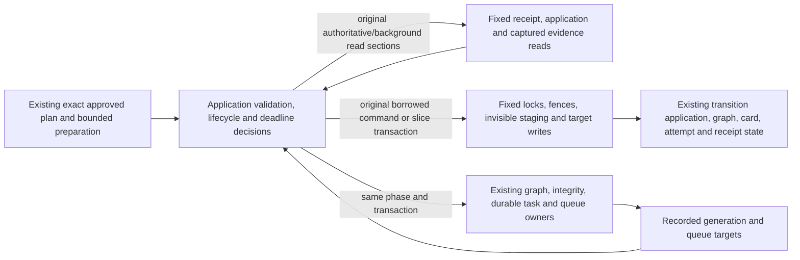

# Exact-plan prefix application persistence

**Current source; live schema/deployment unverified.** [storage.py](storage.py) owns the existing complete queries from [prefix application composition](../../../../backend/app/services/prefix_transition_application.py). It borrows the caller’s transaction and changes no statement, parameter order, lock, clock, field, constraint or stored data. Application planning, decisions and callback/lifecycle authority remain outside this directory.

## Operations and boundaries

| Root responsibility | Application responsibility retained |
| --- | --- |
| Operation receipt/prior application facts; integrity/staged graph evidence; captured-read revalidation. | Source/evaluation/plan identities, shortening and approval, current study day, integrity/staged-content guards, creation/root-role mapping and deadline checks. |
| Receipt/task locks, one reservation barrier, occupied fences, repertoire/integrity/line/depth/card/membership and fixed attempt-row locks. | Contention/conflict classification, no-op exceptions, stale captured state/day decision and retry behavior. The fixed attempt lock loop still rereads the original snapshot card-ID selector at each query. |
| Exact application/fence inserts, staging cursor and staged/publishing state, native session operation marker, line depths/memberships/card kinds and retirement writes. | Strict card creation, membership/card/attempt classification, retirement error JSON, graph publication and durable task enqueue/generation validation. Retirement maps only the original two semantic attempt kinds to their fixed storage tables. |
| Original failed-task requeue, recorded graph/integrity/queue readiness facts, completion and linked-failure writes. | Recovery/staging rejection, queue-day selection/refresh, steady-state/error/response shaping, actual completed generation chaining and receipt/task callback order. |

All 48 original native call sites and three captured-read calls are accounted for. Five pure persistence helpers are byte-equivalent function moves (`own_application`, `release_fences`, `record_integrity_target`, `record_queue_target`, `lock_linked_receipts`); existing application names delegate at their original points. The identical locked-application query is reused by command and slice readers. No generic SQL/dispatch interface, registry, new model, independent connection/commit or second transaction/settlement authority is introduced.

Integrity and staged capture use fixed query implementations here and the existing root `SnapshotRead`/`snapshot_rows` evidence format. Evidence records are constructed after the same application guards, at the original append points. Revalidation accepts that existing captured record and preserves its SHA256-evidence flag; the application still decides/logs staleness. The original imported evidence names remain compatibility aliases in the application, with no local query implementation. The three application date reads, database `NOW()` expressions and exact 31-second pending-operation requeue remain unchanged.

The original receipt/task-before-reservation-before-row lock order, NOWAIT behavior, one reservation lock independent of snapshot size, fixed staging batch of eight, missing-ID fences, strict creates, atomic activation and recovery/publication target semantics are retained. Graph, integrity, queue, attempt and review coupling is existing legacy orchestration, not new table permission or proof of optional-feature/Study failure independence. No canonical lines/positions/presentation-history design is implemented.

## Stored facts and canonical ER/dictionaries

Owner: existing legacy backend, PostgreSQL `public`. The canonical [opening graph ER view and full field/type dictionaries](../../schema/opening-graph/README.md) show actual PK/composite/FK/cardinality; [migration038](../../ddl/migrations/038_prefix_transition_application.sql) is authoritative for these application/fence tables. No edge is inferred from similar identifier names.

| Stored source | Fields used / purpose | Canonical dictionary |
| --- | --- | --- |
| `prefix_transition_applications` | `operation_id text` PK/FK to receipt; `repertoire_id/plan_id/plan_json/state/result_json/last_error text`; `graph_generation bigint`; nullable staging/graph/integrity/queue task IDs, generation targets and queue date; `created_at/updated_at timestamptz`. Application’s repertoire/task/generation fields are logical target relationships unless explicitly constrained by DDL. | [Every field and key](../../schema/opening-graph/README.md#publicprefix_transition_applications) |
| `prefix_transition_card_fences` | `card_id text` PK; `operation_id text` FK to application. The card ID intentionally has no cards FK, so absent identities can be reserved. | [Card fences](../../schema/opening-graph/README.md#publicprefix_transition_card_fences) |
| `prefix_transition_repertoire_fences` | `repertoire_id text` PK/FK to repertoire; `operation_id text` FK to application. Each identity has at most one fence; one application may have many fences. | [Repertoire fences](../../schema/opening-graph/README.md#publicprefix_transition_repertoire_fences) |
| `operation_receipts`, `background_tasks` | Existing operation/task state, attempt/lease token/expiry, response/error/retry fields, generation/payload and phase; unchanged locks and completion/failure authority. | [Runtime metadata](../../schema/runtime-metadata/README.md) |
| Graph/publication/integrity, line depth, cards/memberships and existing queue/opening/Study attempts | Existing generation/clean-source evidence, depth/kind/membership writes, captured exact state and original retirement markers. No field or owner changes. | [Graph](../../schema/opening-graph/README.md), [depth](../../schema/authored-content-2/README.md#publicrepertoire_line_training_depths), [all related source dictionaries](../../schema/README.md) |

The canonical ER chart stays in its schema README rather than being duplicated here. Current source capture/replay does not certify live schema, deployed resource isolation or native locking behavior. Focused source/fake proof preserves the existing invariants; no native database, application startup or full-system run is claimed.
