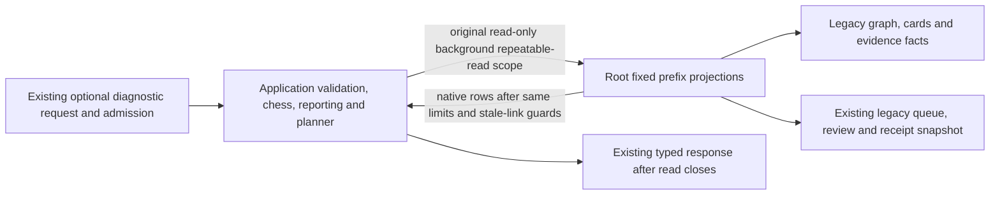

# Legacy bounded prefix read projections

**Current unmerged source; live schema/deployment unverified.** [diagnostics.py](diagnostics.py) and [transitions.py](transitions.py) hold the existing read-only database implementations from [prefix diagnostics](../../../../backend/app/prefix_diagnostics_api.py) and [transition snapshot composition](../../../../backend/app/prefix_transition_api.py). These are existing endpoints and snapshot readers; this move implements no new canonical lines/positions/history model or persisted plan.

| Projection | Actual source / bounds | Application responsibility outside database |
| --- | --- | --- |
| Diagnostics graph/prefix | Existing repertoire and graph-publication/task facts; indexed keyset prefix selection, page8+1 or one explicit card; original unambiguous color/presentation facts. | Graph-generation/current-context guards, cursor response, manifest/chess/SAN and unavailable/error decisions. |
| Diagnostics evidence | Same attempt identity/repertoire/color/card/revision scope and existing attempt-window/observation limits. | Reporting-window validation and observation projection after connection closure. |
| Membership discovery | Ordered legacy `repertoire_cards` IDs; original40,001-row query and40,000-row rejection. | Availability/deadline checks before and after the read. |
| Transition state capture | Existing cards/deletions/memberships/revisions/reviews/schedule seeds/queue/origins/attempt receipts/opening evidence/study attempts/presentations/command receipts/graph/repertoire/publication facts. Original single size statement binds one lookup array; native payload batch preserves table order, cumulative40,000-row/4MiB caps and stale-membership error precedence. | Lookup selection/sort, canonical serialization/hash after read closure, source/presentation/planner algorithms and typed response. |

The complete [source schema index and bounded ER/dictionaries](../../schema/README.md) describe actual fields, types, PKs/composite keys and enforced FKs. These are existing legacy-owner reads, including prior queue/history access; moving them grants no other component's tables or write authority. Graph/evidence/version/JSON-receipt lookup relationships in these projections are logical query predicates, not additional SQL constraints. No field, migration, constraint, schema, stored data or plan changes.

Connections retain `read_only=True`, `background=True`, `repeatable_read=True`; application admission still precedes acquisition. Concrete driver/error classes and SQL stay here; the API retains the same public helper signatures and compatibility module alias. Snapshot capture returns native rows after the same complete projection/size/transfer logic. No generic SQL port, dispatch layer, new context framework, connection/transaction owner, independent commit or serving Study dependency is introduced. Resource/deployment isolation and actual native permissions remain unverified.

One-time named expansion restores both complete non-import application ASTs, the whole transition-capture body, all query/parameter/dynamic query-building values, driver kwargs and error classes. Five Python sources compile. The initial38-case owning selection reports35passes and3pre-existing failures; verified unchanged API source reproduces the same three. The final affected connection/deadline/size/order selection passes9cases, overlapping those35. No assertions were skipped/weakened or test fakes repaired. [Validation and baseline limitations](../../../VALIDATION.md) give the exact commands, original-source hash and failure details. Native PostgreSQL, installed-wheel execution, live/deployed resources and full-system checks remain unverified. [Remaining extraction inventory](../../../INVENTORY.md).
