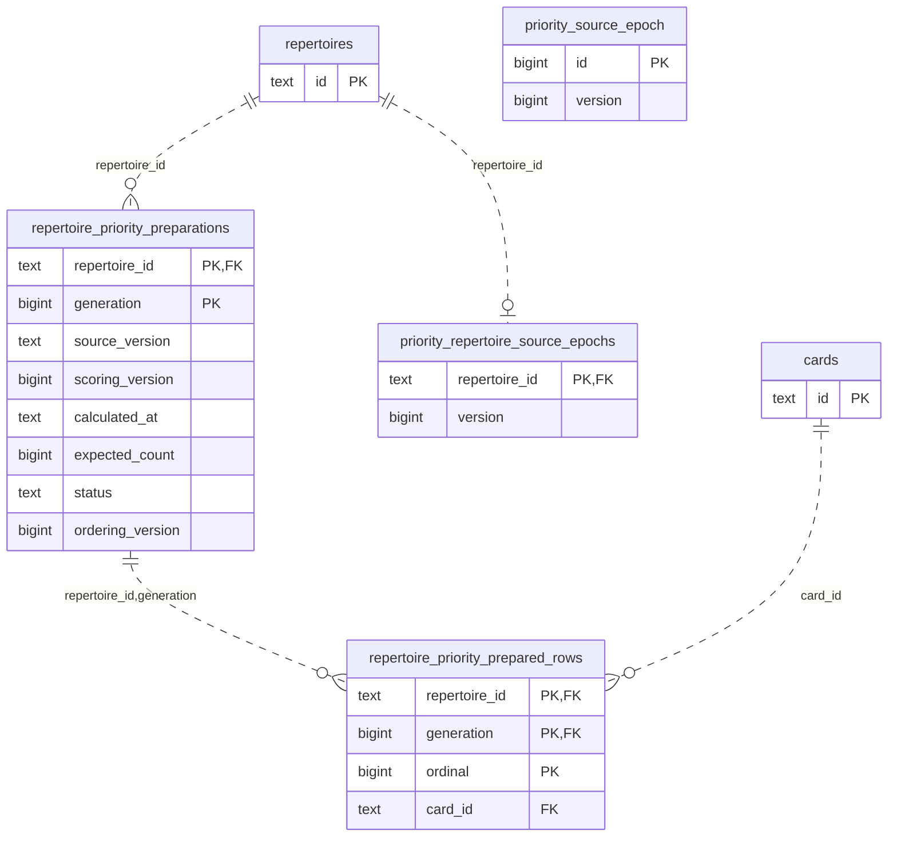
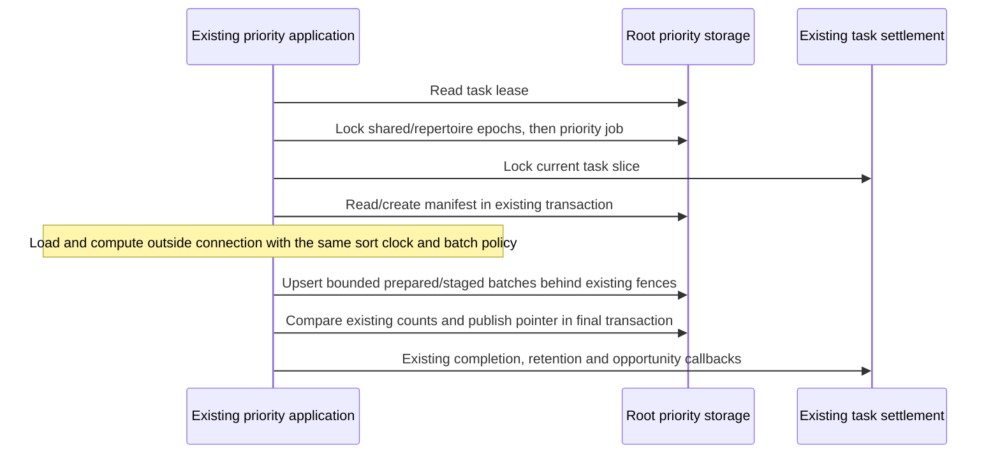

# Legacy priority preparation and retention storage

**Current unmerged source; live schema/deployment unverified.** [preparation.py](preparation.py) and [retention.py](retention.py) own the complete existing database operations extracted from [postgres_priority.py](../../../../backend/app/services/postgres_priority.py) and [priority_retention.py](../../../../backend/app/services/priority_retention.py). They borrow caller-owned transactions. No connection, task/queue authority, lock policy, clock, computation or callback lifecycle is introduced.

| Owner file | Stored facts and effects | Canonical dictionary |
| --- | --- | --- |
| `preparation.py` | Reads the task lease and locks the current priority job; reads/initializes the repertoire source epoch after the shared epoch; reads/inserts a preparation manifest; upserts prepared ordinal rows and staged card rows; reads bounded ordinal pages/counts; marks ready/running/complete. Reuses the exact [introduction publication write](../introduction_priorities/publications.py). | [Preparation, prepared-row, generation, job and publication fields](../../schema/discovery-priority/README.md), [source epochs](../../schema/authored-content-1/README.md), [task lease fields](../../schema/runtime-metadata/README.md#publicbackground_tasks). |
| `retention.py` | Reads the current lease, publication pointer and priority job; selects and deletes bounded stale prepared/generation rows; removes only empty preparation manifests; checks for more work. Native locks/`SKIP LOCKED`/ordering, SQLite row-ID projection/deletion and the configured-driver check live here. Reuses the same locked-job query and the exact [ordinary current-job read](../introduction_priorities/jobs.py). | Same preparation/generation/job/publication dictionary, plus [existing task fields](../../schema/runtime-metadata/README.md#publicbackground_tasks). |

The linked schema READMEs provide **every field/type**, primary/composite key, enforced FK/delete action and unique tuple. This bounded ER view expands preparation identities and their actual enforced links. Each edge is an SQL FK; `PK` fields together form each composite key. Generation publication/task/source-version associations are logical and are described separately below.

| Storage | Types and meaning |
| --- | --- |
| Source epoch identity | Shared `priority_source_epoch(id bigint PK, version bigint)` uses row `id=1`. Repertoire epochs store `repertoire_id text PK/FK`, `version bigint`. The existing source identity is `text "shared_version:repertoire_version"`; no FK joins that string to epoch rows. Shared read/lock → repertoire initialization → repertoire read/lock order and absent-repertoire `None` outcome are unchanged. |
| Preparation manifest | Composite `(repertoire_id text,generation bigint)` PK, with an enforced repertoire FK. `source_version text`, `scoring_version bigint`, `calculated_at text`, `status text` are non-null. `expected_count bigint` and `ordering_version bigint` are nullable in current DDL; the existing writer uses ordering version 1. Source/scoring comparison and manifest state decisions remain application-owned. |
| Prepared rows | Composite `(repertoire_id text,generation bigint,ordinal bigint)` PK; enforced composite FK to the manifest, card FK, and unique `(repertoire_id,generation,card_id)`. Also stores `text completed_line_ids_json`, `frontier_decisions_json`, `evidence_json` and `double precision completion_mass`, `frontier_reach`, `priority_score`, all non-null. The [introduction-priority README](../introduction_priorities/README.md) describes the unchanged JSON/score representation. |
| Staged generations and publication | Existing generated rows and publication-pointer fields/keys are documented in the [priority schema dictionary](../../schema/discovery-priority/README.md). `(repertoire_id,generation)` pointer-to-row association is **logical, without a composite FK**. Application code still checks manifest readiness, ordering/scoring/source versions, contiguous ordinals and all expected/prepared/staged counts before publication. |
| Durable task relation | The task row's `text id`, `bigint generation`, `text lease_token` and `text state` establish the existing lease fact; its JSON payload holds repertoire/generation/cursor. This is a logical relationship to the preparation/job, without a new FK. The compatibility `postgres_store` module export remains the same object so existing private test patches still select the same branch. |

All 31 original database call sites are delegated: 27 new root sites, two exact operations reused from introduction-priority storage, and two pairs of identical local queries sharing their fixed helper. The complete source-epoch function moves intact behind its original application wrapper. Application code retains each connection/admission scope, lease/source/job/task fence, sort and ordinal calculation, source-version checks, timestamp and batch-size evaluation, expected-count decision, metrics and callback/settlement order. Retention still protects published/active generations, uses the existing row budget of 16, reclaims prepared rows before stale generated rows, deletes only empty manifests, and queues follow-up work in the same caller transaction. The native and SQLite branches retain their original order and short-circuit behavior.

Focused checks cover resumable preparation, bounded writes, crash/retry identity, source/scoring/ordering changes, missing/empty generations, withheld publication, abandoned-preparation retention, active/published protection, replay and foreground yielding. Additional cases check the SQL/dialect boundary, semantic lease→source→job→task order, absent-source early exit and repertoire-epoch identity using task-owned SQLite. A one-time source comparison verifies every SQL/method/parameter/result expression, the intact source-epoch body and restored application function ASTs. Native PostgreSQL execution/locking, deployment/resource isolation and full-system behavior remain unverified. Existing legacy coupling remains explicit; no schema, storage format, owner permission or Study dependency changed. See the [unfinished extraction inventory](../../../INVENTORY.md) for remaining mixed files.
