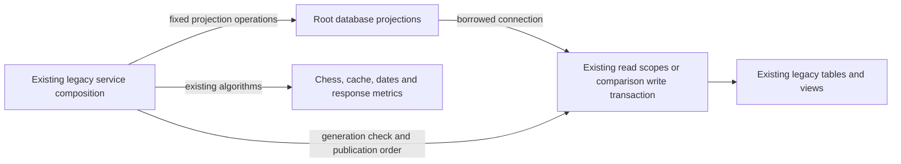

# Legacy repertoire and tactical projections

**Current unmerged source; live schema/deployment unverified.** These fixed query projections and comparison publication operations were extracted from three legacy services. They borrow the caller's existing connection and transaction, without opening or committing either. No schema, query, parameter order, paging bound, publication decision or stored representation changes.

| Database module / application caller | Stored facts and operations | Canonical fields, keys and relationships |
| --- | --- | --- |
| [repertoire_comparison.py](repertoire_comparison.py) / [repertoire_comparison service](../../../../backend/app/services/repertoire_comparison.py) | Reads repertoire identity/prefixes, lines, opening-card memberships and imported game moves. PostgreSQL digest reads and 64-row keyset pages retain their original query order and separate background read scopes. Publishes `imported_games.repertoire_scope_generation`, match rows, decision events and the primary comparison in the existing caller transaction. The application still owns `BEGIN` timing, generation validation, match ordering, event IDs and primary/deviation choices; the adapter executes the existing statements. | [Repertoires](../../schema/authored-content-3/README.md), [lines/memberships](../../schema/authored-content-2/README.md), [cards](../../schema/study-queue-review-1/README.md), [imported games](../../schema/authored-content-1/README.md), [match storage](../../schema/game-projections-2/README.md), [comparison/event storage](../../schema/game-projections-3/README.md). |
| [repertoire_statistics.py](repertoire_statistics.py) / [repertoire_statistics service](../../../../backend/app/services/repertoire_statistics.py) | Reads published opening routes/cards, integrity blocks, valid reviews, Study timezone, current primary game matches/decision events, and background/derivation status. The application retains not-found checks, window/date calculation, readiness policy, grouping, metrics and response pagination. The existing read scope and the position of each query are preserved. | [Opening publications/steps](../../schema/opening-graph/README.md), [integrity/membership data](../../schema/authored-content-2/README.md), [reviews](../../schema/study-queue-review-2/README.md), [settings/background tasks](../../schema/runtime-metadata/README.md), [derivation jobs](../../schema/game-projections-1/README.md), and the comparison sources above. The [schema index](../../schema/README.md#read-projections) distinguishes `current_*` views from stored tables. |
| [tactical_opportunities.py](tactical_opportunities.py) / [tactical_opportunities service](../../../../backend/app/services/tactical_opportunities.py) | Owns the existing SQLite/PostgreSQL filter predicates and bound parameters. SQLite reads matching opportunities; PostgreSQL executes the existing aggregate query followed by its pin-evidence query. Grouping, zero-safe conversion, confidence/missed-cost rounding, pin-evidence decoding and response timestamps remain outside the database after the existing read scope closes. Only bounded filter construction moves inside that scope. | [Tactical opportunity fields and keys](../../schema/practice-families-1/README.md) and [imported game fields](../../schema/authored-content-1/README.md). |

The linked schema READMEs remain canonical for stored types, primary/composite keys, enforced foreign keys and logical relationships. No new relationships or constraints are implied by these joins. PostgreSQL's versioned backing tables/views and SQLite's legacy tables are not claimed to be identical; neither live schema was inspected.

These services remain explicit legacy composition: their connection/configuration selection, comparison scope guard and existing cross-feature reads are preserved. Physical colocation adds no owner permissions, Study dependency, independent deployment claim or generic execution interface. The [unfinished extraction checklist](../../../INVENTORY.md) tracks the remaining mixed files elsewhere.

All 39 original direct database call sites are delegated to the three named modules. Two repeated repertoire SQL literals and one repeated timezone literal share fixed helpers; runtime query counts and order remain unchanged. The original SQL values, tactical predicate construction and pure chess/date/metric algorithms were checked against the pre-extraction source.

Seventeen focused cases cover comparison/transposition/publication behavior, foreground write progress during background chess computation, statistics pagination/read budgets, fake PostgreSQL 64-row paging/cache scopes and two-query tactical aggregation, tactical SQLite response metrics, the three-module SQL boundary, and filter binding/order for both dialects. Only fakes and task-owned SQLite ran. Native PostgreSQL execution/locking, deployment/resource isolation and full-system behavior remain unverified.
