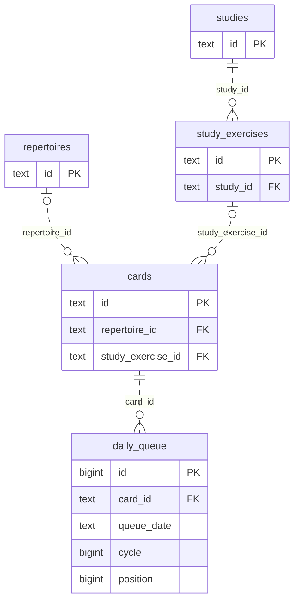
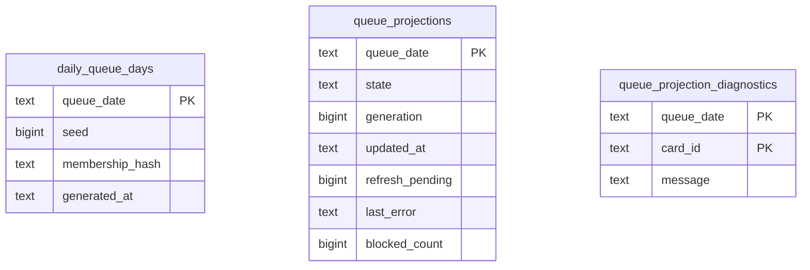

# Legacy queue-refresh storage

**Current unmerged source; live schema/deployment unverified. Partial extraction.** The [legacy queue-refresh composition](../../../../backend/app/services/postgres_queue_refresh.py) still owns eligibility decisions, queue planning, frozen-policy checks, admission/task authority, row budgets, clocks, foreground waits, callbacks and transaction lifecycles. Root operations borrow its existing connection and never commit independently.

## Admission writers

[admissions.py](admissions.py) contains the complete existing tactical, unseen-entry, due-card and Study-exercise writer queries. [eligibility.py](eligibility.py) contains the unchanged due/Study eligibility SQL, still exported under its original private names by the application while its bounded read projections await extraction.

| Operation group | Existing facts and effects | Canonical fields and constraints |
| --- | --- | --- |
| Tactical reservation/publication | Takes the same card-edit advisory lock, reads the daily limit and locked rotation/progress, checks pack activation, ensures the tactics repertoire/card, writes progress/introduction, appends only after the same queue-position lock/recheck, then advances rotation. Application code retains deletion, quota, rotation and already-admitted decisions; daily tactic counting/lock authority is reused. | [Tactic activation/progress/introduction/rotation fields](../../schema/practice-families-1/README.md), [card and queue fields](../../schema/study-queue-review-1/README.md), [repertoires](../../schema/authored-content-3/README.md), [settings](../../schema/runtime-metadata/README.md). |
| Unseen introduction reconciliation | Locks the exact eligible queue/card entry; keeps its introduction or removes the entry and resets the unreviewed card, after the same application-owned per-repertoire allowance and real-game-miss decision. Explicit admissions, retained cards and reviewed historical introductions retain their existing exclusions. | [Queue/card fields](../../schema/study-queue-review-1/README.md), [review evidence](../../schema/study-queue-review-2/README.md), [current repertoire dictionary](../../schema/authored-content-3/README.md). |
| Due and Study admission | Locks the selected card, then the queue-date position boundary; rechecks the existing due/Study predicate, quota and sibling burial; appends at the same computed position. Due predicates retain integrity, published-study, burial, archive, validation and existing-membership filters. | [Cards and queue](../../schema/study-queue-review-1/README.md), [studies/exercises/burials](../../schema/study-queue-review-2/README.md), [integrity-card blocks/membership](../../schema/authored-content-2/README.md). |

The linked schema READMEs remain canonical for **every stored field/type**, primary/composite key, enforced FK/delete action and unique tuple. This bounded ER view shows relevant enforced links only. `o|` on the repertoire/exercise side denotes nullable card references; the queue always references one card.

| Additional stored facts | Types and relationships |
| --- | --- |
| Queue admission facts | `daily_queue` uniquely keys `(queue_date text,card_id text,cycle bigint)` in addition to its `bigint id` PK. Position is `bigint`; bucket/admission kind are nullable `text`. Due/tactical append retains defaults; Study append records `card_bucket='study_exercise'`, `admission_kind='new'`. |
| Tactical progress | `tactic_progress(puzzle_id text PK)` stores non-null `deck_id text`, `admission_mode text`, and nullable `card_id text`, `admitted_at text`, `clean_pass_at text`. These card/pack/puzzle associations are logical: this table has **no enforced card or pack FK**. The existing writer preserves admitted time with `COALESCE`. |
| Tactical reservation and rotation | `tactic_introductions(puzzle_id text PK,pack_id text,introduction_date text)`, `tactic_pack_activation(pack_id text PK,active bigint)`, `tactic_rotation(id bigint PK,last_pack_id text)` retain their existing logical associations without FKs. The application still applies the source-neutral daily introduction counter. |
| Card introduction facts | Existing `state`, `introduced_at`, content/source FEN and move JSON fields are unchanged. Advisory keys and queue position locks are transaction-scoped controls, not stored relational constraints. |

## Opening and presentation publication

[openings.py](openings.py) owns the original published-route/order/priority SQL constants and the complete route occurrence, parent-review, allowance, current-opportunity, locked-card, safe-route, opening append/introduction and opportunity-resolution operations. Application code still validates exact content/route, frozen proposal state, allowance/miss/capacity decisions and the original post-lock rechecks. The [opening graph dictionary](../../schema/opening-graph/README.md) records its actual `(repertoire_id,generation,line_id,decision_index)` step PK and enforced repertoire/line FKs. Its card, parent-card and publication-generation associations are logical without additional constraints.

[presentation.py](presentation.py) owns saved-plan/current-membership/locked-hash reads, the same affected-row-count randomization update and plan write, locked quarantine facts and skip/diagnostic writes, projection publication and diagnostic reset. Application code retains presentation/attempt/membership/frozen-state comparisons, exact admitted-head protection, generated list/clock evaluation, affected-row decisions, quarantine content comparison, task completion and prefix-transition callbacks in their original order and transactions.

These three tables have **no enforced FK** connecting them to each other or to queue/card rows: their date/card associations are logical. All fields are non-null except projection `updated_at` and `last_error`. The canonical [day/diagnostic dictionary](../../schema/study-queue-review-1/README.md) and [projection dictionary](../../schema/study-queue-review-2/README.md) retain DDL links and full constraints. Publication still increments the existing projection generation, records the blocked count/status/timestamp, and commits only with successful task completion; lost-receipt exceptions roll back that transaction. No schema, new publication/queue authority, storage format or owner permission changed.

All 55 original direct database sites are now delegated: admission writers cover 29 sites and opening/presentation operations cover 26. The latter use 21 fixed new operations and reuse five call sites from an existing fixed operation; all seven SQL constants remain compatibility exports under their original application names, including `_PRIORITY_OPENING_PAGE_SQL` consumed by the ranking snapshot. All original query/parameter/result expressions, deletion/lock order, quotas, replay, admitted-head/position allocation and transaction authority are preserved. No new generic execution interface was added.

**Still unfinished in the original file:** 24 bounded SQL-read sites, SQL construction, the existing timeout/dialect reader and reader callback bridges. The 55 direct attribute-call sites have moved, which is not a claim that all database code has moved. The source remains pending in the [extraction inventory](../../../INVENTORY.md). This directory does not yet mean that the complete queue-refresh implementation has been centralized.

Focused evidence covers Study quota/burial/replay and post-lock rechecks, due-card eligibility/order, deleted tactical publication, saved-attempt recovery, plus a task-owned SQLite tactical reservation/replay/rotation/quota case and an admission-only SQL boundary guard. One selected existing unseen-reconciliation parity test fails in its reference fixture because `frozen_opening_activation` is absent, **before any extracted writer runs**; executing the original pre-extraction module in memory reproduces the same failure. That fixture is unchanged. Source comparison now verifies all 55 moved direct operations, seven SQL constants and restored application functions. Four selected existing opening/presentation/quarantine cases and two new boundary/projection rollback cases pass. Three additional selected fixtures fail before the moved operations: one lacks frozen activation storage; two omit the frozen metadata reader while selecting the PostgreSQL branch. The original module reproduces those early failures, with a task-only reader sentinel preventing native access for the missing-reader cases. Those fixtures are unchanged. No native PostgreSQL, live storage, full-system, resource-isolation or deployment check ran; existing legacy component coupling remains unchanged.
