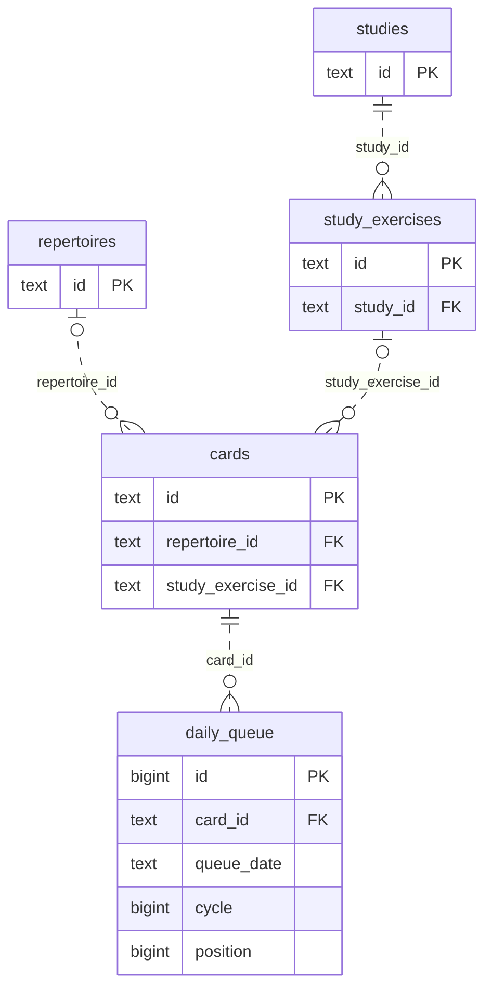
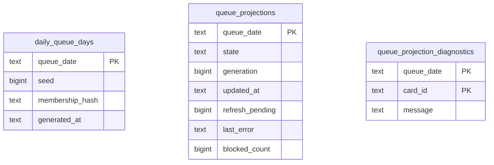
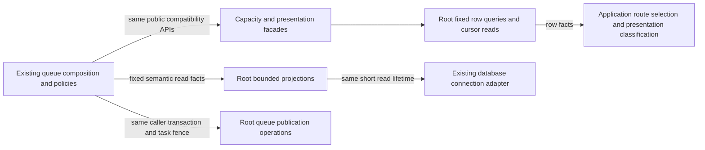

# Legacy queue-refresh storage

**Current unmerged source; live schema/deployment unverified.** The [legacy queue-refresh composition](../../../../backend/app/services/postgres_queue_refresh.py) still owns eligibility decisions, queue planning, frozen-policy checks, admission/task authority, row budgets, clocks, foreground waits, callbacks and transaction lifecycles. Writes borrow its existing transaction and never commit independently. The existing bounded read adapter opens and closes the same short read sections and retains its unchanged three-attempt timeout retry; it has no write or queue authority.

## Admission writers

[admissions.py](admissions.py) contains the complete existing tactical, unseen-entry, due-card and Study-exercise writer queries. [eligibility.py](eligibility.py) contains the unchanged due/Study eligibility SQL, still exported under its original private names for compatibility. Their bounded read projections also live in the root tree.

| Operation group | Existing facts and effects | Canonical fields and constraints |
| --- | --- | --- |
| Tactical reservation/publication | Takes the same card-edit advisory lock, reads the daily limit and locked rotation/progress, checks pack activation, ensures the tactics repertoire/card, writes progress/introduction, appends only after the same queue-position lock/recheck, then advances rotation. Application code retains deletion, quota, rotation and already-admitted decisions; daily tactic counting/lock authority is reused. | [Tactic activation/progress/introduction/rotation fields](../../schema/practice-families-1/README.md), [card and queue fields](../../schema/study-queue-review-1/README.md), [repertoires](../../schema/authored-content-3/README.md), [settings](../../schema/runtime-metadata/README.md). |
| Unseen introduction reconciliation | Locks the exact eligible queue/card entry; keeps its introduction or removes the entry and resets the unreviewed card, after the same application-owned per-repertoire allowance and real-game-miss decision. Explicit admissions, retained cards and reviewed historical introductions retain their existing exclusions. | [Queue/card fields](../../schema/study-queue-review-1/README.md), [review evidence](../../schema/study-queue-review-2/README.md), [current repertoire dictionary](../../schema/authored-content-3/README.md). |
| Due and Study admission | Locks the selected card, then the queue-date position boundary; rechecks the existing due/Study predicate, quota and sibling burial; appends at the same computed position. Due predicates retain integrity, published-study, burial, archive, validation and existing-membership filters. | [Cards and queue](../../schema/study-queue-review-1/README.md), [studies/exercises/burials](../../schema/study-queue-review-2/README.md), [integrity-card blocks/membership](../../schema/authored-content-2/README.md). |

The linked schema READMEs remain canonical for **every stored field/type**, primary/composite key, enforced FK/delete action and unique tuple. This bounded ER view shows relevant enforced links only. `o|` on the repertoire/exercise side denotes nullable card references; the queue always references one card.

| Additional stored facts | Types and relationships |
| --- | --- |
| Queue admission facts | `daily_queue` uniquely keys `(queue_date text,card_id text,cycle bigint)` in addition to its `bigint id` PK. Position is `bigint`; bucket/admission kind are nullable `text`. Due/tactical append retains defaults; Study append records `card_bucket='study_exercise'`, `admission_kind='new'`. |
| Tactical progress | `tactic_progress(puzzle_id text PK)` stores non-null `deck_id text`, `admission_mode text`, and nullable `card_id text`, `admitted_at text`, `clean_pass_at text`. These card/pack/puzzle associations are logical: this table has **no enforced card or pack FK**. The existing writer preserves admitted time with `COALESCE`. |
| Tactical reservation and rotation | `tactic_introductions(puzzle_id text PK,pack_id text,introduction_date text)`, `tactic_pack_activation(pack_id text PK,active bigint)`, `tactic_rotation(id bigint PK,last_pack_id text)` retain their existing logical associations without FKs. The application still applies the source-neutral daily introduction counter. |
| Card introduction facts | Existing `state`, `introduced_at`, content/source FEN and move JSON fields are unchanged. Advisory keys and queue position locks are transaction-scoped controls, not stored relational constraints. |

## Opening and presentation publication

[openings.py](openings.py) owns the original published-route/order/priority SQL constants and the complete route occurrence, parent-review, allowance, current-opportunity, locked-card, safe-route, opening append/introduction and opportunity-resolution operations. Application code still validates exact content/route, frozen proposal state, allowance/miss/capacity decisions and the original post-lock rechecks. The [opening graph dictionary](../../schema/opening-graph/README.md) records its actual `(repertoire_id,generation,line_id,decision_index)` step PK and enforced repertoire/line FKs. Its card, parent-card and publication-generation associations are logical without additional constraints.

[presentation.py](presentation.py) owns saved-plan/current-membership/locked-hash reads, the same affected-row-count randomization update and plan write, locked quarantine facts and skip/diagnostic writes, projection publication and diagnostic reset. Application code retains presentation/attempt/membership/frozen-state comparisons, exact admitted-head protection, generated list/clock evaluation, affected-row decisions, quarantine content comparison, task completion and prefix-transition callbacks in their original order and transactions.

These three tables have **no enforced FK** connecting them to each other or to queue/card rows: their date/card associations are logical. All fields are non-null except projection `updated_at` and `last_error`. The canonical [day/diagnostic dictionary](../../schema/study-queue-review-1/README.md) and [projection dictionary](../../schema/study-queue-review-2/README.md) retain DDL links and full constraints. Publication still increments the existing projection generation, records the blocked count/status/timestamp, and commits only with successful task completion; lost-receipt exceptions roll back that transaction. No schema, new publication/queue authority, storage format or owner permission changed.

All 55 original direct database sites are now delegated: admission writers cover 29 sites and opening/presentation operations cover 26. The latter use 21 fixed new operations and reuse five call sites from an existing fixed operation; all seven SQL constants remain compatibility exports under their original application names, including `_PRIORITY_OPENING_PAGE_SQL` consumed by the ranking snapshot. All original query/parameter/result expressions, deletion/lock order, quotas, replay, admitted-head/position allocation and transaction authority are preserved. No new generic execution interface was added.

## Bounded reads and compatibility bridges

[reads.py](reads.py) owns all 24 original bounded query sites, the exact existing `_bounded_read` retry/connection function, the configured-driver check and root-only SQL construction. Fixed semantic functions return the same row sets; queue policy still applies their values outside database. The existing reader remains a compatibility export from the application, including its signature and exception class. Tests patch the reader/factory at its new root owner rather than introducing a query-execution port.

| Root read group | Data read and existing bounds |
| --- | --- |
| Published Study openings | Reads the same allowance, stable upper occurrence and bounded 16-occurrence page. One fixed query pair captures route/order/frozen-rank SQL before the first read; the application still validates content, deduplicates cards, applies quota and advances the same cursor over rejected occurrences. [Graph dictionary](../../schema/opening-graph/README.md), [frozen activation/rank dictionary](../../schema/opening-evidence-1/README.md). |
| Tactical and due/Study inputs | Reads daily allowances/reservations, activated packs/rotation/admitted puzzles and bounded candidate tombstones; reads the same due/Study candidate and introduced count. Catalog/chess preparation, quota decisions, date handling, candidate validation and loop order remain outside storage. [Tactic dictionary](../../schema/practice-families-1/README.md), [queue/card](../../schema/study-queue-review-1/README.md), [authored Study/exercise/burial facts](../../schema/study-queue-review-2/README.md). |
| Opening priority, reconciliation and obligations | Reads active misses, bounded 16-ID candidate pages and the unchanged priority SQL, separate introduction counts/limits, capacity priority rows, one unseen entry and reviewed count, one real-game obligation. Existing legacy feedback relationships remain unchanged; no new Games call/lifecycle dependency is introduced. [Priority/opportunity dictionary](../../schema/discovery-priority/README.md), [feedback projections](../../schema/game-projections-2/README.md). |
| Quarantine and projection status | Reads the existing 32-card quarantine window plus lookahead and the same blocked-count union. Application-owned chess validation, cursor/stop decisions and diagnostics text stay outside. No schema or new persisted fields. |

[capacity.py](capacity.py) owns the original SQL builders, three direct route-validity queries and three bounded route-page queries. Its fixed row generator retains SQL/page/keyset order and returns rows; the application still constructs `CapacityRoute` objects, selects the deterministic winning route and preserves its original public API. The existing raw-reader parameter is retained solely as the same compatibility capability used by current callers; there is no new arbitrary query executor or framework. The application supplies the unchanged read budget. No root module imports application code.

[presentation.py](presentation.py) additionally owns the three existing presentation-fact queries, optional legacy reader/default borrowed reader and PostgreSQL shadow-evidence predicate. It returns rows, reviewed-card IDs and available-entry IDs. Empty input still makes exactly one read; the original admission-kind/eligibility classification and legacy remediation checks remain in the narrow [`queue_presentation.presentation_rows`](../../../../backend/app/services/queue_presentation.py), reexported by `queue_application.presentation_rows`. Attempt/teaching/evidence fields and relations are documented in the [queue/review dictionary](../../schema/study-queue-review-2/README.md), [queue/origin dictionary](../../schema/study-queue-review-1/README.md), [teaching-state dictionary](../../schema/study-queue-review-3/README.md) and [opening-evidence dictionary](../../schema/opening-evidence-1/README.md). Existing availability SQL is reused from its [root owner](../http_composition/availability.py).

The complete `postgres_queue_refresh.py` and `opening_capacity_admission.py` sources now contain zero direct database calls, raw bounded-query calls, SQL literals or dialect checks. All **55 direct + 24 bounded** queue sites are rooted here, together with the capacity storage operations. Original SQL constants and public/private names remain compatibility exports. This is physical storage separation with existing legacy composition, not proof of a new isolated domain runtime.

Only the approved presentation span and two required constant aliases were changed in `queue_application.py`: its other **40 direct database sites remain pending** in the [extraction inventory](../../../INVENTORY.md). `queue_admission_adapter` still supplies its existing compatibility reader and needs its separately owned extraction. Those remaining sources are not declared complete or permanent exceptions.

Focused evidence covers Study quota/burial/replay and post-lock rechecks, due-card eligibility/order, deleted tactical publication, saved-attempt recovery, plus a task-owned SQLite tactical reservation/replay/rotation/quota case and an admission-only SQL boundary guard. One selected existing unseen-reconciliation parity test fails in its reference fixture because `frozen_opening_activation` is absent, **before any extracted writer runs**; executing the original pre-extraction module in memory reproduces the same failure. That fixture is unchanged. Source comparison now verifies all 55 moved direct operations, seven SQL constants and restored application functions. Four selected existing opening/presentation/quarantine cases and two new boundary/projection rollback cases pass. Three additional selected fixtures fail before the moved operations: one lacks frozen activation storage; two omit the frozen metadata reader while selecting the PostgreSQL branch. The original module reproduces those early failures, with a task-only reader sentinel preventing native access for the missing-reader cases. Those fixtures are unchanged. No native PostgreSQL, live storage, full-system, resource-isolation or deployment check ran; existing legacy component coupling remains unchanged.

Final-slice verification adds the existing bounded Study/tactical/due reads, capacity parity/writer/frontier cases, presentation fixture/receipt/import cases, and new root-boundary, captured-query-identity and empty-presentation read-count guards. **78 focused cases pass** across the two selected groups. Three additional early fixture failures reproduce with the original module: the candidate-page fixture omits frozen metadata, and two capacity-worker SQLite fakes reject the unchanged native active-miss `::` cast. The baseline uses a task-only sentinel where a reader is missing so native access is prevented. Earlier recorded frozen-fixture gaps remain unfixed. No assertion or expected behavior was weakened; reader/factory patch targets and one subprocess `PYTHONPATH` were updated to the physical package location.

One-time source proof compares all 79 queue query/method/parameter/result expressions, the exact timeout reader and captured Study SQL setup, the capacity SQL/page/cursor generator and pure route-selection kernel, presentation fact-query order and original application classification. Every other `queue_application` function/assignment is unchanged apart from the two approved compatibility constants. These fakes/task-owned SQLite and source checks do not establish native PostgreSQL locking/execution, live schema, deployment or optional-feature resource isolation.

[Foreground refresh projection](foreground.py) owns the unchanged named queue-projection write used after canonical task enqueue. Existing `queue_application` compatibility constant aliases it and request_queue_refresh_in_transaction calls it at the original point on the same borrowed transaction. Coordinated legacy review consumers use this same operation; no second SQL implementation or task/commit authority is introduced.

[Queue application eligibility and seeding storage](application/README.md) holds complete original fixed queries and sparse unlock selection; application allowance/seed/unlock/phase/clock/feedback decisions remain outside. The category name identifies its consumer, not application policy inside the database tree. Randomization/quarantine/materialization/requeue queries now reside in the same root category; queue_application contains policy only with no SQL/direct driver/dialect operations. The existing queue_admission_adapter capacity-reader bridge is separated too: fixed borrowed rows stay root, pure deterministic route selection remains application code. Original public reader wrapper remains compatible.

Native presentation captures now bind reviewed-card and available-entry IDs with
arrays, so queue size does not generate a new SQL parser tree. The fixed
`prepare_presentation_queries(miss_reason)` compiles immutable availability SQL
before a short unit opens; no row data or eligibility result is cached. The
native reader re-evaluates all original current availability predicates in the
writer. Explicit legacy read callbacks and SQLite keep their original query
shape. See [protected priority promotion](../study/review/README.md#actual-scale-protected-promotion).

`priority_ownership_state` and `presentation_facts` evaluate issued-origin,
evidence-attempt and teaching membership as uncorrelated sets, avoiding a
historical table scan per queued card when current-day statistics underestimate
the queue. Presentation still captures every protection fact and independently
re-evaluates complete current history and eligibility before publication; the
ownership digest alone does not certify a presentation. Digest fields,
row-version/ownership/protection guards and NULL-as-absent semantics are unchanged.
No schema, writer, transaction boundary, public signature or timeout changed.
