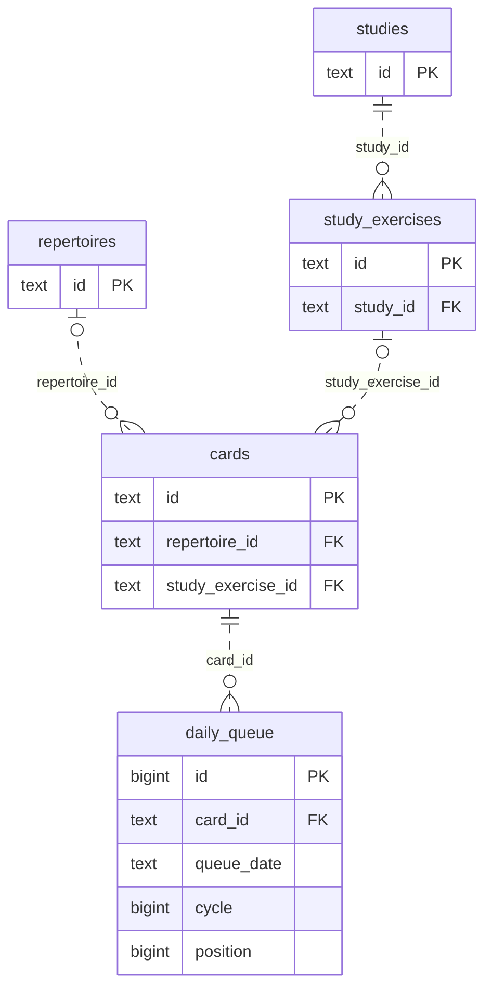

# Legacy queue-refresh storage

**Current unmerged source; live schema/deployment unverified. Partial extraction.** The [legacy queue-refresh composition](../../../../backend/app/services/postgres_queue_refresh.py) still owns eligibility decisions, queue planning, frozen-policy checks, admission/task authority, row budgets, clocks, foreground waits, callbacks and transaction lifecycles. Root operations borrow its existing connection and never commit independently.

## Admission writers

[admissions.py](admissions.py) contains the complete existing tactical, unseen-entry, due-card and Study-exercise writer queries. [eligibility.py](eligibility.py) contains the unchanged due/Study eligibility SQL, still exported under its original private names by the application while its bounded read projections await extraction.

| Operation group | Existing facts and effects | Canonical fields and constraints |
| --- | --- | --- |
| Tactical reservation/publication | Takes the same card-edit advisory lock, reads the daily limit and locked rotation/progress, checks pack activation, ensures the tactics repertoire/card, writes progress/introduction, appends only after the same queue-position lock/recheck, then advances rotation. Application code retains deletion, quota, rotation and already-admitted decisions; daily tactic counting/lock authority is reused. | [Tactic activation/progress/introduction/rotation fields](../../schema/practice-families-1/README.md), [card and queue fields](../../schema/study-queue-review-1/README.md), [repertoires](../../schema/authored-content-3/README.md), [settings](../../schema/runtime-metadata/README.md). |
| Unseen introduction reconciliation | Locks the exact eligible queue/card entry; keeps its introduction or removes the entry and resets the unreviewed card, after the same application-owned per-repertoire allowance and real-game-miss decision. Explicit admissions, retained cards and reviewed historical introductions retain their existing exclusions. | [Queue/card fields](../../schema/study-queue-review-1/README.md), [review evidence](../../schema/study-queue-review-2/README.md), [current repertoire dictionary](../../schema/authored-content-3/README.md). |
| Due and Study admission | Locks the selected card, then the queue-date position boundary; rechecks the existing due/Study predicate, quota and sibling burial; appends at the same computed position. Due predicates retain integrity, published-study, burial, archive, validation and existing-membership filters. | [Cards and queue](../../schema/study-queue-review-1/README.md), [studies/exercises/burials](../../schema/study-queue-review-2/README.md), [integrity-card blocks/membership](../../schema/authored-content-2/README.md). |

The linked schema READMEs remain canonical for **every stored field/type**, primary/composite key, enforced FK/delete action and unique tuple. This bounded ER view shows relevant enforced links only. `o|` on the repertoire/exercise side denotes nullable card references; the queue always references one card.

| Additional stored facts | Types and relationships |
| --- | --- |
| Queue admission facts | `daily_queue` uniquely keys `(queue_date text,card_id text,cycle bigint)` in addition to its `bigint id` PK. Position is `bigint`; bucket/admission kind are nullable `text`. Due/tactical append retains defaults; Study append records `card_bucket='study_exercise'`, `admission_kind='new'`. |
| Tactical progress | `tactic_progress(puzzle_id text PK)` stores non-null `deck_id text`, `admission_mode text`, and nullable `card_id text`, `admitted_at text`, `clean_pass_at text`. These card/pack/puzzle associations are logical: this table has **no enforced card or pack FK**. The existing writer preserves admitted time with `COALESCE`. |
| Tactical reservation and rotation | `tactic_introductions(puzzle_id text PK,pack_id text,introduction_date text)`, `tactic_pack_activation(pack_id text PK,active bigint)`, `tactic_rotation(id bigint PK,last_pack_id text)` retain their existing logical associations without FKs. The application still applies the source-neutral daily introduction counter. |
| Card introduction facts | Existing `state`, `introduced_at`, content/source FEN and move JSON fields are unchanged. Advisory keys and queue position locks are transaction-scoped controls, not stored relational constraints. |

The first slice delegates 29 direct database call sites in four admission functions to 24 fixed operations; five repeated calls share the same existing operation. All original query/parameter/result expressions, eligibility constants, deletion/lock order, quota decisions, replay behavior, queue-position allocation and writer transaction authority are preserved. No new generic execution interface or queue authority was added.

**Still unfinished in the original file:** 26 direct database sites, 24 bounded SQL-read sites, opening SQL construction/constants and existing reader callback bridges. The source remains pending in the [extraction inventory](../../../INVENTORY.md). This directory does not yet mean that the complete queue-refresh implementation has been centralized.

Focused evidence covers Study quota/burial/replay and post-lock rechecks, due-card eligibility/order, deleted tactical publication, saved-attempt recovery, plus a task-owned SQLite tactical reservation/replay/rotation/quota case and an admission-only SQL boundary guard. One selected existing unseen-reconciliation parity test fails in its reference fixture because `frozen_opening_activation` is absent, **before any extracted writer runs**; executing the original pre-extraction module in memory reproduces the same failure. That fixture is unchanged. Source comparison verifies all 29 moved operations and restored application functions. No native PostgreSQL, live storage, full-system, resource-isolation or deployment check ran; existing legacy component coupling remains unchanged.
