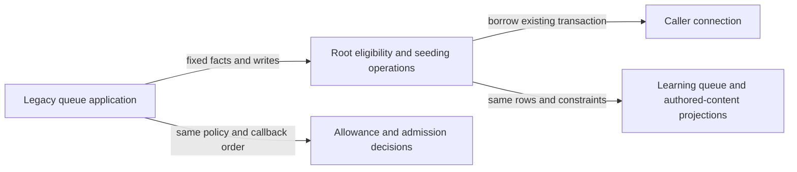

# Legacy queue application storage

**Current source; live schema and deployment unverified.** These fixed operations
borrow the existing Learning/queue caller connection. They never open, commit,
roll back or close a transaction, and add no queue, task or settlement authority.
The legacy [application composition](../../../../../backend/app/services/queue_application.py)
keeps phase order, bounded page/selection decisions, daily allowance arithmetic,
chess validation, response construction and existing feedback callbacks.

[eligibility.py](eligibility.py) owns the three original opening-unlock SQL
constants, dialect selection, bounded candidate reads and selected-card update,
and the unchanged opening/defense block, due/Study restoration and introduction
reset operations. The native page retains one captured eligibility projection
between its read and selected-card write. Original private names remain
compatibility exports in the application; callers retain the same boundaries.

[seeding.py](seeding.py) owns the existing allowance/position/count facts, due
and published-Study candidate queries, due/Study append operations and active-miss
projection read. The application still chooses the allowance, applies remaining
quota, iterates and promotes/clears miss priorities in the same order. Legacy
feedback coupling is preserved, not claimed as newly isolated; no optional
producer dependency or cross-owner permission was added.

| Stored facts/effects | Source fields and relationships |
| --- | --- |
| Daily queue | `daily_queue.id bigint PK`; `(queue_date text,card_id text,cycle bigint)` unique tuple; non-null `position bigint`, `status text`; nullable `card_bucket text`, `admission_kind text`, `admission_repertoire_id text`. `card_id` has an enforced card FK. Date, bucket and admitting-repertoire associations have no added FK. [All queue fields/types and constraints](../../../schema/study-queue-review-1/README.md). |
| Cards and review evidence | Existing card `id text PK`, nullable repertoire/exercise references, state/content/archive/validation/due/introduction facts; review evidence determines reviewed/unseen status. [Card fields and enforced links](../../../schema/study-queue-review-1/README.md), [review/exercise/burial dictionary](../../../schema/study-queue-review-2/README.md). |
| Opening eligibility | Current published graph generation, parent practice evidence, repertoire membership and integrity-card blocks retain their exact SQL filters. Graph card/parent/publication-generation links are logical where no FK exists. [Graph keys/dictionary](../../../schema/opening-graph/README.md), [membership and integrity fields](../../../schema/authored-content-2/README.md). |
| Study and defense eligibility | Published authored exercise/study state and per-day sibling burial; approved, non-superseded defense validation evidence. No new constraint or access is granted. [Study fields](../../../schema/study-queue-review-2/README.md), [threat fields](../../../schema/practice-families-2/README.md). |
| Daily settings and legacy miss facts | Existing `settings.id bigint PK`, `new_cards_per_day bigint`, `study_new_per_day bigint`; settings singleton use is application convention. Existing miss reason and logical queue-priority associations remain unchanged. [Settings](../../../schema/runtime-metadata/README.md), [feedback projections](../../../schema/game-projections-2/README.md). |

The linked schema READMEs are canonical for every field, primary/composite key,
enforced FK, cardinality and delete action. This extraction changes no DDL,
owner, storage format, policy, grants or persisted values.

This first slice moves **21 direct calls plus the existing sparse-selector call**.
The other 18 direct calls in queue application and the separate admission adapter
remain pending; neither is an accepted permanent exception. Future simplification
could consolidate the two legacy/native queue paths after separate behavioral
review, but this move deliberately retains their current differences.
