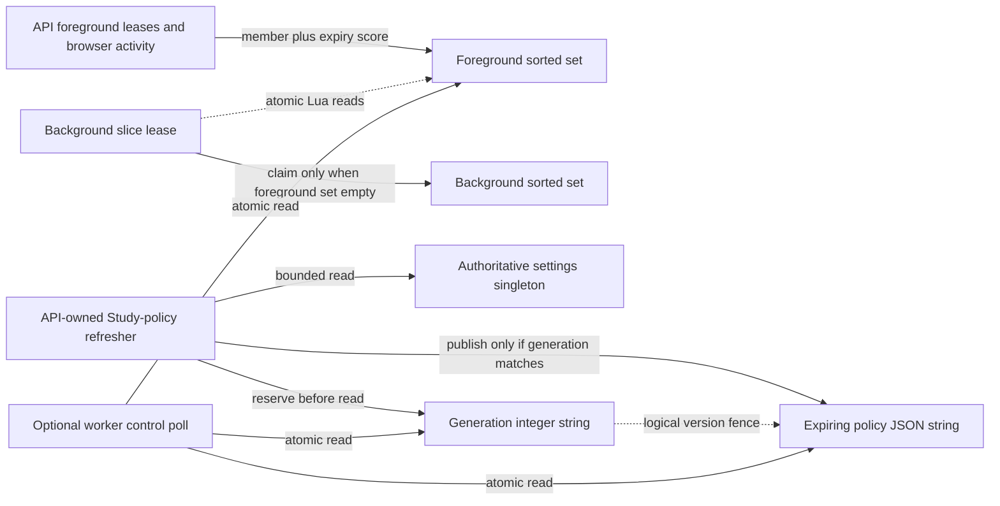

# Legacy Redis admission and Study-policy control storage

**Current unmerged source; live Redis/PostgreSQL state and deployment unverified.** These existing factories, Lua scripts, pipeline operations and one settings query moved from two legacy composition modules. No key names, script bytes, data format, command order, TTLs, socket deadlines or policy decisions change. Redis is storage; these entries are not relational tables and have no primary/foreign-key constraints.

`N` below is the existing `TEMPO_ADMISSION_NAMESPACE` setting, default `tempo:admission`. The application compatibility exports remain mutable for private-owner fixtures. Each operation receives the existing caller-selected client and keys; a slow private refresh retains its captured policy/generation keys and cannot publish after its generation is deleted.

| Redis key | Value layout and field types | Expiry and ownership |
| --- | --- | --- |
| `N:foreground` | Sorted set. Member: lease UUID hex `string`, or `browser-activity:{session_id}` `string`. Score: expiration Unix milliseconds `number`. Foreground registration removes expired members and keeps `max(existing_score, now_ms + lease_ms)` so later pulses never shorten another session's activity. | API HTTP leases use `30000` ms and renew every `10000` ms; browser duration remains the caller's bounded lease value. The script sets key expiry to `max(1, latest_score - now_ms + 1000)` ms. Foreground cleanup removes only its token. Presence/policy reads prune expired scores before counting. |
| `N:background` | Sorted set. Member: background-slice UUID hex `string`; score: expiration Unix milliseconds `number`. The atomic claim script prunes both lease sets, rejects a claim when foreground members remain, then adds this token. | Existing lease `5000` ms; key `EXPIRE` is `ceil(lease_ms/1000)+1`, currently `6` seconds. The background slice removes only its token on exit. Failure/denial retains durable intent through existing application handling. |
| `N:study-policy:generation` | Redis string containing a monotonically incremented integer. Invalidating refresh uses `INCR`; periodic refresh reads the existing generation or initializes it with the existing atomic Lua expression. | No TTL is set by these operations. The API-owned refresher reserves the generation **before** the bounded settings read. Private-owner cleanup can delete its own key, fencing a late result. |
| `N:study-policy` | Redis string containing JSON: `generation: integer`, `study_only_mode: boolean`, `expires_at_ms: integer` (Unix milliseconds). The generation must equal the generation-key value for publication and consumption to be accepted. | Redis `EX 15` seconds; the application also checks `expires_at_ms`. An API-owned publisher refreshes every `5` seconds. Missing, refreshing, stale, malformed or unavailable policy remains conservative application evidence that denies optional work. |

These are logical relationships: the namespace groups the control keys, the generation fences the policy payload, and the presence set reports foreground activity. They are enforced by the existing Lua/application checks, with no relational foreign keys. The PostgreSQL/SQLite `settings(id=1).study_only_mode` field remains authoritative; [stored fields and singleton key](../../schema/runtime-metadata/README.md). Workers read the Redis snapshot through the existing application API; this move adds no Study-to-Games dependency or new table permissions.

| Source | Responsibility retained outside database | Storage now here |
| --- | --- | --- |
| [redis_admission_gate.py](../../../../backend/app/services/redis_admission_gate.py) | UUID/session identity, time sampling, renewal interval/thread/task ownership, cancellation, timing-stage measurement, denial and error translation/logging. Async client construction and time arguments are still evaluated on the event-loop thread before `asyncio.to_thread`; Redis execution runs in its worker. | [admission.py](admission.py): unchanged cached one-second connect/read client, keys/scripts, atomic foreground/background lease operations and presence pipeline. Factory caching/`__wrapped__` and constants remain compatibility exports at the original module. |
| [study_priority.py](../../../../backend/app/services/study_priority.py) | Captured key identity, generation invalidation choice, background read scope, 100ms pool admission bound, policy/clock/JSON validation, private local-cache fallback, exception handling and publisher lifecycle. | [policy.py](policy.py): unchanged cached 50ms connect/read client with zero retries, generation/publish/read Lua operations and the complete Study-only settings query on its borrowed connection. Factory/scripts/keys remain compatibility exports. |

No live store was queried and no migrations run. Existing legacy assembly/resource coupling remains explicit; these file moves do not establish deployment isolation. [The extraction inventory](../../../INVENTORY.md) tracks the remaining mixed storage work. Real Redis storage also remains in `background_wakes.py` (wake ownership/queue metadata) and `background_runtime.py` (worker diagnostic snapshots); those files are a separate extraction slice, not permanent exceptions.

Focused fake-client/private-owner checks cover generation-before-read, expiry/conservative evidence, delayed private publication fencing, session lease identity, cached factory deadlines, synchronous admission and async client/clock/thread order. One selected pre-existing cutover test, `test_postgres_browser_activity_extends_cross_process_foreground_admission`, still fails because its eval-only fake lacks the existing async cleanup's `zrem`; the unchanged pre-extraction source reproduces that failure. No test was skipped or weakened. Native Redis/Lua/PostgreSQL execution, actual outage timing and full-system behavior remain unverified.
