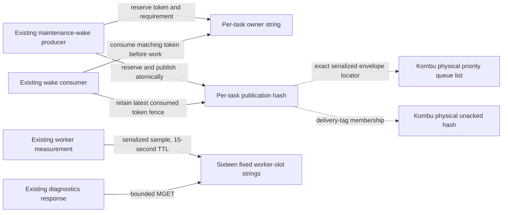

# Legacy maintenance-wake and worker-runtime Redis storage

**Current unmerged source; live Redis/broker state and deployment unverified.** Existing storage mechanics moved from [background_wakes.py](../../../../../backend/app/services/background_wakes.py) and [background_runtime.py](../../../../../backend/app/services/background_runtime.py). Application composition retains Celery/Kombu routing, connection/ack scope, serialization, lifecycle, tokens, retry/error choices, slot hashing and clock/timing decisions. No Lua bytes, data format, key names, command/parameter order, TTLs or cached-factory deadlines change.

All relationships here are logical key/token/message checks performed by existing Lua or application code. Redis has no relational primary/foreign keys. Application-owned durable work remains outside these wake envelopes; this move does not change its database or retry authority.

## Maintenance wakes

[wakes.py](wakes.py) owns the unchanged four scripts, cached Redis factory and fixed consume/publish/reserve/abort operations. The original application module re-exports `client`, `_KEY_PREFIX` and script constants. Its `ownership_keys(task_name)` wrapper passes the current mutable `_KEY_PREFIX` to storage so private-owner overrides still apply. The factory remains cached for four broker URLs, with decoded responses and one-second connect/read timeouts.

Only the existing four payload-free maintenance task names coalesce: `poll_background_tasks`, `recover_operations`, `recover_active_coverage` and `ensure_daily_queue`, each prefixed with `app.tasks.`. Canvas/payload/task-header decisions remain in application composition.

| Key/data location | Stored data and types | Expiry and owner |
| --- | --- | --- |
| `{_KEY_PREFIX}{task_name}`, default prefix `tempo:wake:` | Redis string: current ownership token (`task_id` or UUID hex, `string`). | Reserve uses `PX 5000` ms as a producer-crash lease. Successful publication uses `SET` without expiry, making queued ownership persistent. Matching consumption deletes it; abort deletes only a still-reserved matching token. The producer/consumer uses the existing atomic scripts. |
| `{ownership_key}:publication` | Redis hash; fields below describe one latest per-task record, rather than one record per delivery. | No TTL is set by these operations. Reservation replaces the hash; publication/abort update its phase. Consumption retains only `token` and `phase=consumed`, fencing a late publisher even after owner deletion. |
| Physical Kombu priority queue key | Redis list of the existing serialized message envelopes (`string` values). Existing channel configuration supplies `global_keyprefix + _q_for_pri(queue, priority)`. | Successful publication atomically uses `LPUSH` or `RPUSH` with persistent ownership. Normal routing, pop/redelivery and acknowledgement lifecycle remain Kombu/application composition. These helpers add no queue TTL. |
| Physical Kombu unacked key | Redis hash owned by Kombu. Publication metadata records its key and delivery tag; reserve checks `HEXISTS(unacked_key, tag)`. | This code reads membership to preserve an authoritative unacked wake; it does not create or expire unacked entries. Existing Kombu acknowledgement/redelivery owns those records. |

| Publication hash field | Redis value type | Stored meaning |
| --- | --- | --- |
| `token` | `string` | Latest reserved/published/aborted/consumed ownership identity. |
| `phase` | `string` | `reserved`, `published`, `aborted` or `consumed`. |
| `queue_refresh_wake` | `string`, `0` or `1` | Stronger queue-refresh requirement joined without downgrade while pending; carried through reserve/crash/abort recovery and returned atomically on consumption. Absent in the reduced consumed record. |
| `queue` | `string`, present after publication | Exact physical queue key. |
| `message` | `string`, present after publication | Exact existing `kombu.utils.json.dumps(message)` envelope, serialized by application composition at its original call point. |
| `tag` | `string`, present after publication | Existing envelope delivery tag used for unacked membership. |
| `unacked` | `string`, present after publication | Exact physical unacked hash key. |

Existing reserve logic checks the tracked queue message/unacked tag before reusing ownership or recovering a stranded wake. Existing token/phase checks prevent an obsolete publisher or abort from changing a successor. Consumption runs before work; a Redis failure still causes the existing consumer retry. No broker behavior is redesigned here.

## Worker runtime diagnostics

[runtime.py](runtime.py) owns the unchanged cached `_diagnostic_client` and fixed `SET`/`MGET` operations. The original module re-exports the same factory, including caching and `__wrapped__`; it retains the slot hash and sample model. Its five-millisecond connect/read deadlines and zero-retry policy remain independent of admission-client deadlines.

| Redis key | Value layout | Expiry and owner |
| --- | --- | --- |
| `tempo:diagnostics:worker:{slot}`, `slot` integer `0..15` | Redis string containing the application-serialized `WorkerStage` JSON below. The existing slot is `blake2s(hostname:pid, digest_size=2) mod 16`. | `SET ... EX 15` seconds. Worker measurements publish their latest stage, normally at most every five seconds unless forced by existing lifecycle transitions. Fixed slots can collide; this remains representative latest-sample telemetry. Readers use one bounded `MGET` of slots `0..15`. |

| WorkerStage JSON field | Type | Meaning |
| --- | --- | --- |
| `kind` | supported `WorkKind` string | Existing fixed work-kind label, with unknown measurement kinds mapped to `other`. |
| `stage` | enum string | `idle`, `dispatch`, `foreground_admission`, `database`, `execution` or `unknown`. |
| `observed_at` | ISO timestamp string | Sample observation time. |
| `process_started_at` | ISO timestamp string | Existing per-process startup time. |
| `admission_wait_seconds` | nonnegative finite float | Measured admission waiting. |
| `handler_elapsed_seconds` | nonnegative finite float | Total elapsed handler duration. |
| `execution_seconds` | nonnegative finite float | Elapsed duration less admission wait. |
| `dispatch_wait_seconds` | nonnegative finite float or null | Existing broker submission-to-handler delay, when known. |

The [application models and timing code](../../../../../backend/app/services/background_runtime.py) remain authoritative for these values and validation. Readers retain only valid known-kind samples with `0 <= age < 15` seconds; malformed/unavailable telemetry still returns unavailable diagnostics without changing admission or execution. Publication remains suppressed while local/shared database reservations are held, and diagnostic I/O remains excluded from admission-wait timing.

Focused proof uses only fakes and task-owned SQLite: the full fake wake suite, reservation/timing cases, a storage boundary guard and runtime client/slot/serialization/read/clock ordering checks. Script bytes, decorated factories, error handlers, sample models, slot hash and timing code were compared with the pre-extraction source. Native Lua/Redis/Kombu execution, network outage deadlines and deployment/resource isolation remain unverified. [Admission/policy storage](../README.md) and [unfinished extraction inventory](../../../../INVENTORY.md) remain separate documented scopes.
