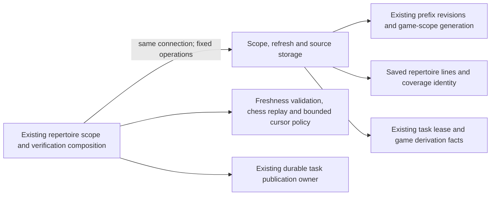

# Legacy repertoire scope and source storage

**Current source in this extraction; live schema and deployment unverified.** These are existing repertoire-scope SQL predicates/facts, refresh queries and source digest/page operations. Application selection, chess replay, freshness validation, time/budget policy and task composition remain outside `database/`. Every operation retains its original caller connection and transaction.

| Database module | Stored facts / operations | Application owner |
| --- | --- | --- |
| [freshness.py](freshness.py) | Existing coverage/current-attempt/opportunity SQL predicates, latest current coverage ID and optionally locked game-scope generation. | [canonical_scope_freshness.py](../../../../backend/app/services/canonical_scope_freshness.py) retains prefix identity and Python coverage/opportunity freshness validation. Moved functions remain import/re-export aliases there. |
| [game_refresh.py](game_refresh.py) | Existing driver capability facts, local leased-task check, next imported-game projection and derivation enqueue. Reuses the unchanged [Games derivation-version projection](../games/coordinator/storage.py). | [repertoire_game_refresh.py](../../../../backend/app/services/repertoire_game_refresh.py) retains mutation-generation comparison, foreground waits, lease/task selection, timestamp, durable task publication and sweep cursor decisions. |
| [move_verification.py](move_verification.py) | Existing SQLite source aggregate, native PostgreSQL source token and bounded saved-line projection. | [repertoire_move_verification.py](../../../../backend/app/services/repertoire_move_verification.py) retains legal requested move/source validation, chess replay, deadline, source cursor, result/error handling and final source recheck. The digest class/token function remain available through their original aliases. |

Canonical source schema dictionaries and ER charts describe actual stored fields/types, primary/composite keys and enforced relationships:

- [Repertoire fields](../../schema/authored-content-3/README.md) and [saved-line fields](../../schema/authored-content-2/README.md): canonical-prefix/source revisions, preview reference and move JSON; saved line ID, repertoire, trained color, start FEN and moves JSON. Source verification reads these existing fields and writes no source data.
- [Coverage/opportunity fields](../../schema/discovery-priority/README.md): saved coverage settings JSON/current-attempt metadata and opportunity prefix/source/global-generation fields. JSON identity and generation comparisons are logical freshness fences, not additional enforced FKs.
- [Game-scope generation](../../schema/game-projections-3/README.md), [imported games](../../schema/authored-content-1/README.md), [derivation jobs](../../schema/game-projections-1/README.md) and [durable task lease metadata](../../schema/runtime-metadata/README.md): singleton generation, ordered game ID cursor, queued derivation/version state and task generation/lease/state facts.

The coverage SQL builders retain their exact SQLite/compatibility/native JSON expressions and canonical-prefix restrictions. Latest-attempt selection retains its original current-scope and creation/ID order. Generation reads retain the original optional native `FOR UPDATE`; application code still decides when to lock and how to validate identity. No table, field, key, FK, migration, view, stored JSON shape or SQL expression changes.

Source tokens retain their original formats and dialect behavior: SQLite registers the existing SHA-256 aggregate over ordered source fields; PostgreSQL uses the existing native MD5/JSON aggregate. No digest algorithm, cross-dialect equivalence, replay limit or token protocol is invented. The application still closes reads before replay, chooses the page-size-plus-one bound, checks its monotonic deadline and rechecks the token before returning a result.

The refresh worker still uses the mutation's borrowed transaction, original foreground/lease checks, one-game sweep cursor and task generation fences. The existing `read_prefix` implementation and durable task writers retain their original owners/seams. Existing legacy cross-feature Games/coverage/opportunity coupling is preserved, not new table permission, clean domain isolation or proof of Games/Study shutdown/resource independence. Study gains no Games dependency; no generic execution port or new framework is introduced.

Fifteen focused fake/task-temporary SQLite cases pass: saved-source verification, local refresh replay, PostgreSQL-shaped refresh admission/replay, compatibility translation, mutation rollback/fencing and stale-coverage behavior. Exact source comparison preserves moved definitions and all retained application logic/call points. Native PostgreSQL execution/collation/locking/rollback, installed-package discovery, live schema and deployment remain unverified.
