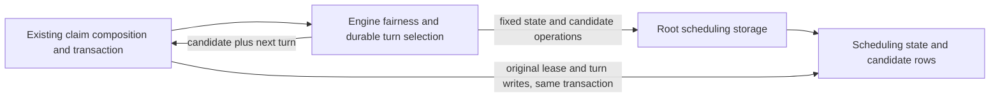

# Legacy scheduling storage

**Current unmerged source; live schema/deployment unverified.** [engine.py](engine.py) and [durable.py](durable.py) contain the existing parameter-bound queries, SQL fragments, dialect selection and translation/warming from the [engine](../../../../backend/app/services/engine_scheduling.py) and [durable](../../../../backend/app/services/durable_scheduling.py) scheduling compositions. They borrow the existing connection; no helper opens, commits or rolls back a transaction.

| Location | Actual storage / relationship | Application responsibility retained outside database |
| --- | --- | --- |
| `public.engine_scheduling_state` | `id bigint` primary key and `automated_streak bigint`, both non-null. Singleton `id=1`; existing bound/cap and locked state/exists reads remain unchanged. No FK. | Missing-state HTTP outcome, busy-state yield, ordinary-turn threshold and interactive-demand precedence. |
| `public.background_scheduling_turns` | `lane text` primary key, `next_turn bigint`, `promoted_since_turn bigint`, `control_streak bigint`; all non-null. These operations use lane `durable`. No FK. | Pipeline classes, class order, unknown-kind fallback, finite control/promoted preference and chosen next-turn tuple. |
| Candidate reads | Existing `background_tasks`, `background_activity`, `settings`, threat/candidate/recommendation and game projections, including original native row-lock clauses and SQLite placeholder handling. | Allowed classes, application call/clock order and accepted-lease authority. No second writer or independent commit. |

The complete [runtime state dictionary and ER chart](../../schema/runtime-metadata/README.md), [game dictionaries](../../schema/README.md) and [canonical defensive predicates](../defensive_analysis.py) describe actual source fields/keys/constraints. Candidate-to-state/grouping links in this flow are logical query relationships, not additional foreign keys. No schema, field, key, FK, migration, task format or lease changes.

The old engine module re-exports its existing SQL constants/SQL-only helpers for remaining callers; each implementation resides only here. The durable compatibility builder forwards its existing defensive task kinds into the unchanged root predicate. SQL warming invokes the existing class selector after the same translator import, preserving preparation order before the fail-fast database budget. No new generic execution API is introduced; the pre-existing engine executor is relocated intact.

One-time comparison restores the specific application/query ASTs and compares 186 original/current fake paths (422 query executions), including native/SQLite, busy/missing state, control/promoted/class selection, empty/new-kind fallback and warm selection/translation order. Thirty-four selected existing fairness, scheduling-turn and fake-native claim cases pass, including rollback/restart/stale-receipt boundaries. No engine, native PostgreSQL, broker or live store ran. Existing legacy cross-feature reads/resource coupling is retained and disclosed; this does not establish strict domain or deployed Study/Games resource isolation. [Remaining extraction work](../../../INVENTORY.md).
