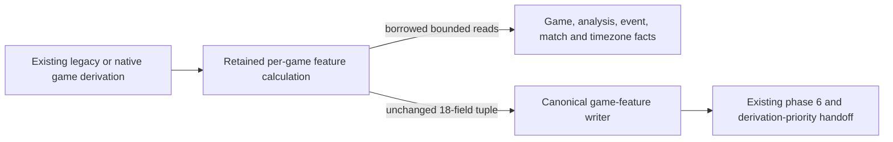

# Legacy game-feature storage

**Current source; deployment unverified.** Daily chess snapshots and insights
materialization is retired from this source branch. Its refresh route, command,
workers, activity controls and exclusive storage operations are removed. It
previously combined daily outcome/tactical totals after provider/analysis
readiness; the [last implementation](https://github.com/aaweaver-actuary/tempo/tree/1a0fd5c582c13f9d0de428d2f66d7e7cb358c4bf) remains in Git. No old job/history drain
or migration is required by the graph-preserving fresh start.

[storage.py](storage.py) retains only feature-input projections and re-exports
the single canonical [feature writer](../games/derivation/features.py). The
[application](../../../../backend/app/services/statistics.py) retains player
perspective, timezone/DST, chess phase and tactical feature calculations.

The [native publication](../../../../backend/app/services/postgres_game_features.py)
still checks its task lease, derivation version and phase before writing,
advancing phase 6 and enqueuing the existing handoff in one caller-owned
transaction. Legacy game import no longer invalidates retired daily results;
its game identity, insert/update/duplicate and analysis admission remain.

No schema, table, graph/repertoire source, stored field or transaction ownership
changes here. Old daily tables remain described by the [source schema](../../schema/study-queue-review-1/README.md);
this is source retirement, not live data deletion. The
[named regressions](../../../../tests/REGRESSIONS.md#daily-statistics-producer-retirement)
cover absent admission and retained game/feature behavior with task-owned SQLite
and fakes. Native PostgreSQL, browser and deployment qualification are separate.
