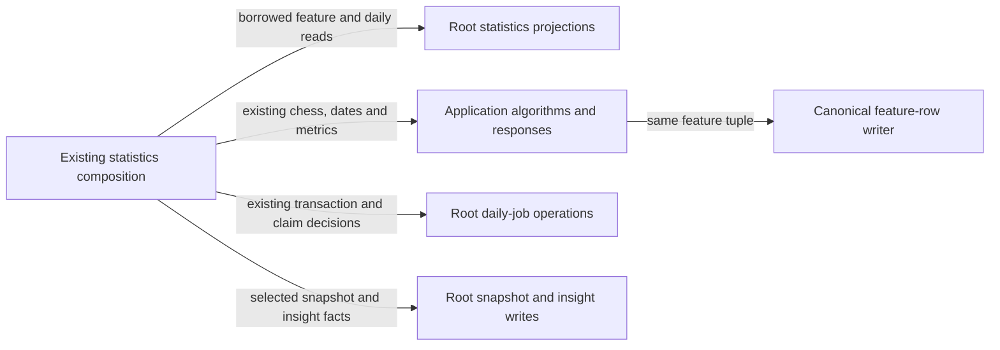

# Legacy chess feature and statistics storage

**Current source; live schema/deployment unverified.** [storage.py](storage.py) owns feature-input projections, snapshot/insight writes and daily-job operations used by [statistics.py](../../../../backend/app/services/statistics.py). The optional overview, breakdown and insights GET routes are retired; daily refresh commands and stored facts remain unchanged. All operations borrow existing connections and never open, commit or close one. The existing canonical [feature writer](../games/derivation/features.py) and [claim-control SQL](../controls/claim_sql.py) are reused; there is no second feature writer, claim authority or generic execution interface.

| Operation group | Stored facts and effects | Canonical fields, keys and relationships |
| --- | --- | --- |
| Feature inputs and canonical upsert | Reads one imported game, ordered move analysis, classifier-version-1 gameplay events, current primary repertoire match and settings timezone. Writes the unchanged 18-field feature tuple through the existing `write_feature_values` function. Chess phase scanning, player perspective, local day/hour/weekday, decision/loss/tactical calculations and feature timestamps remain outside database, after the existing read scope closes. `prepare_only` and foreground yielding remain application decisions. | [Imported-game fields](../../schema/authored-content-1/README.md), [move/match/event projections](../../schema/game-projections-2/README.md), [feature fields keyed by `game_id`](../../schema/game-projections-1/README.md), [settings](../../schema/runtime-metadata/README.md), [current-view DDL index](../../schema/README.md#read-projections). |
| Daily readiness and publications | Reads configured providers, sync watermarks, eligible day-game/feature presence and ready feature rows; writes the existing waiting/complete snapshot JSON and the selected outcome-trend/tactical-focus insights. Application code retains next-day calculation, waiting-sync precedence, exclusions/failed-analysis handling, metric math, insight thresholds/IDs, JSON serialization and all clock points inside the same existing transaction. | [Account and feature storage](../../schema/game-projections-1/README.md), [sync watermarks](../../schema/game-projections-2/README.md), [daily snapshot/insight fields and keys](../../schema/study-queue-review-1/README.md). Snapshot key: `local_day`; insight key: `id`. |
| Daily job lifecycle | Executes the existing enqueue upsert, `BEGIN IMMEDIATE`, paused/promoted/Study-mode-aware candidate query, conditional queued→running update and completion/failure writes. Application composition still samples the claim/status clock, handles the affected-row decision, runs the work and emits its original progress callbacks. Transaction ownership and failure handling remain unchanged. | [Daily job key/status/error fields](../../schema/study-queue-review-1/README.md), [activity controls/settings](../../schema/runtime-metadata/README.md). Control lookup is the existing logical `(source='statistics', work_id=local_day)` relationship, not a new FK. |

The linked schema READMEs remain canonical for every stored type, primary/composite key, enforced FK and explicitly logical relationship. Complete daily JSON stores day/status, game count, nullable score and tactical counts; waiting JSON stores missing provider watermarks and blocked game IDs. Insights store that same accepted snapshot as evidence. The existing source DDL distinguishes stored backing tables from current-publication views. No schema, stored representation, owner permissions or Study dependency changes are introduced, and no live schema/data was inspected.

The unused `overview_rows` projection and the separate HTTP `daily_insights` adapter were removed after their overview/insights GET routes retired; neither had a retained caller. The remaining statistics service and daily-job routes remain active. The dimension reader and its compatibility whitelist were removed with the retired breakdown endpoint. Remaining feature and daily-publication operations still borrow the caller’s connection and preserve their transaction, callback and clock ordering. This does not claim a new isolated runtime.

Retained tests cover timezone/DST, player-perspective evaluations, readiness and late-arrival invalidation, current-comparison filtering, pause/promotion/Study-mode job selection and the local SQL boundary. Tests solely for the retired overview/breakdown responses were removed. The earlier overview/breakdown route-retirement batch had static AST, caller and route-contract checks; its focused Python suite was unavailable in that historical cloud checkout. The later two-unused-read cleanup passed both existing cases in `backend/tests/test_legacy_statistics_database_split.py` using a disposable Python 3.13 environment. An AST comparison confirms every retained storage definition is unchanged, and the active service, command, worker, feature-writer and connection sources remain byte-identical to main `782bf537`. These two focused SQLite/source cases are not native PostgreSQL qualification. PostgreSQL execution/locking, deployment/resource isolation and full-system behavior remain unverified. The [unfinished extraction inventory](../../../INVENTORY.md) tracks the remaining mixed files.
