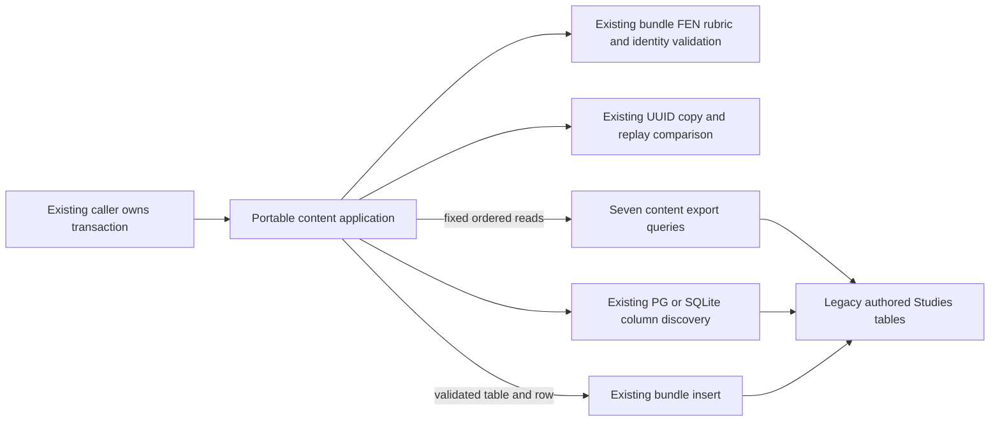

# Authored Studies portable storage

**Current source; live schema/deployment unverified.** Existing storage for the
seven-table `tempo-study` content format moved from
[study_portable.py](../../../../../backend/app/services/study_portable.py) to
[storage.py](storage.py). Authored/imported Studies are distinct from daily
Study practice. This move changes no schema, field, bundle, grading rule,
personal review history or transaction ownership.

| Storage operation | Original responsibility retained |
| --- | --- |
| `study_header` | Study row or missing-header fact; application still raises the original error before dependent reads. |
| `chapter_rows`, `source_rows`, `position_rows`, `exercise_rows`, `revision_rows`, `link_rows` | Complete parameter-bound export queries in their original order. Cursors are returned without eager materialization; the existing application comprehensions still turn each row into a dictionary. |
| `table_columns` | Unchanged `PostgresConnection` type branch, PostgreSQL `information_schema` query or SQLite `PRAGMA`, and discovered column-name set. Application still compares incoming row keys and raises the original error before copying IDs/writing. |
| `study_exists` | Original identity-presence read before replay comparison. |
| `insert_bundle_row` | Original existing seven-table import statement, row key/placeholder order and parameter tuple. The application passes only names from its unchanged, validated `TABLES` format definition. No raw SQL execution interface is exposed. |

The application retains the versioned payload and table set, size limits,
uniqueness/references, parent/FEN/move/rubric/revision/link checks, UUID remapping
(including source groups), non-mutating row copies, order-insensitive replay
comparison, conflict errors and result envelopes. `validate_bundle` is unchanged.
The existing `PostgresConnection` compatibility alias remains the same class.
Storage imports no application implementation and creates no connection,
commit, rollback or second transaction authority.

## Source data map

Export includes complete existing rows. Follow these canonical dictionaries for
all stored fields/types, nullability, actual constraints and rendered ER views:

| Table | Stored content and key relationships |
| --- | --- |
| [`studies`](../../../schema/study-queue-review-2/README.md#publicstudies) | `id text` PK; title/description/source JSON, archive and timestamps. |
| [`study_chapters`](../../../schema/study-queue-review-2/README.md#publicstudy_chapters) | `id text` PK, `study_id text` FK; chapter text and `position bigint` ordering. |
| [`study_sources`](../../../schema/study-queue-review-3/README.md#publicstudy_sources) | `id text` PK, `chapter_id text` FK; source-group/version/record identity, raw PGN, hash, filename, headers/diagnostics and validity. `source_group_id` is an existing grouping value, not an inferred FK. |
| [`study_positions`](../../../schema/study-queue-review-2/README.md#publicstudy_positions) | `id text` PK, source and nullable parent FKs; FEN/move/history/annotations/node path. Application preserves same-tree parent and legal-move validation. |
| [`study_exercises`](../../../schema/study-queue-review-2/README.md#publicstudy_exercises) | `id text` PK, study/position FKs; current revision, status, sibling group, source JSON and points. The current-revision association is validated by the application; no composite FK is invented here. |
| [`study_exercise_revisions`](../../../schema/study-queue-review-2/README.md#publicstudy_exercise_revisions) | Composite PK (`exercise_id text`, `revision bigint`), exercise FK; specification JSON/hash and creation time. |
| [`study_links`](../../../schema/study-queue-review-2/README.md#publicstudy_links) | `id text` PK, study/source-position FKs and nullable target-position/exercise FKs; relation text. The original application one-target rule remains unchanged. |

The content bundle still declares `excludes_review_history=True`; it does not
export/import personal review, attempt, queue or scheduling records. These are
the existing tables and format, not the planning-only canonical model. No live
schema or data was inspected and no migration/backfill ran.

## Focused relocation proof

[Six fake-only boundary cases](../../../../../backend/tests/test_study_portable_storage_boundary.py)
cover missing export headers, column validation before UUIDs/writes, the real
driver-type branch with fake connections, copy/remapping and ordered borrowed
inserts, replay despite row-order changes, and content conflicts without writes.
The existing [contract/corpus checks](../../../../../backend/tests/test_study_contract_identity.py)
still validate the checked-in authored corpus through the same Learning-owned
grader model identity. A one-time source comparison restores all three original
function bodies/signatures and verifies all 11 SQL strings, query/cursor order
and parameters unchanged. No native, SQLite integration, startup or full-system
check ran; fake connections do not qualify actual database constraints/rollback.
