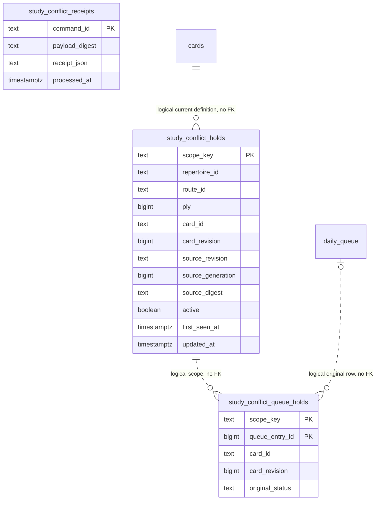

# Scoped conflict storage proposal

Owner: Study. [Application and transaction diagram](../../../../backend/app/study/conflicts/README.md).
[Adapter](conflicts.py) borrows the caller's writer; it opens/commits/closes no
connection and calls no optional producer. Only this adapter mutates these
proposed tables and their associated queue status. Source policy stays Repertoire.

The [private DDL](../../ddl/study_conflicts.sql) is unregistered and has not been
applied to a live database. `study_conflict_holds.scope_key` is a stable hash of
repertoire/route/zero-based ply/current physical presentation/revision. Source
tokens do not create a second identity. Current assessments update the retained
source fence/active flag while preserving first observation time. Exact command
payload digest and immutable receipt are separate. Queue-hold rows retain the
original `queued` state so restoration cannot claim a preexisting block.

There are no cascading foreign keys: queue rebuild/deletion, source changes and
future presentation rebinding must not erase suspension/receipt provenance.
Relationships below are logical references, revalidated before use. No relation
to reviews or FSRS is created; those rows are never mutated by this operation.

`study_conflict_active_card` partially indexes `(repertoire_id,card_id,card_revision)`
for active admission/recovery guards. `study_conflict_active_scope` indexes active
cursor sweeps; `study_conflict_pending_queue` indexes pending card/day queue reads.
Reads and reconciliation pages are bounded;
maintenance applies one target per borrowed transaction and yields on busy locks.
Integrators must allocate/register the additive DDL and adopt the named current
serving hooks before claiming product enforcement or installed-schema readiness.
