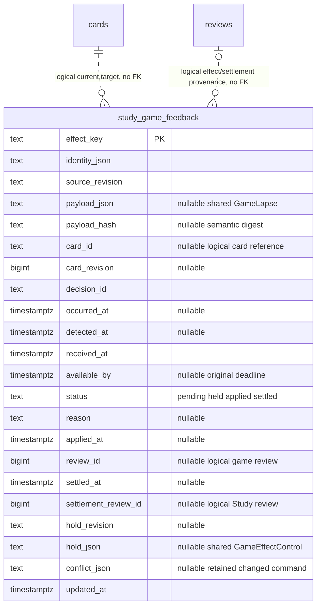

# Study game-feedback storage

The Study-owned [recombination adapter](recombination.py) now supplies bounded
`CurrentStudyRecombination` source/attempt fencing, fresh generated card scheduling,
normal queue projection and confirmed splits. Its canonical
[component, sequence and six-table ER views](../../../../backend/app/study/recombination/README.md)
describe source migration 053, explicit current decision/presentation mappings and
original history/provenance relationships. No live schema/deployment is asserted.

When the optional published [scoped conflict store](conflicts.py) is installed,
the retained serving/recovery boundary uses its original-attempt guard, while
queue seeding reapplies one provably scoped queued hold. Existing suspended rows
remain unchanged. Generated-presentation identity proof comes from the current
recombination mapping; conflict and restoration eligibility remain Repertoire's
injected policy. These hooks neither register C's DDL nor claim C browser proof.

`PostgresGameFeedbackStore.targeting` supplies the optional Study-owned
`GameFeedbackTargets` capability: applied obligations follow one exact current
decision target, and genuine whole-sequence reviews settle the original effect.
Original effect/card/lapse identity, deadline and occurrence/processing facts stay
immutable. Combined review invalidation reopens that same receipt; joining does
not apply another lapse. No producer is called to resolve or serve this state.

[`game_feedback_authority.py`](game_feedback_authority.py) supplies the concrete
`current_owner_game_feedback` factory and retained-owner `CurrentOwnerDecisions`
fencer. It requires the existing backend capture plus its public snapshot,
rechecks current stored rows/generations and existing completed scan facts in
the mutation transaction, and returns no authority on missing/busy/stale facts.
No new certificate, source migration, catalogue capture or Games call is added.

[`game_feedback.py`](game_feedback.py) implements the Study owner's semantic
storage port using its existing borrowed PostgreSQL connection. It opens no
connection and never commits, rolls back, deploys, or calls a producer.
[`051_study_game_feedback.sql`](../../ddl/migrations/051_study_game_feedback.sql)
is an additive source migration; no live-schema assertion is made.

Only this adapter writes `study_game_feedback`. Original identity/payload,
detection/occurrence/processing times and deadline are immutable after insertion.
Status, actual application review ID/time, control tombstone, conflict provenance,
and settlement review ID/time are retained separately. Text JSON columns contain
the shared validated DTOs. Primary key is the hash of the stable logical identity;
`identity_json` retains its lossless original. Source/control revisions are opaque
text in storage and positive integer values at the public boundary.

There are deliberately no foreign keys to cards/reviews/queue: deletion or future
presentation rebinding must not cascade away owed evidence. Card and review IDs
are logical Study-owned relationships, revalidated at use. Scheduling/history
tables and canonical queue remain existing owners; no second queue is created.
`study_game_feedback_owed(card_id,effect_key)` partially indexes pending/applied
work. No producer can write these rows through this interface.

The canonical [owner interface/transaction drawings](../../../../backend/app/study/README.md)
and its hook manifest describe the receiver, queue recovery and settlement.
Native fixture/cleanup instructions belong with
[`test_product_game_lapse_postgres.py`](../../../../backend/tests/test_product_game_lapse_postgres.py).
