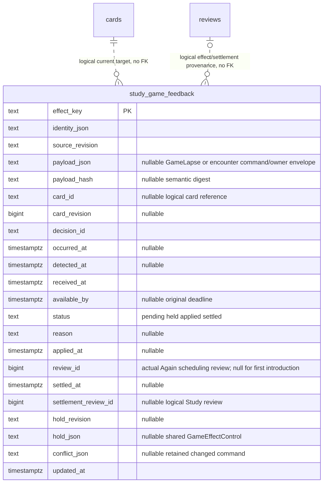

# Study game-feedback storage

The Study-owned [recombination adapter](recombination.py) now supplies bounded
`CurrentStudyRecombination` source/attempt fencing, fresh generated card scheduling,
normal queue projection and confirmed splits. Its canonical
[component, sequence and six-table ER views](../../../../backend/app/study/recombination/README.md)
describe source migration 053, explicit current decision/presentation mappings and
original history/provenance relationships. No live schema/deployment is asserted.

Current source/integrity fences and generated-presentation guards remain with
Study. The separate unmerged scoped-conflict extension is preserved on the
historical R11 stack, rather than imported as a prerequisite to this feature.

`PostgresGameFeedbackStore.targeting` supplies the optional Study-owned
`GameFeedbackTargets` capability: applied obligations follow one exact current
decision target, and genuine whole-sequence reviews settle the original effect.
Original effect/card/lapse identity, deadline and occurrence/processing facts stay
immutable. Combined review invalidation reopens that same receipt; joining does
not apply another lapse. No producer is called to resolve or serve this state.

[`game_feedback_authority.py`](game_feedback_authority.py) supplies the concrete
`current_owner_game_feedback` factory and retained-owner `CurrentOwnerDecisions`
fencer. It requires the existing backend capture plus its public snapshot,
rechecks current stored rows/generations and existing completed scan facts in
the mutation transaction, and returns no authority on missing/busy/stale facts.
No new certificate, source migration, catalogue capture or Games call is added.

Equivalent route aliases can bind one exact approved decision/physical target.
Only route ID/ply may differ: every other shared mapping fact, including physical
and repertoire revision, availability and introduction/source chronology, must
agree. The complete mapping route set must equal the already fenced current
card's graph route set. Encounter delivery retains and proves its supplied
original route member; the lapse path selects a deterministic existing member
only after the same equivalence proof. The full snapshot, captured graphs and
source provenance remain intact. True conflicts, uncovered routes and changed
card/source facts grant no effect. The existing64-route/128-card/256-graph bounds,
transaction locks, completed integrity certificate and lapse chronology checks
remain unchanged.

[`game_feedback.py`](game_feedback.py) implements the Study owner's semantic
storage port using its existing borrowed PostgreSQL connection. It opens no
connection and never commits, rolls back, deploys, or calls a producer.
[`051_study_game_feedback.sql`](../../ddl/migrations/051_study_game_feedback.sql)
is an additive source migration; no live-schema assertion is made.

Only this adapter writes `study_game_feedback`. Original identity/payload,
detection/occurrence/processing times and deadline are immutable after insertion.
Status, actual application review ID/time, control tombstone, conflict provenance,
and settlement review ID/time are retained separately. Text JSON columns contain
the shared validated DTOs. Primary key is the hash of the stable logical identity;
`identity_json` retains its lossless original. Source/control revisions are opaque
text in storage and positive integer values at the public boundary.

The additive next-release encounter uses the same schema051 row. `payload_json`
is either the unchanged shared `GameLapse`, or an envelope with `kind=encounter`,
immutable shared `GameEncounter` in `command`, and small `owner` admission facts.
Old raw `GameLapse` JSON remains readable. A lapse needing owner facts uses an
equivalent `kind=lapse` envelope retaining its original command JSON bytes.
On conflict, SQL can update only the envelope's `owner` section; original command,
semantic hash, detection, target and logical identity remain unchanged. There is
no new effect table or DDL here. Qualified `introduced_again` records the actual
existing `game_lapse` scheduling review ID and application time. First introduction
has no scheduling review. Old priority `applied_at` alone proves neither Again
nor admission. The owner JSON keeps separate qualification, immutable accepted
disposition, current target, actual application/issuance/settlement progress and
bounded preparation retry time. Original occurrence/source facts stay unchanged.
For a generated current target, the existing owner section also retains the
prepared source-header binding and immutable result/receipt digest. The normal
review's one-effect settlement hook rechecks those bounded facts, current map,
card revision and membership; it does not replay a repertoire. Remaining
same-card obligations consume the retained actual completion one at a time in
the existing preparation path. Physical remaps append prior issuance fences and
preserve the original real scheduler receipt and first service.
New qualified effects leave `available_by` null because their service promise is
actual front/five-card issuance. Upgraded old effects preserve a real legacy
column as history; version 0.2.2 receipts do not present it as a new deadline.

`current_owner_encounter_feedback` adds qualified target validation. It permits only
the current introduction field to race delivery while preserving all existing
definition/source/membership fences. Its injected #495 introduction capability
retains the sole canonical writer and reads existing canonical introduction facts;
the targeted capability requires no D charge/rotation/ranking tables. The
retained source revision is converted only to that capability's explicit
`scope_source_revision + 1` mapping-version convention. Definition, physical
identity and route fields remain unchanged; that actual source revision is already
checked against current rows in the same transaction. The boundary is documented
by the [receiving owner](../../../../backend/app/study/README.md#next-release-encounter-importance-and-first-introduction).

Preparation that found no current lineage still needs an absence fence in the
borrowed writer. `fence_feedback_lineage_absence` takes the existing nonblocking
route lock and probes the indexed route/decision map and physical identity.
A newly installed map or unavailable generated identity holds the original key
for fresh preparation; unchanged legacy card/publication fields do not permit
an Again on a retired card. The route lock also protects the absent map key
from a concurrent join until commit. The native regression is
`test_prepared_original_refuses_new_lineage_then_fresh_current_target_settles`.

There are deliberately no foreign keys to cards/reviews/queue: deletion or future
presentation rebinding must not cascade away owed evidence. Card and review IDs
are logical Study-owned relationships, revalidated at use. Scheduling/history
tables and canonical queue remain existing owners; no second queue is created.
`study_game_feedback_owed(card_id,effect_key)` partially indexes pending/applied
work. No producer can write these rows through this interface.

`feedback_queue_priorities` uses single-step PostgreSQL JSON operators for its
current target, available admission and absent-progress checks. The bounded
reader passes these through the existing SQLite-to-PostgreSQL translator, which
drops later arguments from variadic JSON-path calls. Nested extraction preserves
the complete paths and the same SQL-NULL legacy-reset fallback as a borrowed
native connection. The regrouped obligation lookup already uses single-step
extraction; its complete repertoire paths share the focused translation regression.

`retains_encounter_introduction(database, card_id)` and the complete
`retained_encounter_introduction_query()` expose an existing same-revision material
admission fact to Study's legacy admission/rebuild adapter. They grant no new
introduction. Pending observations, missing/currently unintroduced cards and
changed revisions are excluded; a later source hold cannot refund historical
admission. The caller checks `installed()` for the PostgreSQL query projection.
Ordinary unseen-card reconciliation and stale-introduction resets consume this
fact while keeping their usual controls for unrelated cards. The receiving owner's
native normal-seeding regression covers both the admission day and the next day.
This source wiring does not claim product activation or a live schema change.

The canonical [owner interface/transaction drawings](../../../../backend/app/study/README.md)
and its hook manifest describe the receiver, queue recovery and settlement.
Native fixture/cleanup instructions belong with
[`test_product_game_lapse_postgres.py`](../../../../backend/tests/test_product_game_lapse_postgres.py).
