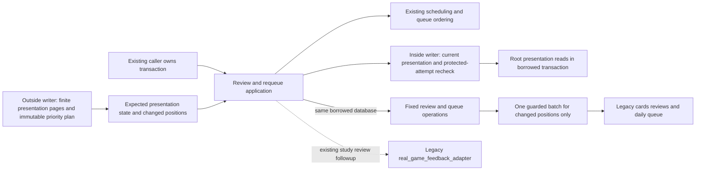

# Legacy Study review and requeue storage

**Current source; live schema/deployment unverified.** These are existing fixed
statements moved from [review_service.py](../../../../../backend/app/services/review_service.py).
Daily Study practice is distinct from authored/imported Studies. No schema,
grading, recall, scheduling, queue policy, receipt or transaction rule changed.

| [storage.py](storage.py) operation | Complete existing storage responsibility |
| --- | --- |
| `valid_defense_reviews` | Valid reviews in `reviewed_at,id` order for defense-rubric schedule reconstruction. |
| `reset_defense_schedule`, `save_defense_schedule` | Original defense-only card updates and JSON serialization. Application supplies scheduling results/state and the original empty-history date factory. |
| `queued_order_entries`, `queue_membership_receipt` | Original ordered queue rows and saved membership token. Application retains the late activation lookup and provenance decision between their existing call points. |
| `write_queue_order_receipt` | Original queue-day receipt UPSERT. Fingerprint/seed and UTC clock expression stay in the application; its clock factory is invoked at the original write-argument evaluation point. |
| `queued_entry`, `next_cycle`, `insert_entry` | Original queued-entry selection, next cycle and insert. The protected insert keeps its nested maximum-position read in the same parameter expression/order. |
| `set_priority`, `other_queued_entries`, `set_position` | Original priority write, lazy ordered cursor and individual position updates. The identical position UPDATE has one implementation serving both original application call sites. |
| `classify_entry` | Original card bucket and explicit/review/new admission update. |

Every operation borrows the caller's database. There is no connection creation,
commit, rollback, close, new writer or second transaction authority. The
application retains schedule replay/maturity decisions, receipt provenance and
fingerprints, seed/clock evaluation, protected ordering, list insertion,
per-position iteration and public signatures. It imports no SQL or generic
execution interface; storage imports no application implementation.

`apply_scheduling_review` is unchanged: existing scheduling application/store
composition, idempotent return, feedback clearing and legacy child unlock run
in their original order. Its study-review call to
`real_game_feedback_adapter.clear_satisfied_miss_priority` is **existing legacy
coupling**. This move adds no Games dependency and does not claim that legacy
Study is independent of that feedback path. The other Learning adapter and
queue implementation owners are untouched.

## Source data map

Canonical diagrams/dictionaries below describe all stored fields, nullability
and enforced relationships; these fixed operations change none of them.

| Stored source | Keys and fields used here |
| --- | --- |
| [Reviews](../../../schema/study-queue-review-2/README.md#publicreviews) | Existing review identity/card association, `rating`, `reviewed_at`, `invalidated_at`; only valid history is replayed. |
| [Cards](../../../schema/study-queue-review-1/README.md#publiccards) | `id text` PK; defense scheduling fields include due date/interval, FSRS JSON, first-correct/reinforcement/stability, state/mode/streak and recent-attempt JSON. `content_type` also supplies queue buckets. |
| [Daily queue](../../../schema/study-queue-review-1/README.md#publicdaily_queue) | `id bigint` PK, `card_id text` FK to cards; queue date/cycle/position, attempt state, gameplay priority reason, card bucket and admission kind retain their existing shapes. |
| [Queue-day receipt](../../../schema/study-queue-review-1/README.md#publicdaily_queue_days) | `queue_date text` PK, `seed bigint`, `membership_hash text`, `generated_at text`. Its date association with queue rows is logical, not an added FK. |

No live schema or data was inspected. Date/JSON values, filters, ordered/lazy
cursor consumption and parameter types remain the original implementation.

## Focused relocation proof

[Six fake-only cases](../../../../../backend/tests/test_review_service_storage_boundary.py)
cover empty/history schedule reconstruction, borrowed write/clock order,
new/existing requeue behavior, lazy cursor consumption, protected nested reads,
position updates and receipt preservation. The existing canonical-writer
consumer import guard remains selected. A one-time source proof restores all
six original public/private function bodies and signatures exactly, including
the unchanged scheduling wrapper. All 14 distinct SQL strings are unchanged;
physical literals reduce from 15 to 14 by sharing the identical position update.
Runtime invocation count/order is unchanged. No native, SQLite integration,
full-system or application startup check ran; these fakes do not establish
live lock, rollback, timing or resource-isolation guarantees.

## Short receiving transactions

Protected requeue reads [queue_presentation.py](../../../../../backend/app/services/queue_presentation.py)
directly, without importing the queue-seeding/task orchestration facade. The
[queue application](../../../../../backend/app/services/queue_application.py)
keeps its public compatibility entry. Review/presentation dependencies load when
the receiving store is constructed, before a retained-history writer opens; all
current eligibility, issuance, attempt and queue reads still run in that borrowed
writer. No prepared mutable snapshot, alternate writer, schema or timeout change
is introduced. The existing priority ordering protects exactly the same slots.

## Actual-scale protected promotion

[queue_priority_promotion.py](../../../../../backend/app/services/queue_priority_promotion.py)
prepares one immutable existing-target priority overlay before the command writer
opens, using finite16-row reads and the existing pure ordering policy. It carries
an expected presentation-state digest, target entry and changed-position tuples;
it grants no source, control, introduction or scheduling authority. Preparation
is bounded to4096queued rows and defers beyond that bound. An absent queued target
keeps canonical introduction's existing writer path.

`ensure_card_queued_after(..., prepared_priority=...)` rechecks the **complete current**
presentation state in the borrowed writer, including membership, card revision,
eligibility, teaching, issued/presented and attempt/result state. A stale plan
raises the existing background-admission deferral type, aborting the provisional
effect and sender cursor; the next supported retry prepares again. The original
card/day locks and protected-slot policy remain. First delivery's accepted target
priority is included before its new receipt exists; historical-priority cleanup
cannot erase that provisional owner intent.

Native presentation reads use constant-shape array bindings and immutable query
compilation outside the writer. `apply_priority_positions` writes only changed
positions in one native update, guards prior positions and current attempt
protection, and rejects any affected-row mismatch. SQLite retains its prior
per-position writes. There is no new schema, transaction, scheduler, timeout or
live setting change. History source/current mapping, chronology, full pause and
foreground/maintenance admission remain their current owners' responsibilities.

The permanent owning regression is
[test_scaled_game_priority_postgres.py](../../../../../backend/tests/test_scaled_game_priority_postgres.py):
805/1005queued rows,25protected attempts, nine real reviews, one priority effect
and replay, plus stale position/issuance/eligibility rollback of receipt and cursor.
The canonical writer/adapter cases remain in their existing files. This source
proof is distinct from installation/live acceptance and its separately recorded
constrained-worker check.
