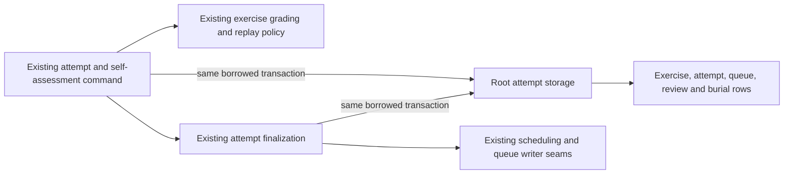

# Legacy authored-exercise attempt storage

**Current unmerged source; live schema/deployment unverified.** [storage.py](storage.py) holds the thirty existing query call sites from the [attempt commands](../../../../backend/app/study_attempt_commands.py) and [attempt finalizer](../../../../backend/app/services/study_attempts.py), sharing three identical reads. These are legacy authored/imported **Studies** exercise attempts and their existing daily **Study** practice/review composition; this move does not collapse those owners or move non-database domains.

| Stored location | Actual identity / relationship | Existing operations here |
| --- | --- | --- |
| `public.study_attempts` | `id text` PK; required `exercise_id text` FK; nullable `card_id text` and `queue_entry_id bigint` FKs. `revision` and `cycle` checks remain application guards, not invented composite FKs. | Same advisory identity lock, replay/locked reads, answer/assessment insert and finalized result JSON. |
| `public.study_exercise_revisions` | Composite PK (`exercise_id text`, `revision bigint`); `exercise_id` FK to exercise. | Exact specification read at current revision. |
| `public.study_sibling_burials` | Composite PK (`exercise_id text`, `study_day text`); exercise FK. `reason text` stores the unchanged answer-exposure reason. | Same insert per sibling with original per-call day sampling. |
| Exercise/position/card/review/queue rows | Existing owner facts and FKs shown in the canonical dictionaries below. | Locked and unlocked card/queue/exercise reads retain distinct original queries; queue-date locking stays at its existing caller point. Scalar latest-review reads retain their different MAX/COALESCE semantics. |

See the complete field/type/key/FK dictionary and bounded ER chart for [attempts and authored exercise storage](../../schema/study-queue-review-2/README.md), [card/queue storage](../../schema/study-queue-review-1/README.md) and [settings](../../schema/runtime-metadata/README.md). All source fields and relationships are unchanged; logical revision/cycle/ownership/replay predicates are not additional SQL constraints. No live schema or data was queried.

Payload/model validation, grading, guided-rating selection, HTTP errors, answer/receipt identity, JSON projection, clocks/dates, scheduling, requeue, sibling decisions and refresh callbacks remain in the original application compositions. Helpers never open, commit or roll back a connection. The sibling read executes at its original point and returns a root-owned row iterator, preserving lazy row consumption between burial writes without exposing a cursor or arbitrary-query API. Existing queue/scheduling coupling is preserved and disclosed; no Games dependency or independent-resource isolation is introduced or established.

Specific query expansion restores every retained non-import application AST node, including bound parameter, callback and clock expressions. All thirty original statement values match the twenty-seven root queries. Six selected existing cases cover practice/self-assessment replay, duplicate queue answers, automatic and guided completion, revision rejection and sibling burial with explicit practice. They use only task-owned SQLite/fake-native operations. Native PostgreSQL locks/advisory behavior, installed-wheel execution, live/deployed isolation and full-system behavior remain unverified. [Unfinished extraction inventory](../../../INVENTORY.md).
