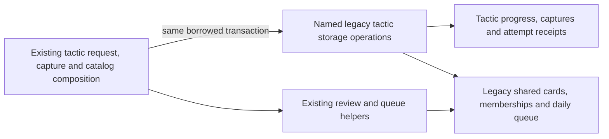

# Legacy tactic persistence

**Current source in this mechanical extraction; live schema/deployment unverified.** These are the existing complete statements moved from three legacy tactic files. Operations borrow the caller's existing connection/transaction, execute only their named statement and return fetched facts or the existing inserted-row boolean. They never open a connection, commit, choose grading/admission policy or return a driver cursor.

| Module | Existing persistence operations | Application owner retained outside this directory |
| --- | --- | --- |
| [attempts.py](attempts.py) | Puzzle advisory lock, attempt receipt/settings read, tactic repertoire/progress/card writes, card lock/schedule read, queued-card fact, admission/result receipt writes. | [tactic_commands.py](../../../../backend/app/tactic_commands.py) retains request/receipt handling, card identity, clocks, clean/correct grading, due/mode decisions, review-queue callback and queue-refresh handoff. |
| [captures.py](captures.py) | Capture advisory lock/receipt, repertoire/card/membership writes, driver-specific row/queue locks, reopening/guided queue update and source/result receipt. | [tactic_capture.py](../../../../backend/app/services/tactic_capture.py) retains legal-line validation, source trust/provenance, canonical request bytes, replay/content conflict HTTP errors, identity, clocks and review-queue reason/result decisions. |
| [catalog.py](catalog.py) | Active/progress/due facts, activation upsert, quota/rotation/introduction facts, packaged-card/progress/introduction/queue/cursor writes. Reuses the identical repertoire operation from `attempts.py`. | [tactical_catalog.py](../../../../backend/app/services/tactical_catalog.py) retains asset/version loading, membership/status aggregation, known-pack validation, daily allowance/rotation/selection, puzzle validation, deletion skip and queue-position decisions. |

The existing [daily tactic admission lock/count](../tactic_admission.py) and [queue position lock](../queue_position_lock.py) remain singular. Capture's SQLite/PostgreSQL capability checks now live with the driver-specific lock/read operations. SQL, parameter values/order, lock order, request/result JSON, UUID and clock points, callbacks and transaction authority are unchanged. Duplicate active-pack reads and the identical repertoire insert reuse a named operation; application invocation count/order stays the same. No generic SQL port, framework, schema/migration change, new runtime database or cross-owner permission is introduced.

The [practice-family diagrams/dictionary](../../schema/practice-families-1/README.md) remain canonical for actual stored fields/types, primary/composite keys and enforced/logical relationships:

| Stored tables | Existing facts |
| --- | --- |
| `tactic_captures` | Capture ID/card, source kind/reference/URL/note/time, canonical request JSON and result JSON. |
| `tactic_discovery_attempts` | Attempt/deck/puzzle identity, clean-solve flag and immutable replay result JSON. |
| `tactic_progress` | Puzzle/deck/card identity, first clean/admitted timestamps and admission mode. |
| `tactic_pack_activation`, `tactic_introductions`, `tactic_rotation` | Active pack flags, puzzle/pack/introduction date records and the singleton last-pack cursor. |

Shared legacy reads/writes are explicitly retained: [cards/daily queue](../../schema/study-queue-review-1/README.md) hold tactic executable FEN/moves, state/schedule/source and queue position/guided attempt state; [settings](../../schema/runtime-metadata/README.md) holds the existing light interval/daily quota; [repertoires](../../schema/authored-content-3/README.md) and [memberships](../../schema/authored-content-2/README.md) hold repertoire metadata/card links. These table accesses and the `review_service.ensure_card_queued_after` / queue-command refresh coupling existed before the move. They are legacy Study/review coupling, not new ownership permission or proof of optional-feature/Study isolation. No new sibling-domain dependency was added.

Focused existing capture/task-SQLite checks and one-time old/new synthetic traces cover borrowed transaction, advisory/row/queue lock order, replay before clocks/writes, grading/due/queue decisions, capture conflicts/reuse, catalog activation/rotation/deletion/quota and exact statement/parameter/state results. Native-style locks in traces are fakes; no native PostgreSQL, live data/schema, API lifecycle, provider, deployment or full-system check is claimed.
