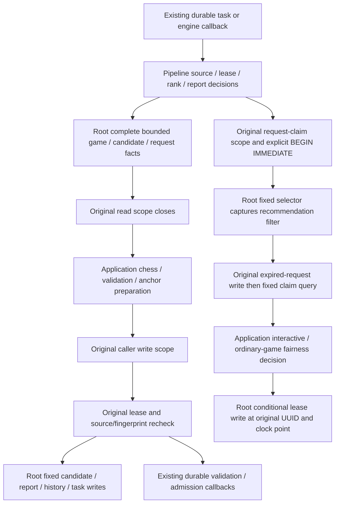

# Existing legacy defensive-threat persistence

**Current source; live schema and deployment unverified.** [pipeline.py](pipeline.py) holds complete fixed report/finding/candidate/request/task operations and the existing SQLite-compatible request-claim SQL. [threat_pipeline.py](../../../../backend/app/services/threat_pipeline.py) retains detection/traversal, model/report parsing and validation, immutable identities and evidence, seed/source ranking, anchor/plan preparation, lease/source/fingerprint decisions, clocks, engine fairness, durable callbacks and connection scope composition.

This first slice covers only the pipeline. threat_training.py remains the separately pending admission/exercise/review file; this directory does not claim complete threat-domain centralization or isolation.

Read/compute/write boundaries and foreground yielding remain in the original application composition. PostgreSQL scanning still selects one prepared seed per slice, and source/lease checks still occur before publication. Candidate upserts retain source fingerprint, validation/dismissal/approval/revision rules, rank precedence and obsolete-card invalidation; unchanged evidence never reissues its request relations. Saved-report validation runs after its read scope closes, before the writer rechecks actual request/lease/content. Report repair archives the exact rejected evidence only if the current saved row still matches.

The request selector is one existing fixed query, not a generic query port: the disabled-analysis recommendation filter is captured before expired requests are requeued, while control/search SQL is composed at its original later selection point. Existing public SQL-helper exports and THREAT_CANDIDATE_UPSERT_SQL remain available as compatibility aliases; SQL implementation is in the single root tree. The original explicit BEGIN IMMEDIATE stays within the same caller-owned request-claim scope. No new connection, commit/rollback, transaction owner, lease authority or scheduling writer is introduced.

## Data and relationships

The canonical rendered ER diagrams and full dictionaries list every stored field/type, primary/composite key and actual enforced FK:

| Existing storage | Facts/effects used here | Source dictionary / ER |
| --- | --- | --- |
| threat_training_candidates | Finding/game/analysis/incident/player-ply identity, evidence/policy/source fingerprint, detector version; supersession, validation, diagnostic, approval/dismissal and exercise revision | [Threat candidates](../../schema/practice-families-2/README.md) |
| threat_analysis_requests, threat_candidate_requests, threat_analysis_report_history | Immutable request/report JSON, best/historical/attempt roles, state/lease/attempt/error/timestamps and rejected-report audit history | [Threat requests and history](../../schema/practice-families-2/README.md) |
| game_findings, imported_games, game_move_analysis_candidates | Current finding evidence and retained game/version/color/FEN/moves; bounded ranked saved principal variations | [Findings](../../schema/game-projections-1/README.md), [game source](../../schema/authored-content-1/README.md), [analysis](../../schema/game-projections-2/README.md) |
| cards | Existing pending-validation stamp when supporting evidence changes or becomes obsolete | [Study cards](../../schema/study-queue-review-1/README.md) |
| background_tasks, background_activity, settings | Task generation/token/state/payload/retry timestamps and existing claim pause/promotion/Study-mode/defensive-analysis filters | [Runtime metadata](../../schema/runtime-metadata/README.md) |
| repertoires, existing discovery/coverage recommendation relations and current opportunity projections | Bounded backfill identity and unchanged recommendation-driven eligibility when defensive exercise analysis is disabled | [Repertoires](../../schema/authored-content-3/README.md), [discovery](../../schema/discovery-priority/README.md), [coverage recommendation relation](../../schema/authored-content-1/README.md) |

Current game-finding/opportunity views retain their existing source/publication fences. Identity/payload references shown by this flowchart are logical associations; no absent FK is inferred. No table, field, type, key, relationship, encoding, schema, model or grants change.

Existing legacy threat/candidate/card/queue/discovery/durable-engine coupling remains at its original composition points. This move adds no new table grant or Study dependency and does not establish strict domain, resource or optional-feature shutdown independence. The separate native threat-command storage remains [commands/threat_analysis.py](../commands/threat_analysis.py); it is not consolidated or redesigned here.

## Focused evidence and limits

Thirteen cases in [test_threat_pipeline_storage_separation.py](../../../../backend/tests/test_threat_pipeline_storage_separation.py) and two existing [PostgreSQL-style validation/backfill fake cases](../../../../backend/tests/test_postgres_threat_validation.py) pass. They check read-close-before-validation/preparation, exact-row repair fencing, stale lease/source rejection, native single-seed preparation, filter/expiry/claim/fairness ordering, saved request gates and SQL/application placement. Fake PostgreSQL paths never open a database.

A captured-original/current comparison passes 71 paths with identical results/errors, 237 queries/parameters, 151 cursor consumptions, 70 clock reads, 220 scope events and 185 capability events. All 39 distinct original SQL/BEGIN fragments match; 42 physical fragments become 40 by sharing the identical task-lease and card-block operations. All nineteen application signatures and original exports remain; application source contains no SQL/direct cursor/driver operations. The thirteen new cases also pass from an isolated source snapshot using installed dependencies with socket/SQLite connections denied. This is source/import evidence, not a backend wheel or native PostgreSQL lock/rollback/race, deployment or full-system qualification. Exact hashes and comparison/snapshot evidence remain under /tmp/tempo-threat-pipeline-*.
