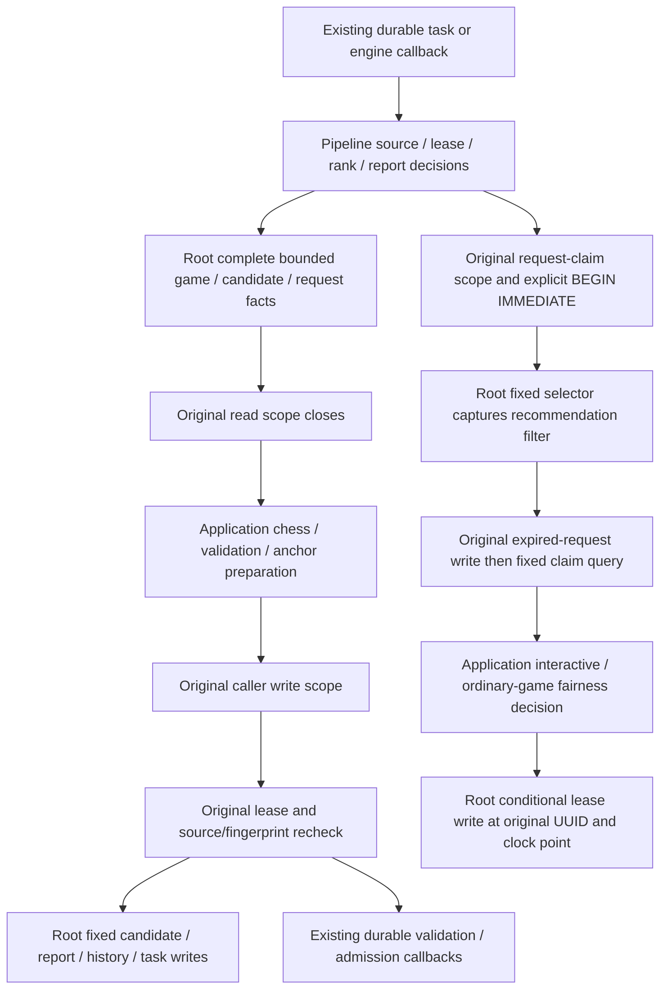
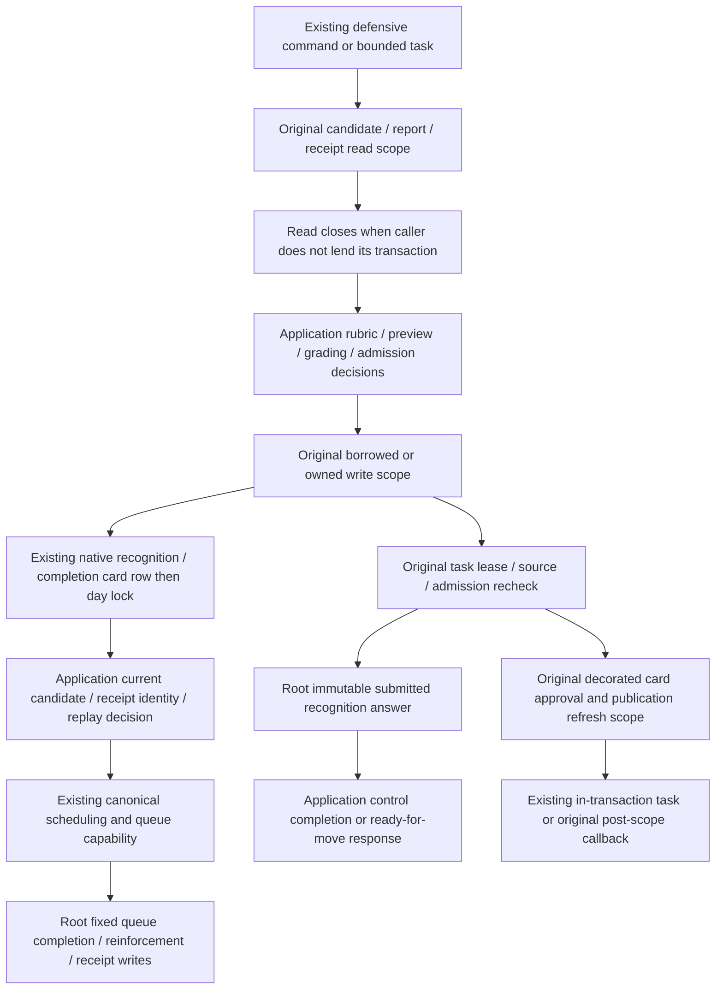

# Existing legacy defensive-threat persistence

**Current source; live schema and deployment unverified.** [pipeline.py](pipeline.py) holds complete fixed report/finding/candidate/request/task operations and the existing SQLite-compatible request-claim SQL. [threat_pipeline.py](../../../../backend/app/services/threat_pipeline.py) retains detection/traversal, model/report parsing and validation, immutable identities and evidence, seed/source ranking, anchor/plan preparation, lease/source/fingerprint decisions, clocks, engine fairness, durable callbacks and connection scope composition.

These slices cover the existing pipeline and training files. Their physical reorganization does not establish strict domain or resource isolation.

Read/compute/write boundaries and foreground yielding remain in the original application composition. PostgreSQL scanning still selects one prepared seed per slice, and source/lease checks still occur before publication. Candidate upserts retain source fingerprint, validation/dismissal/approval/revision rules, rank precedence and obsolete-card invalidation; unchanged evidence never reissues its request relations. Saved-report validation runs after its read scope closes, before the writer rechecks actual request/lease/content. Report repair archives the exact rejected evidence only if the current saved row still matches.

The request selector is one existing fixed query, not a generic query port: the disabled-analysis recommendation filter is captured before expired requests are requeued, while control/search SQL is composed at its original later selection point. Existing public SQL-helper exports and THREAT_CANDIDATE_UPSERT_SQL remain available as compatibility aliases; SQL implementation is in the single root tree. The original explicit BEGIN IMMEDIATE stays within the same caller-owned request-claim scope. No new connection, commit/rollback, transaction owner, lease authority or scheduling writer is introduced.

## Data and relationships

The canonical rendered ER diagrams and full dictionaries list every stored field/type, primary/composite key and actual enforced FK:

| Existing storage | Facts/effects used here | Source dictionary / ER |
| --- | --- | --- |
| threat_training_candidates | Finding/game/analysis/incident/player-ply identity, evidence/policy/source fingerprint, detector version; supersession, validation, diagnostic, approval/dismissal and exercise revision | [Threat candidates](../../schema/practice-families-2/README.md) |
| threat_analysis_requests, threat_candidate_requests, threat_analysis_report_history | Immutable request/report JSON, best/historical/attempt roles, state/lease/attempt/error/timestamps and rejected-report audit history | [Threat requests and history](../../schema/practice-families-2/README.md) |
| game_findings, imported_games, game_move_analysis_candidates | Current finding evidence and retained game/version/color/FEN/moves; bounded ranked saved principal variations | [Findings](../../schema/game-projections-1/README.md), [game source](../../schema/authored-content-1/README.md), [analysis](../../schema/game-projections-2/README.md) |
| cards | Existing pending-validation stamp when supporting evidence changes or becomes obsolete | [Study cards](../../schema/study-queue-review-1/README.md) |
| background_tasks, background_activity, settings | Task generation/token/state/payload/retry timestamps and existing claim pause/promotion/Study-mode/defensive-analysis filters | [Runtime metadata](../../schema/runtime-metadata/README.md) |
| repertoires, existing discovery/coverage recommendation relations and current opportunity projections | Bounded backfill identity and unchanged recommendation-driven eligibility when defensive exercise analysis is disabled | [Repertoires](../../schema/authored-content-3/README.md), [discovery](../../schema/discovery-priority/README.md), [coverage recommendation relation](../../schema/authored-content-1/README.md) |

Current game-finding/opportunity views retain their existing source/publication fences. Identity/payload references shown by this flowchart are logical associations; no absent FK is inferred. No table, field, type, key, relationship, encoding, schema, model or grants change.

Existing legacy threat/candidate/card/queue/discovery/durable-engine coupling remains at its original composition points. This move adds no new table grant or Study dependency and does not establish strict domain, resource or optional-feature shutdown independence. The separate native threat-command storage remains [commands/threat_analysis.py](../commands/threat_analysis.py); it is not consolidated or redesigned here.

## Focused evidence and limits

Thirteen cases in [test_threat_pipeline_storage_separation.py](../../../../backend/tests/test_threat_pipeline_storage_separation.py) and two existing [PostgreSQL-style validation/backfill fake cases](../../../../backend/tests/test_postgres_threat_validation.py) pass. They check read-close-before-validation/preparation, exact-row repair fencing, stale lease/source rejection, native single-seed preparation, filter/expiry/claim/fairness ordering, saved request gates and SQL/application placement. Fake PostgreSQL paths never open a database.

A captured-original/current comparison passes 71 paths with identical results/errors, 237 queries/parameters, 151 cursor consumptions, 70 clock reads, 220 scope events and 185 capability events. All 39 distinct original SQL/BEGIN fragments match; 42 physical fragments become 40 by sharing the identical task-lease and card-block operations. All nineteen application signatures and original exports remain; application source contains no SQL/direct cursor/driver operations. The thirteen new cases also pass from an isolated source snapshot using installed dependencies with socket/SQLite connections denied. This is source/import evidence, not a backend wheel or native PostgreSQL lock/rollback/race, deployment or full-system qualification. Exact hashes and comparison/snapshot evidence remain under /tmp/tempo-threat-pipeline-*.

## Existing defensive training and recognition storage

[training.py](training.py) holds the original complete candidate/audit/automatic-admission/recognition/attempt queries and writes, the fixed recurrence-ranked selector and native card-row lock. [threat_training.py](../../../../backend/app/services/threat_training.py) retains manual eligibility, deterministic card identities, chess positions and previews, control-slot/daily-cap choices, exact submitted-answer/receipt identity, revision/currentness gates, grading, recognition feedback, scheduling/requeue decisions, clocks, decorated publication refresh and borrowed-versus-owned scope composition. Its seventeen function signatures and existing exports are unchanged.

Only existing native recognition/completion paths take the card/day locks; the order remains card row, queue-day fact, day lock, then current candidate and attempt/recognition replay. SQLite compatibility retains its original path. Required scheduling, queue completion/reinforcement and attempt receipt effects remain on one transaction. Exact receipt/answer conflicts still stop before new effects. The existing mutation-refresh decorator stays around approval, including existing-card returns. Supplying a write database still lends the caller's transaction across the original read/compute/write sections instead of opening another scope.

Automatic admission retains its original current-day/daily-cap/control-slot rules, same-incident/position/deletion checks, one-candidate offset/fallback and recurrence ranking. Cutoff time and state/offset are bound to the same fixed selector, including control-to-threat fallback. Reports/previews and submitted moves are interpreted in the application after its owned read closes; source/revision/state is rechecked before persistence. Rubric audits retain review invalidation/rebuild and admission/queue callbacks in their original order. The fixed task-lease and task-advance operations reuse the existing [pipeline implementation](pipeline.py), with identical SQL.

### Training data and actual constraints

| Existing storage | Facts/effects used here | Source dictionary / ER |
| --- | --- | --- |
| defense_attempts | Immutable attempt identity, candidate/card/optional queue reference, exercise revision, move, grade/feedback JSON and review timestamp | [Defense attempts](../../schema/practice-families-1/README.md) |
| defense_recognition_submissions | Immutable attempt identity, candidate/queue/revision, exact serialized answer, correctness and creation timestamp | [Recognition submissions](../../schema/practice-families-1/README.md) |
| threat_training_candidates and request relations | Validation/approval/dismissal/pause/source/exercise revision, stored evidence/policy/validation JSON, best/historical/attempt report roles, automatic/manual/explicit admission | [Threat candidate/request dictionary](../../schema/practice-families-2/README.md) |
| cards, repertoires, reviews, daily_queue | Existing defensive physical card and introduced day/revision, scheduling source review, invalidation and canonical requeue/slot/cycle/result state | [Cards/queue](../../schema/study-queue-review-1/README.md), [reviews](../../schema/study-queue-review-2/README.md), [repertoires](../../schema/authored-content-3/README.md) |
| imported_games, game_position_occurrences | Source analysis/currentness/URL and recent non-excluded recurring-position facts used for admission ordering | [Game source](../../schema/authored-content-1/README.md), [versioned position sources](../../schema/game-projections-2/README.md) |
| settings, background_tasks | Existing light interval/daily admission cap and borrowed task generation/token/phase/payload/lease/retry state | [Runtime metadata](../../schema/runtime-metadata/README.md) |

Both receipt tables have attempt_id as primary key. defense_attempts enforces candidate/card FKs; its nullable queue_entry_id is a logical reference without an enforced FK. defense_recognition_submissions enforces candidate and queue-entry FKs. The linked canonical ER/dictionaries give every actual field/type/key and cardinality; exercise revision and response payload associations do not introduce extra constraints. Current position projections keep their existing source/publication semantics. No schema, data, model, ownership, relationship or grant changes.

### Training evidence and limits

Fourteen cases in [test_threat_training_storage_separation.py](../../../../backend/tests/test_threat_training_storage_separation.py) plus the existing [admission source fake](../../../../backend/tests/test_postgres_threat_validation.py) pass. They cover rejected manual mutation before clocks/writes, decorated borrowed approval, card/day-before-replay, scheduling/queue/reinforcement/receipt order, read-only recognition replay, actual pure-fixture grading after read close, late revision fencing, supplied-day admission and SQL/application placement.

Captured-original/current comparison passes 98 paths with identical results/errors, 395 query/parameter events, 315 cursor reads, 103 clock reads, 178 scope events and 171 capability events. It covers every one of the twelve mixed functions, owned/borrowed sections, immutable answer/attempt replay, decorated publication refresh, control/threat selection, rubric repair and actual pure-fixture move grading. All 46 distinct original SQL strings match: 58 source occurrences are represented by 44 new fixed operations/strings and two exact existing operations. Full application syntax restores exactly after substituting the moved fixed operations, including the original local selector assignment.

The fourteen new cases also pass from an isolated source snapshot with installed dependencies and socket/SQLite connections denied; the existing pure grading fixture is copied unchanged into that snapshot. This is source/import evidence, not a backend wheel, native PostgreSQL locking/races/rollback or deployment qualification. Existing legacy Study/card/queue/grading/publication coupling remains disclosed; this move makes no strict domain or optional-feature resource independence claim. Evidence/hashes remain under /tmp/tempo-threat-training-*.
