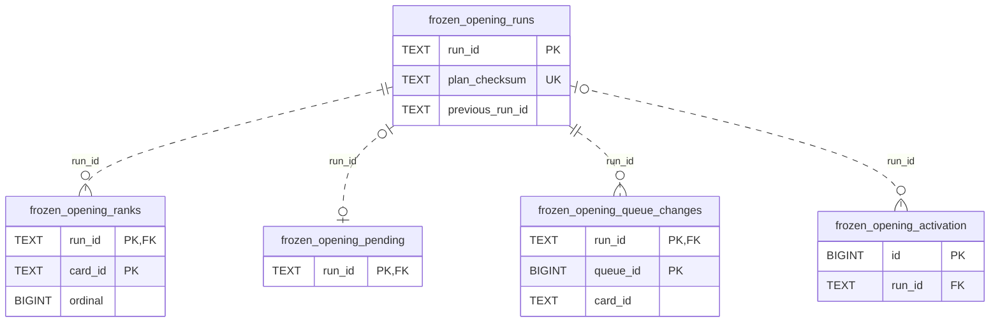

# SQLite frozen-order storage

**Current source DDL, live state unverified.** Owner: legacy Learning/Study persistence. [frozen_opening_schema.py](../frozen_opening_schema.py) contains the existing five-table schema, activation seed and 51 invalidation triggers. It is executed at the same points in the SQLite initializer as before; moving it does not apply a migration. PostgreSQL retains its separate [ordered migrations](../migrations/README.md).

`PK`/`UK`/`FK` denote declared primary, unique and foreign keys. All marked PK fields form one composite key where more than one is shown. SQLite FK enforcement depends on `PRAGMA foreign_keys=ON`, which the owning connection factory sets. SQLite's non-`INTEGER PRIMARY KEY` declarations do not by themselves prohibit NULL; required fields below follow explicit `NOT NULL`, not PostgreSQL assumptions. The ordinary writer supplies the intended non-null identities and singleton activation id `1`.

| Table | Stored fields / declared SQLite types | Constraints and meaning |
| --- | --- | --- |
| `frozen_opening_runs` | `run_id TEXT`, `plan_checksum TEXT NOT NULL`, `plan_json TEXT NOT NULL`, `previous_run_id TEXT`, `created_at TEXT NOT NULL`, `reader_version TEXT NOT NULL`, `invalidated BIGINT NOT NULL DEFAULT 0` | PK `run_id`; unique `plan_checksum`. Immutable plan/reader facts plus pending-input invalidation. `previous_run_id` is a logical rollback link, with **no FK**. |
| `frozen_opening_ranks` | `run_id TEXT NOT NULL`, `card_id TEXT NOT NULL`, `ordinal BIGINT NOT NULL`, `fingerprint TEXT NOT NULL`, `memberships_json TEXT NOT NULL`, `definition_json TEXT NOT NULL` | Composite PK `(run_id,card_id)`; unique `(run_id,ordinal)`; `ordinal>0`; FK `run_id → frozen_opening_runs.run_id`. Card identity is a logical link without a card FK. Captured rank and definition facts, JSON stored as text. |
| `frozen_opening_pending` | `run_id TEXT` | PK and FK `run_id → frozen_opening_runs.run_id`; identifies plans still subject to input invalidation. |
| `frozen_opening_queue_changes` | `run_id TEXT NOT NULL`, `queue_id BIGINT NOT NULL`, `queue_date TEXT NOT NULL`, `card_id TEXT NOT NULL`, `before_position BIGINT NOT NULL`, `after_position BIGINT NOT NULL`, `definition_json TEXT NOT NULL` | Composite PK `(run_id,queue_id)`; FK `run_id → frozen_opening_runs.run_id`. Queue/card IDs are logical references without FKs. Records owned position changes for conditional rollback. |
| `frozen_opening_activation` | `id BIGINT`, `run_id TEXT`, `epoch BIGINT NOT NULL DEFAULT 0` | PK `id`; `CHECK(id=1)`; nullable FK `run_id → frozen_opening_runs.run_id`. Seed `(1,NULL,0)` is inserted idempotently. No uniqueness is declared on `run_id`. |

The 51 triggers cover INSERT/UPDATE/DELETE on the 17 names in `GUARDED_TABLES`. They set `invalidated=1` only for runs named in `frozen_opening_pending`, within the caller's existing transaction. The initializer installs a trigger only when its guarded table exists. Accepted runs and historical publications are retained. Foreign keys use their default NO ACTION behavior; no cascading deletes are introduced.

The [adapter](../../adapters/frozen_order.py) owns frozen-order queries and writes; [Study policy and legacy composition](../../../../backend/app/study/frozen_order/README.md) live outside the database tree. This closes one source file's SQL/DDL extraction. Other work remains on the [mixed-file extraction checklist](../../../INVENTORY.md); no complete-centralization or whole-backend domain-isolation claim follows from this split.
