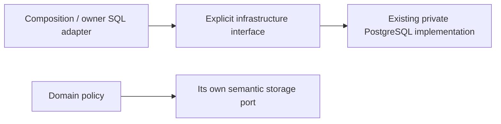

# Storage infrastructure interface

Owner: #501. Composition and owner storage adapters import the explicit symbols
from `tempo_legacy_database.interfaces`. The existing PostgreSQL implementation
and all object identities, signatures, qmark translation and transaction behavior
are preserved. Domain policy uses its owning semantic ports; this driver surface
is not an arbitrary-SQL domain interface or permission to write another owner.

`PostgresConnection`, `TempoRow` and `tempo_row_factory` retain the existing
driver/row types. `connection(...)` owns its existing context-managed pool
acquisition, commit/rollback, bounds and release. `diagnostic_read_connection`
retains its bounded read-only behavior. `configured()` reads the current explicit
configuration only when called; `close_pools()` belongs to process composition's
shutdown. Importing the interface opens no pool, connection, provider or worker.

This is source adoption, not resource-isolation or deployed-schema proof. The
legacy `connections.py` still contains SQLite compatibility, activity-gate and
environment-path composition; it is deliberately not imported by this surface.
SQL adapters and old compatibility imports migrate in their assigned batches.
No lock order, writer, DDL, scheduling authority or canonical receipt changes.
