# Legacy backend: Authored Content (1)

Repertoire/line/membership and annotation source data or related authored-content projections.

**Current source schema, deployment unverified.** Owner: Legacy backend; SQL schema `public`. Derived from checked-in DDL at the `14ad5754` baseline with file relocation only. No live database was queried. [Database index](../../README.md).

Charts show primary/foreign key columns; the dictionary lists **every stored field and its SQL type**. `PK` means primary key (all marked fields form one composite key); `FK` means an enforced SQL foreign key. Parent `||`/`o|` means a required/optional parent; child `o{` means zero or more children and `o|` zero or one (a unique referencing tuple). Edges describe allowed SQL cardinality, not an obligation to create children. Nullable components of a composite FK can leave the tuple unlinked under PostgreSQL MATCH SIMPLE. No edge is inferred from a similar field name.

```mermaid
erDiagram
  analysis_refresh_requests {
    text kind PK
    text repertoire_id PK,FK
  }
  coverage_discovery_recommendation_requests {
    text opportunity_id PK,FK
    text request_id FK
    text coverage_node_id FK
  }
  explorer_position_cache {
    text cache_key PK
  }
  imported_games {
    text id PK
  }
  legacy_learning_identity {
    smallint id PK
  }
  next_opponent_accounts {
    text account PK
    text profile_version FK
  }
  next_opponent_snapshots {
    text version PK
  }
  opening_card_schedule_seeds {
    text card_id PK,FK
    text source_card_id FK
  }
  position_annotations {
    text repertoire_id PK,FK
    text fen_key PK
  }
  priority_repertoire_source_epochs {
    text repertoire_id PK,FK
  }
  priority_source_epoch {
    bigint id PK
  }
  puzzle_decks {
    text id PK
  }
  repertoires ||..o{ analysis_refresh_requests : "repertoire_id"
  repertoire_opportunities ||..o| coverage_discovery_recommendation_requests : "opportunity_id"
  threat_analysis_requests ||..o{ coverage_discovery_recommendation_requests : "request_id"
  repertoire_coverage_nodes ||..o{ coverage_discovery_recommendation_requests : "coverage_node_id"
  next_opponent_snapshots o|..o{ next_opponent_accounts : "profile_version"
  cards ||..o| opening_card_schedule_seeds : "card_id"
  cards ||..o{ opening_card_schedule_seeds : "source_card_id"
  repertoires ||..o{ position_annotations : "repertoire_id"
  repertoires ||..o| priority_repertoire_source_epochs : "repertoire_id"
```

Referenced tables outside this view: `public.cards`, `public.repertoire_coverage_nodes`, `public.repertoire_opportunities`, `public.repertoires`, `public.threat_analysis_requests`. Follow the [schema index](../README.md) for their full definitions.

## Data dictionary

### `public.analysis_refresh_requests`

Primary key: (`kind`, `repertoire_id`). DDL: [046_refresh_input_versions.sql](../../ddl/migrations/046_refresh_input_versions.sql).

| Field | SQL type | Null allowed | Keys |
| --- | --- | --- | --- |
| `kind` | `text` | no | PK |
| `repertoire_id` | `text` | no | PK; FK repertoire_id → public.repertoires(`id`) |
| `input_version` | `text` | no |  |
| `published_input_version` | `text` | yes |  |
| `pending_since` | `text` | yes |  |
| `requested_at` | `text` | no |  |

Foreign key delete actions: (`repertoire_id`) CASCADE.

### `public.coverage_discovery_recommendation_requests`

Primary key: (`opportunity_id`). DDL: [001_initial.sql](../../ddl/migrations/001_initial.sql).

| Field | SQL type | Null allowed | Keys |
| --- | --- | --- | --- |
| `opportunity_id` | `text` | no | PK; FK opportunity_id → public.repertoire_opportunities(`id`) |
| `request_id` | `text` | no | FK request_id → public.threat_analysis_requests(`id`) |
| `coverage_node_id` | `text` | no | FK coverage_node_id → public.repertoire_coverage_nodes(`id`) |
| `route_json` | `text` | no |  |
| `created_at` | `text` | no |  |
| `updated_at` | `text` | no |  |

Foreign key delete actions: (`opportunity_id`) CASCADE, (`request_id`) CASCADE, (`coverage_node_id`) CASCADE.

### `public.explorer_position_cache`

Primary key: (`cache_key`). DDL: [001_initial.sql](../../ddl/migrations/001_initial.sql).

| Field | SQL type | Null allowed | Keys |
| --- | --- | --- | --- |
| `cache_key` | `text` | no | PK |
| `fen_key` | `text` | no |  |
| `speeds` | `text` | no |  |
| `ratings` | `text` | no |  |
| `response_json` | `text` | no |  |
| `fetched_at` | `text` | no |  |

### `public.imported_games`

Primary key: (`id`). DDL: [001_initial.sql](../../ddl/migrations/001_initial.sql), [009_versioned_game_analysis.sql](../../ddl/migrations/009_versioned_game_analysis.sql), [035_canonical_publication_freshness.sql](../../ddl/migrations/035_canonical_publication_freshness.sql).

| Field | SQL type | Null allowed | Keys |
| --- | --- | --- | --- |
| `id` | `text` | no | PK |
| `provider` | `text` | no |  |
| `username` | `text` | no |  |
| `played_at` | `text` | no |  |
| `speed` | `text` | no |  |
| `rated` | `bigint` | no |  |
| `color` | `text` | no |  |
| `result` | `text` | no |  |
| `start_fen` | `text` | no |  |
| `moves_json` | `text` | no |  |
| `game_url` | `text` | yes |  |
| `opening_name` | `text` | yes |  |
| `analysis_state` | `text` | no |  |
| `analysis_version` | `bigint` | no |  |
| `major_mistake_ply` | `bigint` | yes |  |
| `missed_punishment_ply` | `bigint` | yes |  |
| `provider_game_id` | `text` | yes |  |
| `content_hash` | `text` | yes |  |
| `adaptive_excluded` | `bigint` | no |  |
| `player_rating` | `bigint` | yes |  |
| `opponent_rating` | `bigint` | yes |  |
| `rating_change` | `bigint` | yes |  |
| `time_control` | `text` | yes |  |
| `analysis_evidence_version` | `bigint` | no |  |
| `published_analysis_generation` | `bigint` | no |  |
| `repertoire_scope_generation` | `bigint` | no |  |

### `public.legacy_learning_identity`

Primary key: (`id`). DDL: [050_learning_remediation.sql](../../ddl/migrations/050_learning_remediation.sql).

| Field | SQL type | Null allowed | Keys |
| --- | --- | --- | --- |
| `id` | `smallint` | no | PK |
| `target_id` | `text` | no |  |
| `workspace_id` | `text` | no |  |

Unique tuples (including non-partial simple unique indexes): (`target_id`).

### `public.next_opponent_accounts`

Primary key: (`account`). DDL: [044_next_opponent_profiles.sql](../../ddl/migrations/044_next_opponent_profiles.sql).

| Field | SQL type | Null allowed | Keys |
| --- | --- | --- | --- |
| `account` | `text` | no | PK |
| `input_generation` | `bigint` | no |  |
| `published_generation` | `bigint` | yes |  |
| `published_method` | `text` | yes |  |
| `profile_version` | `text` | yes | FK profile_version → public.next_opponent_snapshots(`version`) |
| `next_evidence_at` | `timestamptz` | yes |  |

Foreign key delete actions: (`profile_version`) NO ACTION.

### `public.next_opponent_snapshots`

Primary key: (`version`). DDL: [044_next_opponent_profiles.sql](../../ddl/migrations/044_next_opponent_profiles.sql).

| Field | SQL type | Null allowed | Keys |
| --- | --- | --- | --- |
| `version` | `text` | no | PK |
| `account` | `text` | no |  |
| `method_version` | `text` | no |  |
| `profile_json` | `text` | no |  |
| `published_at` | `text` | no |  |

### `public.opening_card_schedule_seeds`

Primary key: (`card_id`). DDL: [001_initial.sql](../../ddl/migrations/001_initial.sql).

| Field | SQL type | Null allowed | Keys |
| --- | --- | --- | --- |
| `card_id` | `text` | no | PK; FK card_id → public.cards(`id`) |
| `source_card_id` | `text` | no | FK source_card_id → public.cards(`id`) |
| `baseline_successful_days` | `bigint` | no |  |
| `baseline_recent_clean` | `bigint` | no |  |
| `verification_due` | `text` | no |  |
| `created_at` | `text` | no |  |

Foreign key delete actions: (`card_id`) CASCADE, (`source_card_id`) CASCADE.

### `public.position_annotations`

Primary key: (`repertoire_id`, `fen_key`). DDL: [001_initial.sql](../../ddl/migrations/001_initial.sql).

| Field | SQL type | Null allowed | Keys |
| --- | --- | --- | --- |
| `repertoire_id` | `text` | no | PK; FK repertoire_id → public.repertoires(`id`) |
| `fen_key` | `text` | no | PK |
| `comment` | `text` | no |  |
| `arrows_json` | `text` | no |  |
| `squares_json` | `text` | no |  |
| `updated_at` | `text` | no |  |

Foreign key delete actions: (`repertoire_id`) CASCADE.

### `public.priority_repertoire_source_epochs`

Primary key: (`repertoire_id`). DDL: [021_priority_preparations.sql](../../ddl/migrations/021_priority_preparations.sql).

| Field | SQL type | Null allowed | Keys |
| --- | --- | --- | --- |
| `repertoire_id` | `text` | no | PK; FK repertoire_id → public.repertoires(`id`) |
| `version` | `bigint` | no |  |

Foreign key delete actions: (`repertoire_id`) CASCADE.

### `public.priority_source_epoch`

Primary key: (`id`). DDL: [021_priority_preparations.sql](../../ddl/migrations/021_priority_preparations.sql).

| Field | SQL type | Null allowed | Keys |
| --- | --- | --- | --- |
| `id` | `bigint` | no | PK |
| `version` | `bigint` | no |  |

### `public.puzzle_decks`

Primary key: (`id`). DDL: [001_initial.sql](../../ddl/migrations/001_initial.sql).

| Field | SQL type | Null allowed | Keys |
| --- | --- | --- | --- |
| `id` | `text` | no | PK |
| `name` | `text` | no |  |
| `themes_json` | `text` | no |  |
| `min_rating` | `bigint` | no |  |
| `max_rating` | `bigint` | no |  |
| `daily_limit` | `bigint` | no |  |
| `created_at` | `text` | no |  |
